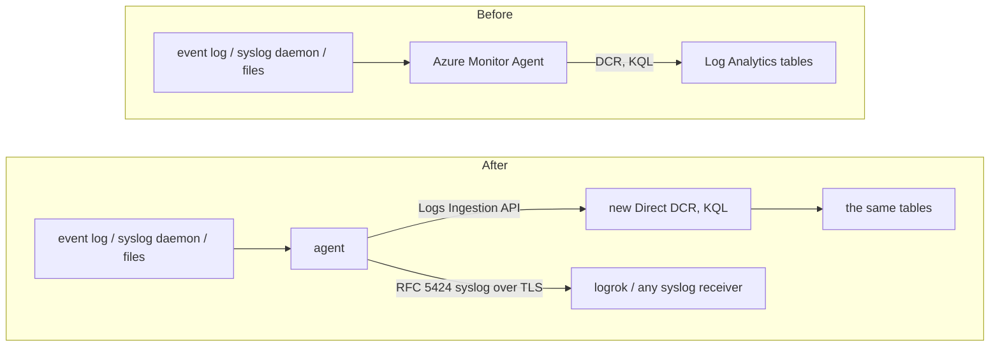

# Migrating from Azure Monitor Agent

Azure Monitor Agent keeps no collection settings on the machine: what it collects is a **data collection rule
(DCR)**, a JSON document stored in Azure and associated with the machine. The agent can take over that collection —
Windows event logs, syslog, text and JSON log files, IIS and Windows Firewall logs, ETW providers — and either keep
delivering to the same Log Analytics workspace (and therefore Microsoft Sentinel) through the Logs Ingestion API, or
send everything as RFC 5424 syslog to logrok or any syslog receiver.

You don't rewrite the rule by hand: `luna-migrate` reads the rule's JSON, converts what it can and writes an agent
configuration plus a report of everything it could not carry over.

If you still run the legacy **Log Analytics agent** (MMA / OMS): Microsoft retired it on 31 August 2024, and after
2 March 2026 its data upload "can stop at any time without further notice" (Microsoft's
[Log Analytics agent migration](https://learn.microsoft.com/en-us/azure/azure-monitor/agents/azure-monitor-agent-migration)
page; the retirement does not apply to an agent connected only to an on-premises System Center Operations Manager).
Its configuration lives in the workspace, not in a DCR: Microsoft's DCR Config Generator turns it into DCRs, which
this converter then reads.

## Is it a fit?

**Verified against:** the Microsoft Learn pages on data collection rules (read 2026-10-16; DCR REST API version 2024-03-11). Delivery into syslog-ng 4.12.0 over TLS, with syslog fed by rsyslog 8.2604.0, was run end to end; no run against Azure Monitor Agent or Azure itself.

| If your data collection rule… | Then |
|---|---|
| collects Windows events with `xPathQueries` | converted: one `windows_eventlog` input per channel and stream, the XPath queries as a structured query |
| collects syslog (`facilityNames`, `logLevels`) | converted: a local `syslog_in` listener your syslog daemon forwards to, plus the same facility / level selection |
| collects text or JSON log files (`logFiles`), IIS logs or Windows Firewall logs | converted to `filetail`; a record-start timestamp format becomes multi-line assembly |
| collects ETW providers | converted to `etw` |
| sends to a Log Analytics workspace | converted to the `sentinel` output — **you create one new Logs Ingestion rule in Azure** (Step 3) |
| transforms data with KQL (`transformKql`) | **not converted**: KQL runs in Azure; it moves to the new rule, adapted |
| collects performance counters, Prometheus or OpenTelemetry metrics / traces | **not converted**: the agent forwards logs |
| sends to Event Hubs, Storage, Azure Data Explorer or Fabric | **not converted** (each is reported) |
| collects data through a VM extension (`extensions`) | **not converted** |

## How it fits together



## Step 1 — export the rule

Take the rule's JSON definition in any of these shapes (all are read; so is a JSON array of rules, or a list
response, when a machine is associated with several rules — they are converted into one configuration):

- the Azure portal: the rule's **JSON view** (choose the newest API version), copied to a file;
- the REST API, as Microsoft documents it:

  ```powershell
  $DCR = Invoke-AzRestMethod -Path ("<rule resource ID>"+"?api-version=2023-03-11") -Method GET
  $DCR.Content | ConvertFrom-Json | ConvertTo-Json -Depth 20 | Out-File -FilePath dcr.json
  ```

  (UTF-16 files written by Windows PowerShell are read as well);
- the portal's **Export template** (an ARM template): every `Microsoft.Insights/dataCollectionRules` resource is
  converted. Values written as template expressions (`[parameters('…')]`) are not evaluated — the report names
  each one; a file path given that way is not converted, so prefer the deployed rule;
- `az monitor data-collection rule show` output (the rule without its `properties` wrapper).

## Step 2 — convert

Get `luna-migrate` first: a separate download published with every agent release (`luna-migrate-<os>-<arch>`, saved as `luna-migrate` / `luna-migrate.exe`) — see [Getting luna-migrate](../USER-GUIDE.md#getting-luna-migrate).

```bash
luna-migrate azure-dcr dcr.json \
  -out /etc/logrok-universal-agent/agent.yaml \
  -report dcr-conversion.json
```

```powershell
& ".\luna-migrate.exe" azure-dcr dcr.json `
  -out "C:\ProgramData\logrok-universal-agent\agent.yaml" `
  -report dcr-conversion.json
```

| Flag | Default | Meaning |
|---|---|---|
| `-out` | *(required)* | where to write the agent configuration; an existing file is never overwritten |
| `-report` | — | also write the full report as JSON |
| `-target` | `native` | `native`: send to the rule's Log Analytics workspace(s). `syslog`: everything to one RFC 5424 receiver over TLS |
| `-syslog-endpoint` | — | `host:port` of the syslog receiver for `-target syslog` |
| `-syslog-plain` | off | send the syslog output over plain TCP instead of TLS (a receiver without TLS, or a lab) |
| `-windows` / `-linux` | guessed | convert for a Windows or a Linux host instead of judging by the rule kind and data sources; the flag wins over a rule's kind (give at most one) |
| `-start-at` | `end` | where file inputs start on first run: `end` (only new lines) or `beginning` |

The configuration is for one platform. If you say which with `-windows` or `-linux`, that decides it, even against a rule's kind. Otherwise a rule of kind `Windows` or `Linux` weighs heavily and a rule without a kind is
judged by its data sources. Data sources for the other platform (a Windows path in a Linux rule, Windows event logs
in a rule converted for Linux) are not converted and are reported — convert the rule again on a machine of that
platform. luna-migrate checks the configuration's structure, then runs the installed agent's `-check-config` (found
beside `luna-migrate` or on the `PATH`, or named with `-agent`), which builds every module and compiles every
condition.

## Step 3 — read the report and fill in the destination

| Severity | Meaning |
|---|---|
| `manual` | **not carried over**: a person must decide (each line says what to do instead) |
| `warning` | carried over, with a difference to check |
| `info` | carried over differently, nothing to do |
| `skipped` | deliberately not converted |

Each finding names the file it came from, and the line where it has one.

**Sending to Log Analytics.** Azure Monitor Agent's rule is fed by Azure Monitor Agent only; the agent sends
through the **Logs Ingestion API**, which needs a rule of kind `Direct`. For each workspace the report lists the
streams and the tables they went to (`Microsoft-Event → Event`, `Custom-MyLogFileFormat → MyTable_CL`, …). Create
one Direct rule per workspace with:

- a stream (for example `Custom-AgentLogs`) declaring the agent's row columns: `TimeGenerated` (datetime),
  `Computer`, `Source`, `Message`, `AdditionalContext` (string), `SeverityNumber`, `Facility` (int);
- a data flow per table in the report, with a transformation that selects that table's rows and shapes them for it.
  Every event carries the field `azure.stream` (the stream its data source fed in the old rule) and
  `azure.data_source` (the data source name) inside `AdditionalContext`, so a flow can select, for example,
  `source | where tostring(parse_json(AdditionalContext)["azure.stream"]) == "Custom-MyLogFileFormat"`. Each KQL
  transformation on a data flow of the old rule is in the report, with its text, to adapt (the log line is in `Message`, not
  `RawData`); one set on a data source is reported without its text, so read it in the old rule. The target table must accept the Logs Ingestion API (custom tables do; for Azure tables check
  Microsoft's table feature-support list);
- the **Monitoring Metrics Publisher** role for a Microsoft Entra app registration.

Then replace the placeholders in the generated `sentinel` output (search for `REPLACE_WITH_`): `endpoint` (the new
rule's logs ingestion endpoint, or a data collection endpoint for private link), `dcr_id` (its immutable id),
`stream`, and `tenant_id` / `client_id` / `client_secret`. Better: delete those three lines and set
`AZURE_TENANT_ID`, `AZURE_CLIENT_ID`, `AZURE_CLIENT_SECRET` in the agent's environment. The rule itself holds no
secrets; none is ever written by the converter. The agent does not use the machine's managed identity.

**Syslog.** Azure Monitor Agent receives syslog from the local syslog daemon: it installs a forwarding rule that
sends every message to `127.0.0.1:28330`, and it applies the rule's facility / level selection itself. The agent does
the same on `127.0.0.1:10514` (a different port, so both can run during the cut-over). Point the daemon at it:

```
# /etc/rsyslog.d/10-logrok-agent.conf — the same forwarding Azure Monitor Agent installs, to the agent's port
template(name="AgentForwardFormat" type="string" string="<%PRI%>%TIMESTAMP% %HOSTNAME% %syslogtag%%msg:::sp-if-no-1st-sp%%msg%")
*.* action(type="omfwd" template="AgentForwardFormat"
           queue.type="LinkedList" action.resumeRetryCount="-1" action.resumeInterval="5"
           target="127.0.0.1" Port="10514" Protocol="tcp")
```

```
# /etc/syslog-ng/conf.d/logrok-agent.conf — use the source name of your syslog-ng.conf (s_src, s_sys, …)
destination d_agent { network("127.0.0.1" port(10514) transport("tcp")); };
log { source(s_src); destination(d_agent); flags(flow-control); };
```

Restart the daemon after adding the file. Like Azure Monitor Agent's rule, this forwards everything; the converted
`expr` rule keeps only the facilities and levels your rule selected. On rsyslog, inputs bound to a non-default
ruleset are not forwarded by a rule in the default ruleset — the same limit Microsoft documents for Azure Monitor
Agent.

## What is converted

### Data sources

| Data collection rule | Agent |
|---|---|
| `windowsEventLogs` `xPathQueries` `Channel!XPath` | `windows_eventlog`, one input per channel and stream (a channel that two data sources send to different streams becomes two inputs): `channels: [Channel]` and a structured `query` with one `Select` per XPath of that channel (the union of what they select). `Channel!` or `Channel!*` selects every event (no query) |
| `syslog` `facilityNames` × `logLevels` | `syslog_in` on `127.0.0.1:10514` (tcp) + one `expr` rule dropping what no syslog data source selects; `*` selects every facility / level |
| `logFiles` `filePatterns`, `format: text` / `json` | `filetail` `paths` (the same wildcards); each line (JSON line) is one event's message |
| `logFiles` `settings.text.recordStartTimestampFormat` | `multiline.line_start_pattern` matching that timestamp at the start of a line: lines without it are joined to the record before |
| `iisLogs` `logDirectories` | `filetail` over `<directory>\*.log`; without directories, IIS's default `C:\inetpub\logs\LogFiles\W3SVC*\*.log` |
| `windowsFirewallLogs` | `filetail` over `C:\Windows\System32\LogFiles\Firewall\pfirewall.log` |
| `etwProviders` `provider`, `logLevel`, `keyword`, `eventIds` | `etw` with its own session: `providers`, `level`, `match_any_keyword`; event ids as an `expr` rule |
| `streams` | the field `azure.stream` on every event; `azure.data_source` carries the data source name (and `azure.dcr` the rule name when several rules are converted) |

### Data flows and destinations

| Data collection rule | Agent |
|---|---|
| `dataFlows` `streams` → `destinations` | which inputs reach which output; a data source no flow sends anywhere collects nothing in Azure Monitor Agent and is not converted |
| `destinations.logAnalytics` | one `sentinel` output per workspace (placeholders, Step 3); a workspace that receives only some streams gets a `when:` condition on `azure.stream` |
| `outputStream` / table | listed in the report for the new rule's data flows |
| `-target syslog` | one `syslog` output over TLS; the `azure.*` fields travel as structured data |

## What is not converted (and what to do)

| Data collection rule | Why / instead |
|---|---|
| `transformKql`, `transform`, `transformations`, `builtInTransform` | run in Azure; recreate them in the new rule's data flows (adapted to the agent's row columns), or filter on the machine with the `filter` / `expr` processors |
| JSON log columns (`streamDeclarations`) | the line is sent as `Message`; parse it in the new rule (`parse_json(Message)`) — or with the `parse_json` processor for a syslog receiver |
| IIS / firewall columns (`W3CIISLog`, `WindowsFirewall`) | the raw lines are sent, including `#` header lines; parse them in the new rule, or with `parse_csv` (separator `" "`) on the machine |
| Windows Firewall `profileFilter` | the agent reads the log file, which holds every profile that logs to it; give each profile its own file and list the ones you want |
| syslog to `Microsoft-CommonSecurityLog` (CEF) beside `Microsoft-Syslog` | the agent receives syslog once; split the two in the new rule's transformation |
| `performanceCounters`, `prometheusForwarder`, OpenTelemetry metrics / traces, `azureMonitorMetrics` | metrics and traces are not forwarded by the agent; keep a metrics collector for them |
| `otelLogs` | point the applications at the agent's `otlp_in` input |
| `extensions` | data collected by a VM extension; keep the extension, or collect its logs with a matching input |
| Event Hubs, Storage, Azure Data Explorer, Fabric destinations | no equivalent output. Event Hubs (Standard tier and above) also exposes an Apache Kafka endpoint, which the `kafka` output (`tls`, `sasl` `plain`) can be configured for by hand; that combination has not been tested with this converter |
| `agentSettings` (e.g. disk quota) | bound the agent's spool with `buffer.max_bytes` |
| template expressions (`[parameters('…')]`) | not evaluated; export the deployed rule instead |

## Step 4 — cut over without a gap

Prefer a few seconds of duplicates to a gap:

1. Create the new Direct rule and the app registration (Step 3), install the agent with the filled-in configuration
   and start it. With `start_at: end` it reads only lines written from now on; event log inputs start at new events.
2. For syslog, add the forwarding file and restart the daemon: messages now go to both agents.
3. Query the workspace (or your syslog receiver) and confirm the agent's rows arrive in each table.
4. Remove the rule's association with the machine (or the machine's Azure Monitor Agent).

Between steps 1 and 4 both agents send new data, so those minutes arrive twice. Removing the association *first*
would lose what is written before the agent starts. The agent does not read Azure Monitor Agent's positions.

## Sending to logrok instead

```bash
luna-migrate azure-dcr dcr.json -out agent.yaml \
  -target syslog -syslog-endpoint logrok.example.com:16575
```

Data sources convert as above; no Azure rule or app registration is needed. Add the TLS trust (`ca_file`, and a
client certificate if your receiver requires one) to the generated `syslog` output.

## Licensing

The converter is free. What the converted configuration uses follows the normal rules
([LICENSING](../LICENSING.md)): file tailing, the syslog input, the `expr` processor and one RFC 5424 syslog
destination are Core; the `sentinel` output, the Windows Event Log and ETW inputs, routing with `when:`, more than
one destination and the disk spool are Apex.
