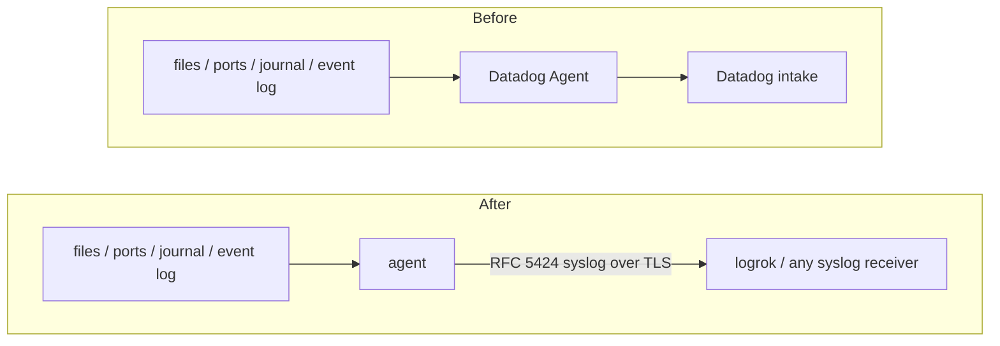

# Migrating from the Datadog Agent (logs)

The Datadog Agent collects logs from files, TCP and UDP ports, the systemd journal and the Windows Event Log and
sends them to the Datadog intake. This agent can take over that log collection and send the same logs, with their
`service`, `source` and `tags`, as RFC 5424 syslog to logrok or any syslog receiver.

You don't rewrite the configuration by hand: the agent reads the Datadog Agent's configuration directory, converts
what it can and writes an agent configuration plus a report of everything it could not carry over.

**What this migration is not.** The Datadog Agent has one destination, the Datadog intake, and this agent has no
Datadog output. The converted configuration therefore always sends to a syslog receiver (`-target syslog`), and
Datadog's own pipelines, facets, indexes and monitors do not exist there. Only **log collection** is converted:
metrics, APM, process and network monitoring, and every Datadog integration check are not.

## Is it a fit?

**Verified against:** Datadog Agent 7.x (documentation read 2026-10-16; its pages state no version). Datadog Agent 7.60.0 loaded the source configuration offline, and delivery into syslog-ng was run end to end.

| If your Datadog Agent… | Then |
|---|---|
| tails files (`type: file`, with `exclude_paths`, `encoding`) | converted |
| listens on a port (`type: tcp` / `udp`) | converted |
| reads the systemd journal (`type: journald`) or the Windows Event Log (`type: windows_event`, with a `query`) | converted |
| uses `exclude_at_match`, `include_at_match`, `mask_sequences` or `multi_line` rules, per source or global | converted where the effect can be reproduced; `multi_line` converts only per source (see [Processing rules](#processing-rules)) |
| collects container logs (`type: docker`, `container_collect_all`, Autodiscovery labels) | **not converted**; the report gives the alternative |
| relies on Datadog log pipelines, parsing, facets, indexes, archives or live monitors | **not converted**: they live in Datadog, not in the Agent |
| also collects metrics, APM traces or processes | **not converted** (log collection only) |

## How it fits together



## Step 1 — convert

Get `luna-migrate` first: a separate download published with every agent release (`luna-migrate-<os>-<arch>`, saved as `luna-migrate` / `luna-migrate.exe`) — see [Getting luna-migrate](../USER-GUIDE.md#getting-luna-migrate).

Run the converter on the Datadog Agent host (it only reads the configuration). Point it at the Agent's
configuration directory — the one holding `datadog.yaml` and `conf.d` — or at a single `datadog.yaml`, a `conf.d`
directory or one integration `conf.yaml`:

```bash
luna-migrate datadog /etc/datadog-agent \
  -out /etc/logrok-universal-agent/agent.yaml \
  -target syslog -syslog-endpoint logs.example.com:6514 \
  -report datadog-conversion.json
```

```powershell
& ".\luna-migrate.exe" datadog "C:\ProgramData\Datadog" `
  -out "C:\ProgramData\logrok-universal-agent\agent.yaml" `
  -target syslog -syslog-endpoint logs.example.com:6514 `
  -report datadog-conversion.json
```

| Flag | Default | Meaning |
|---|---|---|
| `-out` | *(required)* | where to write the agent configuration; an existing file is never overwritten |
| `-report` | — | also write the full report as JSON |
| `-target` | — | must be `syslog` (everything to one RFC 5424 receiver over TLS). Without it, the converter assumes `syslog` when `-syslog-endpoint` is given; with neither, or with `native`, it stops and says so: there is no Datadog output to convert to |
| `-syslog-endpoint` | — | `host:port` of the syslog receiver |
| `-syslog-plain` | off | send the syslog output over plain TCP instead of TLS (a receiver without TLS, or a lab) |
| `-start-at` | `end` | where file inputs start on first run: `end` (only new lines) or `beginning` |

The Datadog Agent's `api_key` is a secret and is **never copied**; nothing in the generated configuration contacts
Datadog. Values written as `ENC[…]` (secrets backend), `%%variable%%` (Autodiscovery) or `${VAR}` are **not
resolved**: the text is kept, every use is reported as `manual`, and the value is listed under "fill in before
deploying". luna-migrate checks the configuration's structure, then runs the installed agent's `-check-config`
(found beside `luna-migrate` or on the `PATH`, or named with `-agent`), which builds every module and compiles every
condition.

## Step 2 — read the report

| Severity | Meaning |
|---|---|
| `manual` | **not carried over**: a person must decide (each line says what to do instead) |
| `warning` | carried over, with a difference to check |
| `info` | carried over differently, nothing to do |
| `skipped` | deliberately not converted |

Each finding names the file and line it came from. Add the TLS trust (`ca_file`, and a client certificate if your
receiver requires one) to the generated `syslog` output.

## Service, source and tags: how the metadata stays

Datadog attaches `service`, `source`, `sourcecategory` and `tags` to every log of a source. The conversion keeps
them as event fields on that source's input, which reach the receiver as RFC 5424 structured data:

| Datadog | Event field |
|---|---|
| `service` | `datadog.service` |
| `source` | `datadog.source` |
| `sourcecategory` | `datadog.sourcecategory` |
| `tags` (plus the host `tags` from `datadog.yaml`) | `datadog.tags`, comma-separated, written as in the Datadog configuration (`env:prod,team:web`) |
| `hostname` in `datadog.yaml` | the event's host name, on every input |

The tags are carried verbatim, not normalised the way Datadog does. Datadog's automatic `host`, container and cloud
tags are not available.

## What is converted

### Inputs

| Datadog `logs:` entry | Agent |
|---|---|
| `type: file`, `path` (with wildcards) | `filetail` `path`; `exclude_paths` → `exclude`; `encoding: utf-16-le` / `utf-16-be` → `utf-16le` / `utf-16be`; resume state kept by the agent |
| `type: tcp` / `udp`, `port` | `syslog_in` listening on all interfaces at that port (`protocols: [tcp]` or `[udp]`; newline-separated lines over TCP) |
| `type: journald` | `journald`; `include_units` → `units`; `include_matches` on `SYSLOG_IDENTIFIER` → `identifiers`; `exclude_units` and `exclude_matches` become drop rules |
| `type: windows_event`, `channel_path`, `query` | `windows_eventlog`: `channels`; an XPath or structured `query` → `query`; the agent keeps its own bookmark |

A `tcp` or `udp` source also recognises syslog headers: a line that looks like syslog is split into fields, any
other line is kept as the message. Check which interface your Datadog Agent listened on; the converted input listens
on all of them.

### Processing rules

Rules come from `logs_config.processing_rules` (global) and from a source's `log_processing_rules`. As in the Datadog
Agent, a source with its **own** rules is not subject to the global ones.

| Datadog | Agent |
|---|---|
| `exclude_at_match` | an `expr` rule that drops the event when the message matches the pattern |
| `include_at_match` | an `expr` rule that drops the event when the message does not match; several rules must all match, as in Datadog |
| `mask_sequences`, `pattern`, `replace_placeholder` | a `redact` processor on the message (an empty placeholder removes the match); a placeholder that refers to capture groups (`$1`) is **not converted** |
| `multi_line`, `pattern` | `multiline.line_start_pattern` on a file input (a line matching it starts a new event); a global `multi_line` rule is reported as manual |
| `exclude_truncated` | nothing to convert |

Patterns are validated as Go regular expressions (the same syntax the Datadog Agent documents); a pattern that does
not compile is reported and not emitted. Rules that belong to one source are limited to it with a condition on the
field `datadog_input`, which is stamped on that source's inputs and removed again before delivery. **One exception:**
the agent's `redact` processor applies to every input, so a mask rule that belonged to only some of your sources is
reported as a `warning` and masks all of them.

## What is not converted (and what to do)

| Datadog | Why / instead |
|---|---|
| `type: docker`, `container_collect_all`, Autodiscovery (`ad_identifiers`, `auto_conf.yaml`) | the agent does not discover containers; tail the container log files with a `filetail` input in container-log mode (`format: docker`, `cri` or `auto`) |
| `auto_multi_line_detection` | the agent does not detect multi-line records; give each file source that needs it a `multi_line` rule |
| `encoding: shift-jis`, other encodings | not supported; reported |
| `start_position` | not carried over; the first run starts at `-start-at` (the default `end` avoids sending again what Datadog already sent) |
| user-level journal units, journal fields other than the unit and `SYSLOG_IDENTIFIER` | not selectable; reported |
| the Datadog intake (`site`, `dd_url`, `logs_dd_url`, compression, HTTP/TCP transport) | not needed: the destination is the syslog receiver |
| `ENC[…]`, `%%variable%%`, `${VAR}` | kept as written and listed to fill in |
| log pipelines, parsing, facets, indexes, metrics | live in Datadog; rebuild what you need on the receiving side |

## Step 3 — cut over without a gap

Prefer a few seconds of duplicates to a gap:

1. Install the agent with the converted configuration and start it. With `start_at: end` it reads only lines written
   from now on.
2. Check the receiver: logs arrive from the agent with `datadog.service`, `datadog.source` and `datadog.tags`.
3. Stop and disable the Datadog Agent's log collection (set `logs_enabled: false` or stop the service).

Between steps 1 and 3 both send new lines, so those few seconds arrive twice. Stopping the Datadog Agent *first*
would lose the lines written before the agent starts. The agent does not read the Datadog Agent's stored offsets.

## Licensing

The converter is free. What the converted configuration uses follows the normal rules
([LICENSING](../LICENSING.md)): file tailing, journald, the syslog input, the `expr` processor and one RFC 5424
syslog destination are Core; the `redact` processor, the Windows Event Log input, container-log mode and the disk
spool are Apex.
