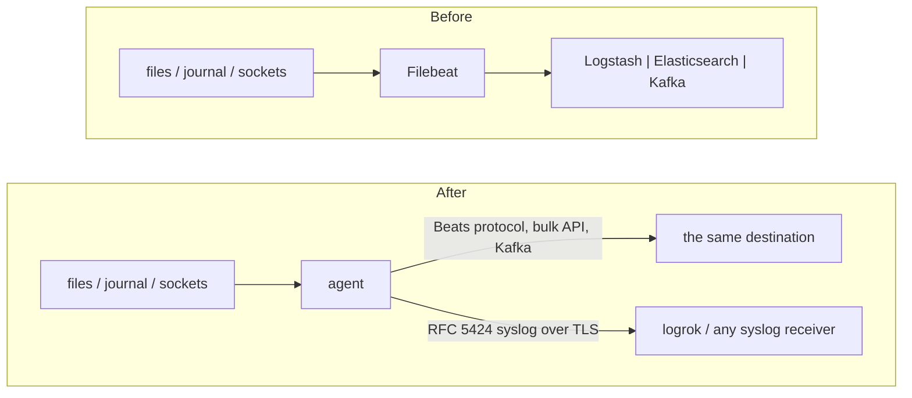

# Migrating from Filebeat

The agent can take over a host's log collection from Filebeat and keep delivering to the same place:
Logstash (it speaks the Beats protocol), Elasticsearch or OpenSearch, or Kafka. Or it can send the same
data as RFC 5424 syslog to logrok or any syslog receiver.

You don't rewrite the configuration by hand: the agent reads `filebeat.yml` and writes an agent
configuration plus a report of everything it could not carry over.

## Is it a fit?

**Verified against:** Elastic's published Filebeat reference (the current pages, read 2026-10-16; the Filebeat version is not recorded). Delivery into Logstash 8.15.3 was run end to end; the converter was not run against Filebeat itself.

Check these first; they decide whether the conversion is a drop-in or a project.

| If your Filebeat… | Then |
|---|---|
| tails files, reads journald, listens for syslog/TCP/UDP, or runs `winlog` | converted (tables below) |
| uses **Filebeat modules** (`filebeat.modules`, `modules.d`) | **not converted.** Modules ship Elasticsearch ingest pipelines that parse the lines; the agent tails the same files, but that parsing is not reproduced |
| relies on **Elasticsearch ingest pipelines** (`output.elasticsearch.pipeline`, `pipelines`) | not converted: the agent's Elasticsearch output does not select a pipeline |
| uses **autodiscover** for containers | not converted: tail the container log files (`format: auto`) or run the agent as a DaemonSet |
| depends on enrichment processors (`add_kubernetes_metadata`, `add_docker_metadata`, `add_cloud_metadata`, `add_host_metadata`) | not converted (the host name is kept) |
| sends to **Redis**, a **file**, or the **console** | not converted natively; use `-target syslog` or configure the destination by hand |

## How it fits together



## Step 1 — convert

Get `luna-migrate` first: a separate download published with every agent release (`luna-migrate-<os>-<arch>`, saved as `luna-migrate` / `luna-migrate.exe`) — see [Getting luna-migrate](../USER-GUIDE.md#getting-luna-migrate).

Run the converter on the Filebeat host (it only reads `filebeat.yml`):

```bash
luna-migrate beats /etc/filebeat/filebeat.yml \
  -out /etc/logrok-universal-agent/agent.yaml \
  -report filebeat-conversion.json
```

```powershell
& ".\luna-migrate.exe" beats "C:\Program Files\Filebeat\filebeat.yml" `
  -out "C:\ProgramData\logrok-universal-agent\agent.yaml" `
  -report filebeat-conversion.json
```

| Flag | Default | Meaning |
|---|---|---|
| `-out` | *(required)* | where to write the agent configuration; an existing file is never overwritten |
| `-report` | — | also write the full report as JSON |
| `-target` | `native` | `native`: send where Filebeat sent (Logstash → `beats` output, Elasticsearch → `elasticsearch`, Kafka → `kafka`). `syslog`: RFC 5424 over TLS |
| `-syslog-endpoint` | — | `host:port` of the syslog receiver for `-target syslog` |
| `-syslog-plain` | off | send the syslog output over plain TCP instead of TLS (a receiver without TLS, or a lab) |
| `-start-at` | `end` | where file inputs start on first run: `end` (only new lines: nothing Filebeat already shipped is shipped again) or `beginning` |

luna-migrate checks the configuration's structure, then runs the installed agent's `-check-config` (found beside `luna-migrate` or on the `PATH`, or named with `-agent`), which builds every module exactly as that agent version would; a configuration the agent rejects is removed. Without an agent to hand it says so — then run `logrok-universal-agent -check-config -config agent.yaml` on the target host. Filebeat
accepts only one output, and so does the converter: with two enabled it stops and says so.

Dotted and nested spellings read the same (`output.logstash.hosts: [...]` and `output: {logstash: {hosts: [...]}}`).
A `modules.d` or `filebeat.config.inputs` file is a separate file: put its list under `filebeat.inputs:` in a copy
and convert that.

## Step 2 — read the report

| Severity | Meaning |
|---|---|
| `manual` | **not carried over**: a person must decide (each line says what to do instead) |
| `warning` | carried over, with a difference to check |
| `info` | carried over differently, nothing to do |
| `skipped` | deliberately not converted: inputs and outputs with `enabled: false` |

Then fill in what the report lists under "fill in before deploying". Passwords, API keys and SASL
passwords are **never copied** out of `filebeat.yml`: the generated file says `REPLACE_WITH_…` (search for
it). That includes values written as `${VARIABLE}`.

## What is converted

### Inputs

| Filebeat | Agent |
|---|---|
| `filestream` / `log` `paths` | `filetail` `paths`. `**` must be a whole path segment (Filebeat expanded it to a fixed depth; the agent's is unbounded) |
| `exclude_files` / `prospector.scanner.exclude_files` | `exclude` globs when the expression is a file-extension match (`\.gz$`, `\.(bz2\|zip)$`); any other expression is `manual` |
| multiline (`parsers: - multiline:` or `multiline.*`) | `multiline.line_start_pattern` / `line_end_pattern`, translated by the rules below; `timeout` becomes `flush_timeout` |
| `include_lines` / `exclude_lines` | exact: only that input's events are dropped (include first, then exclude, as in Filebeat) |
| `encoding` | `utf-8`, `utf-16le`, `utf-16be`; the `-bom` forms become `auto`; any other charset is `manual` |
| `tail_files: true` | `start_at: end` for that input |
| `container` input, or the `container` parser | `filetail` with `format: auto`, `docker` or `cri` |
| `journald` (`units`, `syslog_identifiers`) | `journald` (`units`, `identifiers`) |
| `syslog` input (`protocol.udp` / `protocol.tcp`) | `syslog_in`; one per protocol block. RFC 3164 and 5424 are both detected |
| `tcp` / `udp` input | `syslog_in` (TCP newline-delimited; `framing: rfc6587` → `auto`); TCP with `ssl` → `tls_listen` with the certificate and key (and `tls_client_ca_file` when client authentication is on) |
| `winlog` input (`name`, `event_id`) | `windows_eventlog`; the `event_id` allow/block list becomes a structured query |
| `enabled: false` | skipped |

**Multiline direction.** Filebeat's four `negate` / `match` combinations map as follows; a combination that
needs the *opposite* of a pattern is converted only for the common shapes (a leading-whitespace pattern such as
`^[[:space:]]` or `^\s+`, and the trailing-backslash continuation `\\$`) and is `manual` otherwise, because the
agent's regular-expression engine has no negative look-ahead.

| `negate` | `match` | Meaning in Filebeat | Agent |
|---|---|---|---|
| `true` | `after` | non-matching lines continue the previous matching line | `line_start_pattern` = the pattern |
| `true` | `before` | non-matching lines lead up to the next matching line | `line_end_pattern` = the pattern |
| `false` | `after` | matching lines continue the previous non-matching line | `line_start_pattern` = the opposite of the pattern |
| `false` | `before` | matching lines lead up to the next non-matching line | `line_end_pattern` = the opposite of the pattern |

### Fields, tags and processors

| Filebeat | Agent |
|---|---|
| `fields` (per input, or at the top level) | `add_fields` on the input. With `fields_under_root: true` the key is kept (`env`); otherwise it is `fields.env`. (In the Elasticsearch output the agent puts event fields under `labels`; see the note below the table.) Nested maps flatten with dots; an input's own value wins over a top-level one |
| `tags` | one field `tags` holding the tags joined by commas (`web,edge`). Receivers see **one** tag with that text, so a test for a single tag of several will not match; add one field per tag you filter on. A single tag works as is |
| `add_fields` processor | without `when`: per input, folded into that input's fields; top level, the `add_fields` processor. With `when` (either level): an `expr` rule with `set`, scoped to the condition (and to the input) |
| `drop_event`, `drop_fields`, `rename` with `when` conditions | `expr` rules scoped to the input (or global). Conditions `equals`, `contains`, `regexp`, `and`, `or`, `not` over `message` or a field the conversion itself adds; `range`, `has_fields`, `network` are `manual` |
| `add_host_metadata` | `warning`: events carry the host name only |

Per-input processors and line filters are applied **only to their own input**. The agent's processors are
global, so the converter marks the input with a helper field `beats_input` and removes it again as the last step;
a processor it cannot scope exactly is `manual`, never applied to everything.

### Outputs

| Filebeat | Agent |
|---|---|
| `output.logstash` | `beats` output: `hosts` → `endpoint` / `endpoints` (default port 5044), `index` → the `@metadata.beat` value (`filebeat` if unset), `ssl` → `tls`, `ca_file`, `cert_file`, `key_file`, `compression_level` |
| `output.elasticsearch` | `elasticsearch` output: `hosts` (+ `protocol`, `path`; default port 9200) → `endpoints`, `api_key`, `username` / `password`, `index`, `ssl` → `ca_file`, `timeout` |
| `output.kafka` | `kafka` output: `hosts` → `brokers`, `topic`, `compression` (Filebeat's default `gzip` is kept), `username` / `password` + `sasl.mechanism` → `sasl`, `ssl` → `tls` + `ca_file` / `cert_file` / `key_file` |
| `ssl.verification_mode: none` | `insecure_skip_verify: true` with a `warning` |
| any output, `-target syslog` | one `syslog` output over TLS (`-syslog-endpoint`) |

## What is not converted (and what to do)

| Filebeat | Why / instead |
|---|---|
| `filebeat.modules`, `modules.d`, `filebeat.config.*` | module parsing runs in Elasticsearch ingest pipelines; tail the files with `filetail` and parse with the agent's parse processors or downstream |
| `output.elasticsearch.pipeline`, `pipelines`, `indices` | the agent writes to one index or data stream |
| per-event `index` / `topic` / `key` format strings (`%{[fields.x]}`) | one fixed value only; route by hand (a second output with a `when:` condition; more than one output and routing conditions are Apex features) |
| `index` on an input | not expressible; see above |
| index templates, ILM, dashboards (`setup.*`) | the agent installs none; keep what Filebeat already set up |
| `ignore_older`, `ignore_inactive` | no file-age filter: narrow the paths or excludes |
| `ndjson` parser, `json.*`, `decode_json_fields` | JSON decoding is a global `parse_json` processor in the agent; add it by hand if every event is JSON |
| `dissect`, `script`, `copy_fields`, `truncate_fields`, … | no exact equivalent |
| multiline `type: count`, `flush_pattern` | no equivalent |
| `loadbalance: true` (Logstash) | the agent fails over to the next host; it does not balance |
| `output.kafka.codec`, record `key`, SASL `GSSAPI` / `OAUTHBEARER` | not carried over |
| `cloud.id` / `cloud.auth` | set an Elasticsearch endpoint and API key by hand |
| autodiscover, `kafka`, `redis`, `aws-s3`, `httpjson` and other API inputs | no equivalent (the report line says so; only `http_endpoint` and `mqtt` point to the nearest agent input) |
| the Filebeat registry | the agent keeps its own file state (it does not import Filebeat's offsets) |

The Elasticsearch document differs from Filebeat's: the agent writes ECS-shaped documents with its own
`agent.*`, `event.*` and `log.*` fields and puts your fields under `labels`. Dashboards built on Filebeat's
exact field set need a look.

## Step 3 — cut over without a gap

Prefer a few seconds of duplicates to a gap:

1. Install the agent with the converted configuration and start it. With `start_at: end` it reads only lines
   written from now on.
2. Confirm in the destination that events arrive from the agent: the same index or topic, with your fields.
3. Stop and disable Filebeat.

Between steps 1 and 3 both send new lines, so those few seconds arrive twice. Stopping Filebeat *first* would
lose the lines written before the agent starts. The agent does not read Filebeat's registry.

## Sending to logrok instead

```bash
luna-migrate beats /etc/filebeat/filebeat.yml -out agent.yaml \
  -target syslog -syslog-endpoint logrok.example.com:16575
```

Inputs, fields and processors convert as above; only the destination changes. Add the TLS trust (`ca_file`,
and a client certificate if your receiver requires one) to the generated `syslog` output.

## Licensing

The converter is free. What the converted configuration uses follows the normal rules
([LICENSING](../LICENSING.md)): file tailing, journald, syslog input and syslog forwarding are Core; the
`elasticsearch`, `beats` and `kafka` outputs, container log parsing, the Windows Event Log input and the disk
spool are Apex.
