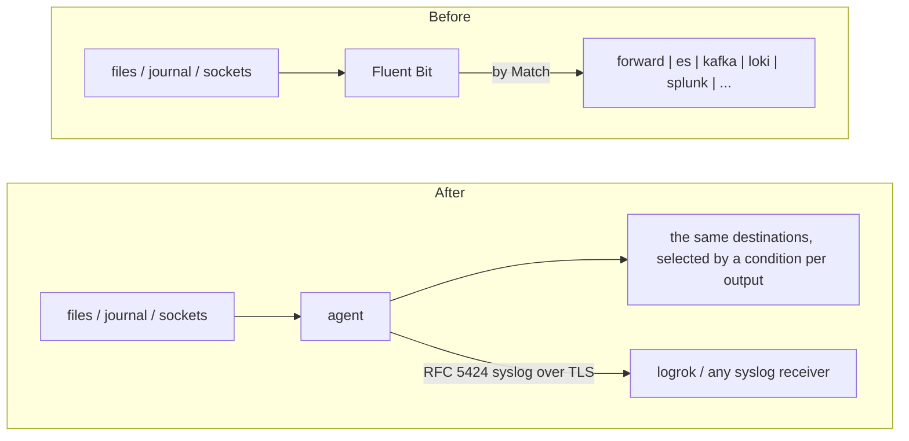

# Migrating from Fluent Bit

The agent can take over a host's log collection from Fluent Bit and keep delivering to the same place: a
Fluentd or Fluent Bit aggregator (Forward protocol), Elasticsearch or OpenSearch, Kafka, Loki, Splunk (HTTP Event
Collector), an OpenTelemetry endpoint, an S3 bucket or a syslog receiver. Or it can send the same data as RFC 5424
syslog to logrok or any syslog receiver.

You don't rewrite the configuration by hand: the agent reads `fluent-bit.conf` (classic format) or
`fluent-bit.yaml` (YAML format), follows its includes, and writes an agent configuration plus a report of
everything it could not carry over.

If you would rather leave Fluent Bit in place, the agent can also sit behind it: point Fluent Bit's `forward`
output at the agent's `fluent_in` input and the agent adds buffering, TLS and its other destinations.

## Is it a fit?

**Verified against:** the current Fluent Bit manual (read 2026-10-16; its pages reference releases up to v5.1.x). Delivery into a Fluent Bit 3.1.9 forward input was run end to end; the converter was not run against Fluent Bit reading your configuration.

Check these first; they decide whether the conversion is a drop-in or a project.

| If your Fluent Bit… | Then |
|---|---|
| tails files, reads the systemd journal, listens for syslog / raw TCP / UDP / Forward / HTTP / OpenTelemetry, or reads the Windows event log | converted (tables below) |
| routes with `Match` / `Match_Regex` to several outputs | converted: the agent routes with a condition per output (see [Tags and routing](#tags-and-routing)) |
| uses **Lua** filters | **not converted.** Re-express the logic with the agent's processors, or keep the script on a Fluent Bit tier in front of the agent |
| uses the **Kubernetes filter** (API-server enrichment of pod labels and annotations) | **not converted.** For container logs, `filetail` with `format: cri`, `docker` or `auto` adds namespace, pod and container from the log path, and the container id for `/var/log/containers` paths |
| uses **`rewrite_tag`** | not converted, and routing decisions in the report assume the original tags |
| uses a **regex parser** or the built-in `java` / `python` / `go` multiline parsers | not converted (JSON and logfmt parsers are) |
| uses **conditional routing** (`routes:` on an input, YAML only) | not converted; express it with output `when:` conditions |
| sends to the generic **`http`** output, **`file`**, **Kinesis**, **CloudWatch** and similar | not converted natively; use `-target syslog` or configure the destination by hand |
| uses **processors** inside a plugin (YAML `processors:`) | not converted |

## How it fits together



## Step 1 — convert

Get `luna-migrate` first: a separate download published with every agent release (`luna-migrate-<os>-<arch>`, saved as `luna-migrate` / `luna-migrate.exe`) — see [Getting luna-migrate](../USER-GUIDE.md#getting-luna-migrate).

Run the converter on the Fluent Bit host (it only reads the configuration files):

```bash
luna-migrate fluentbit /etc/fluent-bit/fluent-bit.conf \
  -out /etc/logrok-universal-agent/agent.yaml \
  -report fluentbit-conversion.json
```

```powershell
& ".\luna-migrate.exe" fluentbit "C:\Program Files\fluent-bit\conf\fluent-bit.conf" `
  -out "C:\ProgramData\logrok-universal-agent\agent.yaml" `
  -report fluentbit-conversion.json
```

| Flag | Default | Meaning |
|---|---|---|
| `-out` | *(required)* | where to write the agent configuration; an existing file is never overwritten |
| `-report` | — | also write the full report as JSON |
| `-target` | `native` | `native`: send where Fluent Bit sent. `syslog`: everything to one RFC 5424 receiver over TLS |
| `-syslog-endpoint` | — | `host:port` of the syslog receiver for `-target syslog` |
| `-syslog-plain` | off | send the syslog output over plain TCP instead of TLS (a receiver without TLS, or a lab) |
| `-start-at` | `end` | where file inputs start on first run: `end` (only new lines: nothing Fluent Bit already shipped is shipped again) or `beginning`. A tail input with `Read_From_Head On` starts at the beginning |

The format is detected from the file (`.yaml` / `.yml`, or content). `@INCLUDE` lines and YAML `includes:` are
followed (relative to the including file; wildcards work in `@INCLUDE` lines but not in YAML `includes:` entries, which are read as literal file names — list each file) and every file read is listed in the report. `@SET`
variables and the YAML `env:` section are substituted, including `${NAME:-default}`; a variable Fluent Bit would
take from its process environment is left as written and reported. The file named by `Parsers_File` is read when
it sits beside the configuration. luna-migrate checks the configuration's structure, then runs the installed agent's `-check-config` (found beside `luna-migrate` or on the `PATH`, or named with `-agent`), which builds every module exactly as that agent version would; a configuration the agent rejects is removed. Without an agent to hand it says so — then run `logrok-universal-agent -check-config -config agent.yaml` on the target host.

## Step 2 — read the report

| Severity | Meaning |
|---|---|
| `manual` | **not carried over**: a person must decide (each line says what to do instead) |
| `warning` | carried over, with a difference to check |
| `info` | carried over differently, nothing to do |
| `skipped` | deliberately not converted: `stdout` and `null` outputs and the `stdout` filter |

Each finding names the file and line it came from. Then fill in what the report lists under "fill in before
deploying". Shared keys, passwords, tokens and SASL credentials are **never copied** out of the Fluent Bit
configuration: the generated file says `REPLACE_WITH_…` (search for it). That includes values written as
`${VARIABLE}`. Key passphrases are not carried over either; use an unencrypted key file the agent can read.

## Tags and routing

Fluent Bit stamps every record with a **tag** at the input and sends it to each output (and runs each filter)
whose `Match` pattern fits the tag; a record whose tag no output matches is discarded. The agent has no tags. The
converter keeps the behaviour like this:

- It works out, for every input and every `Match` / `Match_Regex`, whether the input's records reach that output.
  `Match` follows Fluent Bit's rule: case-sensitive, `*` stands for any text including dots (`app.*` matches
  `app.web.frontend`), everything else is literal.
- An output that receives only some of the inputs gets a `when:` condition — on the field `fluent.tag` for inputs the converter tags, on `source` for an `http` input (its tag is set by the sender) and `source startswith "fluent:"` for a Forward input that is delivered whole; an output
  that receives all of them gets none. Routing conditions are an Apex feature, as is more than one output.
- The converted input carries its tag in that field (`add_fields: {fluent.tag: web.nginx}`). The `fluent` output
  sends it as the Forward tag, so a downstream Fluentd or Fluent Bit sees the same tag; it is not part of the
  record. Other outputs carry it as an ordinary field.
- A **filter** with its own `Match` is applied to its inputs only: its rules are conditioned on the same field.
  A filter is never applied to everything because the agent's processors happen to be global.
- An input that **no output selects** is not converted (Fluent Bit would have discarded its records); the report
  says which.
- A **Forward** input keeps the sender's tag (the agent's `fluent_in` stamps it), so conditions on it are
  evaluated per record at run time.

Where the tag cannot be known in advance the report says so and chooses the safe side (the input is delivered to
the output rather than dropped):

| Situation | What happens |
|---|---|
| `Tag app.*` on a `tail` input (Fluent Bit puts the file path in the tag) or `Tag host.*` on `systemd` (the unit name) | the agent stamps the fixed tag `app` / `host`; a `Match` that splits those tags (`app.web.*`) cannot be reproduced and is reported |
| a `Match_Regex` against such a tag, or against an input whose tag the sender sets (`http`) | the input is delivered to that output; check it receives only what you intended |
| no `Tag` on an input | Fluent Bit's default tag is assumed; reported when a `Match` that is not a catch-all depends on it |
| `Match_Regex` | evaluated as an unanchored search with RE2 syntax; a pattern RE2 cannot compile is `manual` |

## What is converted

### Inputs

| Fluent Bit | Agent |
|---|---|
| `tail` `Path` (comma-separated), `Exclude_Path` | `filetail` `paths`, `exclude`. `DB` is not read: the agent keeps its own resume state (`state_path`) |
| `Read_From_Head On` | `start_at: beginning`; otherwise the `-start-at` setting |
| `multiline.parser docker` / `cri` / `docker, cri` | `filetail` `format: docker` / `cri` / `auto` (container-log mode: reassembles split lines, adds stream and Kubernetes metadata from the log path) |
| `multiline.parser` naming your own regex parser with a start state and one continuation state | `multiline.line_start_pattern`; `Flush_Timeout` becomes `flush_timeout`. Fluent Bit also required continuation lines to match the continuation expression; the agent appends every line that does not start a record (reported) |
| `Parser docker` / `Docker_Mode On` on a tail input | `format: docker` |
| `Parser <json or logfmt>` on a tail input, and the `parser` filter | a global `parse_json` / `parse_kv` processor, only when it applies to every converted input (see below) |
| `Unicode.Encoding` `UTF-16LE` / `UTF-16BE` / `auto` | `encoding` |
| `systemd` with `Systemd_Filter _SYSTEMD_UNIT=…` / `SYSLOG_IDENTIFIER=…` | `journald` `units` / `identifiers`. The agent keeps its own journal cursor |
| `syslog` (`Mode tcp` / `udp` / unix socket) | `syslog_in` (`listen`, `protocols`, `socket`, `framing`); RFC 5424 and 3164 are both parsed |
| `tcp` / `udp` with `Format none` | `syslog_in` (plain lines; text that looks like syslog is parsed as syslog) |
| `forward` | `fluent_in` (`listen`, `shared_key` placeholder, TLS certificate and key); `Tag` overrides the tag |
| `opentelemetry` | `otlp_in` (gRPC and HTTP on one port) |
| `http` | `http_in`. Fluent Bit takes JSON records and the tag from the URL path; the agent's input takes newline-delimited lines at one path, so JSON bodies arrive as text (add `parse_json`) |
| `winevtlog` / `winlog` (`Channels`, `Event_Query`, `Render_Event_As_XML`) | `windows_eventlog`; the XML query is passed through unchanged |

### Filters

| Fluent Bit | Agent |
|---|---|
| `grep` `Regex` / `Exclude` (with or without `Logical_Op`) | `expr` drop rules scoped to the filter's `Match`. A missing key fails a `Regex` and passes an `Exclude`, as in Fluent Bit. Keys are the message (`log` for tail), a plain field, or a record accessor such as `$kubernetes['labels']['app']` |
| `modify` `Set` / `Add` / `Remove` / `Rename` / `Hard_rename` | `expr` rules scoped to the filter's `Match` (`Add` and `Rename` only when the target is absent, as in Fluent Bit). Rules that use `Condition`, `Copy`, `Remove_wildcard` and `Remove_regex` are `manual` |
| `record_modifier` `Record` / `Remove_key` | `expr` set / remove rules scoped to the `Match` |
| `parser` (JSON, logfmt) | `parse_json` / `parse_kv`. These processors apply to every input; when the filter's `Match` selects only some inputs it is `manual` rather than applied too widely |

### Outputs

| Fluent Bit | Agent |
|---|---|
| `forward` | `fluent` output: `Host` / `Port` → `endpoint`, `Shared_Key` → placeholder, `Require_ack_response` → `require_ack`, `Compress gzip`, `Tag` (used for events that carry no tag of their own; events that arrive with a tag keep it, and the report warns), `tls` / `tls.ca_file` / `tls.crt_file` / `tls.key_file` |
| `es`, `opensearch` | `elasticsearch`: `Host`/`Port` (+ `tls`) → `endpoints`, `Index`, `HTTP_User` / `HTTP_Passwd` / `HTTP_API_Key` → placeholders, `tls.ca_file`, `tls.verify off` → `insecure_skip_verify`. `Logstash_Format` writes one index (the prefix) instead of one per day |
| `kafka` | `kafka`: `Brokers`, first of `Topics`, SASL (`rdkafka.sasl.*`, placeholders) and TLS (`rdkafka.security.protocol`, `rdkafka.ssl.*`), `rdkafka.compression.codec`. The Kafka value is the agent's JSON event, not Fluent Bit's record JSON |
| `loki` | `loki`: `Host` / `Port` / `Uri` / `tls`, `Tenant_ID`, static `Labels`, `Label_Keys` → `label_fields`, `Line_Format json`, `Compress gzip`, basic auth and bearer token as placeholders |
| `splunk` | `hec`: `Host` / `Port` / `tls`, `Splunk_Token` placeholder, `Event_Index`, `Event_Sourcetype`, `Event_Source`, `Compress gzip` |
| `syslog` | `syslog`: `Host` / `Port`, `Mode udp` / `tcp` / `tls`. RFC 5424 is always sent |
| `opentelemetry` | `otlp`: `Grpc` → `protocol`, `Host` / `Port` / `Logs_Uri`, `Header` entries (credential headers become placeholders), `Compress gzip` |
| `s3` | `s3`: `Bucket`, `Region`, `Endpoint`, `Compression`, `Storage_Class`, the literal start of `S3_Key_Format` → `key_prefix`. Credentials are placeholders (the agent needs them in its configuration or environment) |
| `stdout`, `null` | skipped |
| any output, `-target syslog` | one `syslog` output over TLS (`-syslog-endpoint`), with a `when:` only if some input reaches its destinations through a per-record tag condition alone |

## What is not converted (and what to do)

| Fluent Bit | Why / instead |
|---|---|
| `lua`, `nest`, `rewrite_tag`, `throttle`, `multiline` and other filters | no equivalent; the report names the nearest agent processor where there is one |
| `kubernetes` filter | see above; pod labels and annotations from the API server are not available |
| `modify` conditions, `copy`, wildcard/regex removal; `record_modifier` `Allowlist_Key` / `Uuid_Key` | no exact equivalent in a scoped processor |
| `Path_Key`, `Offset_Key`, `Ignore_Older` | the path is the event's source (`file:<path>`); no offset field, no file-age filter |
| systemd filters on other fields (for example `PRIORITY=3`), `Path`, `Namespace` | not supported; the agent follows the host's journal |
| `OR` between a unit filter and an identifier filter | the agent combines unit and identifier with AND; use two inputs |
| `tcp` / `udp` with `Format json`, a custom `Separator` | the agent's raw inputs take lines of text |
| `Format avro` / `msgpack` etc. on `kafka`; `parquet` on `s3`; per-record topics | the agent produces JSON / NDJSON (on `s3` also OCSF Parquet for Amazon Security Lake, `format: parquet-ocsf`); configure by hand |
| `es` with `Cloud_ID`, `AWS_Auth`, `Pipeline`, `Path` | set an endpoint and API key by hand; the output does not select an ingest pipeline |
| `oauth2.*`, AWS SigV4 on `opentelemetry` | send an `Authorization` header instead |
| `http` output | no generic JSON POST output |
| Fluent Bit's tail database (`DB`) and journal cursor | the agent keeps its own state; it does not import Fluent Bit's offsets |
| buffering and worker settings (`Mem_Buf_Limit`, `storage.*`, `Workers`, `net.*`) | not needed: the agent has its own spool and delivery settings (reported as `info`) |

## Step 3 — cut over without a gap

Prefer a few seconds of duplicates to a gap:

1. Install the agent with the converted configuration and start it. With `start_at: end` it reads only lines
   written from now on.
2. Confirm in the destination that events arrive from the agent, with your tags (or the fields that replace
   them).
3. Stop and disable Fluent Bit.

Between steps 1 and 3 both send new lines, so those few seconds arrive twice. Stopping Fluent Bit *first* would
lose the lines written before the agent starts. The agent does not read Fluent Bit's offset databases.

The events differ in shape from Fluent Bit's: the agent's record has a message, a host, a severity and a source (named `message`, `host`, `level` and `source` in the `fluent` output, `severity` in the Kafka, S3 and HEC outputs, and in Loki only inside the log line with `line_format: json`)
(and, to Elasticsearch, an ECS-shaped document with your fields under `labels`). Consumers that read Fluent Bit's
`log` key need a look.

## Sending to logrok instead

```bash
luna-migrate fluentbit /etc/fluent-bit/fluent-bit.conf -out agent.yaml \
  -target syslog -syslog-endpoint logrok.example.com:16575
```

Inputs and filters convert as above; only the destination changes. Add the TLS trust (`ca_file`, and a client
certificate if your receiver requires one) to the generated `syslog` output.

## Licensing

The converter is free. What the converted configuration uses follows the normal rules
([LICENSING](../LICENSING.md)): file tailing, journald, syslog input, HTTP input, the parse and `expr` processors
and one RFC 5424 syslog destination over TCP/TLS are Core; a `syslog` output in `Mode udp` (Fluent Bit's default mode) becomes a UDP output and is Apex; the `fluent`, `elasticsearch`, `kafka`, `loki`, `hec`, `otlp` and
`s3` outputs, more than one destination and per-destination routing conditions, the Forward and OpenTelemetry
receivers, container-log mode, the Windows Event Log input and the disk spool are Apex.
