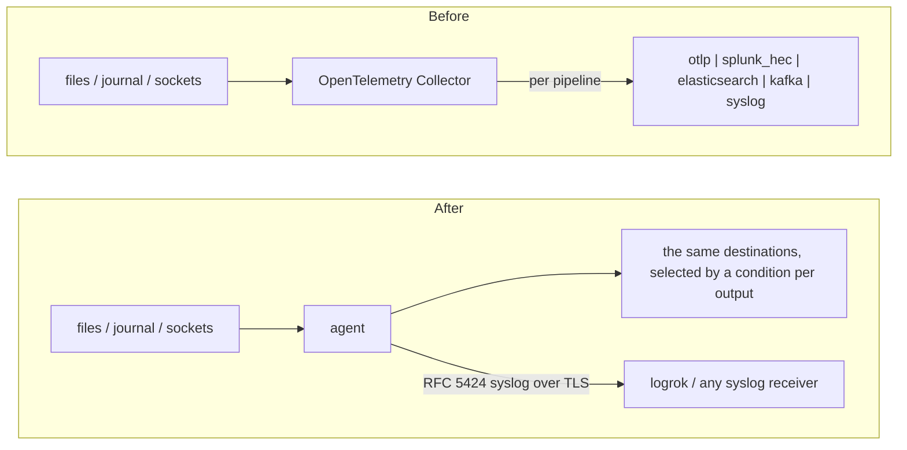

# Migrating from the OpenTelemetry Collector

The agent can take over the **log collection** of a host that runs an OpenTelemetry Collector (the `otelcol` or
`otelcol-contrib` distribution) and keep delivering to the same place: an OpenTelemetry endpoint (OTLP over gRPC or
HTTP), Splunk (HTTP Event Collector), Elasticsearch or OpenSearch, Kafka, or a syslog receiver. Or it can send the
same data as RFC 5424 syslog to logrok or any syslog receiver.

You don't rewrite the configuration by hand: the agent reads the collector's YAML, follows the `service.pipelines`
that carry logs, and writes an agent configuration plus a report of everything it could not carry over.

## Is it a fit?

**Verified against:** the OpenTelemetry Collector component documentation (main branch, read 2026-10-16; the release is not recorded). Delivery over OTLP into OpenTelemetry Collector 0.162.0 was run end to end; the converter was not run against a Collector reading your configuration.

The agent is a **log forwarder**. It is not a metrics or traces collector, it does not scrape, and it has no
processor SDK. If your collector is mostly a log shipper, the conversion is close to a drop-in; if logs are a
small part of what it does, convert the logs and keep the collector for the rest.

| If your collector… | Then |
|---|---|
| reads files (`filelog`), the systemd journal, syslog / raw TCP / UDP, the Windows event log, or receives OTLP, Splunk HEC or Fluent Forward | converted (tables below) |
| has **metrics or traces pipelines** | **not converted, and not carried by the agent.** They are reported as skipped; keep the collector for them |
| uses the **`transform`** processor (OTTL statements), **`k8sattributes`**, **`resourcedetection`**, **`redaction`**, sampling processors | **not converted** (each is reported with the nearest agent feature where there is one) |
| uses **connectors** (routing, forward, count) | a pipeline wired through one is **not converted**; express the routing with output `when:` conditions |
| exports with `otlp`, `otlphttp`, `splunk_hec`, `elasticsearch`, `kafka` or `syslog` | converted |
| exports with Prometheus, Loki's own exporter, AWS, Azure or Google exporters, and similar | not converted natively; use `-target syslog` or configure the destination by hand |
| reads from **Kafka**, scrapes **Prometheus**, or reads **Kubernetes events** | not converted (the agent has no such input) |

## How it fits together



If you would rather leave the collector in place, the agent can also sit in front of it: its `otlp` output sends
to a collector's OTLP receiver, and its `otlp_in` input accepts what a collector's `otlp` exporter sends.

## Step 1 — convert

Get `luna-migrate` first: a separate download published with every agent release (`luna-migrate-<os>-<arch>`, saved as `luna-migrate` / `luna-migrate.exe`) — see [Getting luna-migrate](../USER-GUIDE.md#getting-luna-migrate).

Run the converter where the collector's configuration file is (it only reads files):

```bash
luna-migrate otelcol /etc/otelcol-contrib/config.yaml \
  -out /etc/logrok-universal-agent/agent.yaml \
  -report otelcol-conversion.json
```

```powershell
& ".\luna-migrate.exe" otelcol "C:\Program Files\OpenTelemetry Collector\config.yaml" `
  -out "C:\ProgramData\logrok-universal-agent\agent.yaml" `
  -report otelcol-conversion.json
```

| Flag | Default | Meaning |
|---|---|---|
| `-out` | *(required)* | where to write the agent configuration; an existing file is never overwritten |
| `-report` | — | also write the full report as JSON |
| `-target` | `native` | `native`: send where the collector sent. `syslog`: everything to one RFC 5424 receiver over TLS |
| `-syslog-endpoint` | — | `host:port` of the syslog receiver for `-target syslog` |
| `-syslog-plain` | off | send the syslog output over plain TCP instead of TLS (a receiver without TLS, or a lab) |
| `-start-at` | `end` | where file inputs start on first run: `end` (only new lines: nothing the collector already shipped is shipped again) or `beginning`. A `filelog` receiver that sets `start_at` keeps its own value |

**Several configuration files.** A collector started with several `--config` files merges them; pass the same files
to `luna-migrate`, comma separated and in the same order (`a.yaml,b.yaml`), or pass a directory (its `.yaml` and
`.yml` files are read in name order). Maps are merged key by key and a later list replaces an earlier one, as the
collector does. Other `--config` forms (`env:`, `yaml:`, `http:`) and sections loaded with `${file:…}` cannot be
followed; save the configuration to a file first.

**Component names.** Both spellings of the renamed components are read: `filelog` / `file_log`,
`windowseventlog` / `windows_event_log`, `fluentforward` / `fluent_forward`, `tcplog` / `tcp_log`, `udplog` /
`udp_log`, `otlphttp` / `otlp_http`, `otlp` / `otlp_grpc`.

**Environment variables.** The agent does not expand `${env:NAME}` (nor does `luna-migrate`: the converter never
reads the collector's environment). A secret or an address the collector read from a variable becomes
`REPLACE_WITH_…` and is listed under "fill in before deploying"; the report names the variable. A default written
as `${env:NAME:-default}` is **not** copied (it may itself be a credential).

luna-migrate checks the configuration's structure, then runs the installed agent's `-check-config` (found beside `luna-migrate` or on the `PATH`, or named with `-agent`), which builds every module exactly as that agent version would; a configuration the agent rejects is removed. Without an agent to hand it says so — then run `logrok-universal-agent -check-config -config agent.yaml` on the target host.

## Step 2 — read the report

| Severity | Meaning |
|---|---|
| `manual` | **not carried over**: a person must decide (each line says what to do instead) |
| `warning` | carried over, with a difference to check |
| `info` | carried over differently, nothing to do |
| `skipped` | deliberately not converted: metrics and traces pipelines, `debug` / `file` / `nop` exporters, components no pipeline uses, the collector's diagnostics extensions |

Each finding names the part of the configuration it came from (`receivers.filelog/app`,
`processors.filter/noise`, `exporters.otlp/gateway`, …). Then fill in what the report lists under "fill in before
deploying". Tokens, passwords, API keys and every header that looks like a credential are **never copied** out of
the collector configuration: the generated file says `REPLACE_WITH_…` (search for it).

## Pipelines and routing

A collector hands each receiver's data to **every pipeline that lists it**; every pipeline runs **its own**
processors, in order, and sends only to **its own** exporters. The agent has one processing chain and routes with a
condition per output. The converter keeps your pipelines apart like this:

- A receiver becomes one input. When the converter needs to tell inputs apart, the input stamps the field
  `otelcol.input` (its own name), and the generated rules and outputs are written over that field.
- A processor of a pipeline (`attributes`, `resource`, `filter`) becomes rules that apply **only to the inputs of
  that pipeline**. It is never applied to everything because the agent's processors happen to be global. With a
  single logs pipeline there is nothing to tell apart: no marker, no conditions.
- An output that receives only some of the inputs gets a `when:` condition over the marker; an output that receives
  all of them gets none. Routing conditions and more than one output are Apex features.
- When a **file or journal receiver is listed by pipelines with different processors**, the agent cannot branch one
  stream, so the input is opened once per distinct chain (each copy keeps its own resume state), every copy
  conditioned on its own pipeline. Each file is then read more than once, exactly as the collector's pipelines each
  saw the whole stream; the report says so.
- When a **network listener, or the Windows event log, is listed by pipelines with different processors**, it cannot
  be opened twice. That receiver is **not converted** (`manual`): applying one pipeline's processors to the other's
  events would drop or alter data the collector never touched. Give each pipeline its own receiver (listeners on
  different ports) and convert again.
- An exporter listed by several pipelines that carry the same events receives each event once (the collector sent
  it once per pipeline).
- An input whose pipelines export only to `debug` / `file` sinks is not converted; the report says which.
- When an output needs a `when:`, the field `otelcol.input` is delivered with every event (the condition is
  evaluated after the processors); otherwise a last rule removes it. The report says which case applies.
- `batch` and `memory_limiter` protect the collector's own memory and exporter calls; the agent batches by itself,
  keeps a disk spool and has its own limits. They are reported as `info` and not converted.

## What is converted

### Receivers

| Collector | Agent |
|---|---|
| `filelog` `include` (with `{a,b}` alternation expanded), `exclude`, `start_at`, `multiline` (`line_start_pattern` or `line_end_pattern`), `encoding` (`utf-8`, `utf-16le`, `utf-16be`), `poll_interval`, `fingerprint_size`, `attributes` / `resource` (static values) | `filetail` `paths`, `exclude`, `start_at`, `multiline`, `encoding`, `poll_interval`, `fingerprint_size`, `add_fields`. The `storage` extension is not read: the agent keeps its own resume state (`state_path`) |
| `filelog` operator `container` (docker, crio, containerd, or detected) | `filetail` container-log mode (`format: docker`, `cri` or `auto`; Apex): split lines are reassembled, and the stream and Kubernetes namespace, pod, container and container id come from the log path as the fields `stream`, `k8s_namespace`, `k8s_pod`, `k8s_container`, `container_id` (not as `log.iostream` / `k8s.*` attributes) |
| `journald` `units`, `identifiers`, `priority` (default `info`, as in the collector) | `journald`. The agent keeps its own journal cursor |
| `syslog` (`tcp` and/or `udp`, `tls`, `enable_octet_counting`) | `syslog_in` (`listen`, `protocols`, `tls_listen` with the certificate and key, `framing`); RFC 5424 and 3164 are both recognised |
| `tcplog`, `udplog` | `syslog_in` reading plain lines (text that looks like syslog is parsed as syslog) |
| `otlp` (`grpc` and/or `http` endpoints, TLS) | `otlp_in` (gRPC and HTTP on one port; two different endpoints become two inputs) |
| `splunk_hec` | `hec_in` — the agent's receiver **requires a token**, so the generated file carries a placeholder to fill in (the collector's receiver documents no token setting) |
| `fluentforward` / `fluent_forward` | `fluent_in`; the Forward tag arrives as the field `fluent.tag`, as it was an attribute before |
| `windowseventlog` (`channel`, `query`, `raw`, `path`) | `windows_eventlog` (`channels`, `query`, `render: xml`, `file`). The collector's body was a structured map; the agent's message is the rendered text with the event data as fields |

### Operators on a receiver

Only operators that have an exact equivalent are converted, and each applies to its receiver's events only.

| Collector | Agent |
|---|---|
| `add` / `remove` / `move` on `attributes.x` (or `resource.x`) | `expr` rules: set / remove / rename |
| `filter` with `body matches\|contains\|startsWith\|endsWith "text"`, `body == "text"`, or the same on one attribute | an `expr` drop rule |
| `json_parser` (from the body or one attribute) | a `parse_json` processor, **only when every input asks for it** — the agent's parse processors have no per-input scope. Otherwise it is `manual` |
| `container` | see above |
| `regex_parser`, `severity_parser`, `time_parser`, `recombine`, `router`, anything with an `if:` or hand-wired `output:` | not converted; each finding says what to do instead |

### Processors

| Collector | Agent |
|---|---|
| `attributes` `insert` / `update` / `upsert` (fixed values) | `expr` set rules scoped to the pipeline's inputs. `insert` sets the field only if it is empty or absent, `update` only if it is present |
| `attributes` `delete` (by `key`) | `expr` remove rule |
| `attributes` with `include` / `exclude` on `attributes` and `log_bodies` (`strict` or `regexp`) | the same rules with the match as a condition |
| `resource` (same actions) | the same rules; the agent has one field namespace, so resource attributes become ordinary event fields (warning) |
| `filter` — OTTL conditions in `log_conditions`, or `logs.log_record` | one `expr` drop rule per condition, scoped to the pipeline. Converted: `IsMatch(body, "regex")`, `body == "text"`, `attributes["k"] == "v"`, `resource.attributes["k"]`, `severity_number` compared with a number or a `SEVERITY_NUMBER_*` name, `and` / `or` / `not` |
| `batch`, `memory_limiter` | not needed (`info`) |

A condition is converted only when its meaning is the same on the agent. Everything else is reported with the
reason and **drops nothing** (more events pass than before), for example: a condition on `body` when the
receiver's body is not a line of text (journald, the Windows event log, OTLP); `severity_text`; a
`severity_number` comparison that cuts through a range the agent keeps together (the agent has the eight syslog
severities, so only the boundaries TRACE, INFO, INFO2, WARN, ERROR, ERROR2, ERROR3 and FATAL are exact); the
attributes the collector's receivers add themselves (`log.file.name`, …); other functions.

### Exporters

| Collector | Agent |
|---|---|
| `otlp` / `otlp_grpc` | `otlp` output over gRPC: `endpoint`, TLS on unless `tls.insecure: true` (the collector's default), `ca_file`, client certificate, `server_name_override`, `compression`, `timeout`, `headers` (credential-looking headers and any value read from a variable become placeholders); a `bearertokenauth` or `basicauth` extension becomes an `Authorization` header placeholder |
| `otlphttp` / `otlp_http` | `otlp` output over HTTP: the base URL (the agent appends `/v1/logs` as the collector does), `logs_endpoint` ending in `/v1/logs`, `encoding: json`, TLS files, headers |
| `splunk_hec` | `hec`: `endpoint` (host and scheme), `token` placeholder, `index`, `sourcetype`, `source`, gzip (on unless `disable_compression`), `timeout`, `max_content_length_logs`, `ca_file`, `insecure_skip_verify` |
| `elasticsearch` | `elasticsearch`: `endpoint` / `endpoints`, `logs_index`, `user` + `password` placeholder or `api_key` placeholder, `ca_file`. The collector wrote OpenTelemetry-shaped documents by default; the agent writes ECS-shaped documents |
| `kafka` | `kafka`: `brokers`, the logs topic, SASL `PLAIN` / `SCRAM-SHA-256` / `SCRAM-SHA-512` (a literal username is copied; the password, and a username read from a variable, become placeholders), TLS, `producer.compression`, `record_headers`. The value is the agent's JSON event: **consumers that decode OTLP must change** (warning) |
| `syslog` | `syslog`: host + `port`, `network` tcp/udp, TLS (on unless `tls.insecure`), `enable_octet_counting`. RFC 5424 is always sent |
| `debug`, `nop`, `file` | skipped |
| any exporter, `-target syslog` | one `syslog` output over TLS (`-syslog-endpoint`) |

## What is not converted (and what to do)

| Collector | Why / instead |
|---|---|
| metrics and traces pipelines | the agent forwards logs |
| `transform`, `k8sattributes`, `resourcedetection`, `redaction`, sampling and deduplication processors | no general equivalent; the agent has `expr`, `parse_json`, `parse_kv`, `redact`, `sample` and `dedup` processors to port the logic by hand |
| `attributes` actions `hash`, `extract`, `convert`; `delete` by `pattern`; values copied from another attribute (`from_attribute`) | no exact equivalent; reported per action |
| connectors | no equivalent; use output `when:` conditions |
| the removed `loki` exporter | send OTLP to Loki's `/otlp` endpoint with `otlphttp` (converted), or use the agent's `loki` output by hand |
| `elasticsearch` with `cloudid`, ingest `pipeline`, or an authenticator extension; `splunk_hec` with `export_raw` or a client certificate | configure by hand; the report names the setting |
| `kafka` with SASL `OAUTHBEARER` / AWS MSK / Kerberos, or a topic taken from an attribute | the output is converted without that part and the report says so |
| `compression: gzip` on `filelog`, `delete_after_read`, `exclude_older_than`, `ordering_criteria` | no equivalent; see the finding |
| the `storage` extension (`file_storage`) | not needed: the agent keeps its own offsets; it does not import the collector's |
| queue, retry and batch settings (`sending_queue`, `retry_on_failure`, `batch`) | not needed: the agent spools to disk and retries on its own (`info`) |

## Step 3 — cut over without a gap

Prefer a few seconds of duplicates to a gap:

1. Install the agent with the converted configuration and start it. With `start_at: end` it reads only lines
   written from now on.
2. Confirm in the destination that events arrive from the agent.
3. Stop and disable the collector's logs pipelines (or the collector).

Between steps 1 and 3 both send new lines, so those few seconds arrive twice. Stopping the collector *first* would
lose the lines written before the agent starts. The agent does not read the collector's offset storage.

The events differ in shape from the collector's: the agent's event has a message, a host, a severity and a source
(the file is named in the source, `file:<path>`, not in a `log.file.name` attribute), and the fields of the event
travel as OTLP log-record attributes, Elasticsearch `labels`, syslog structured data or Kafka JSON fields.
Consumers that read the collector's attribute names need a look.

## Sending to logrok instead

```bash
luna-migrate otelcol /etc/otelcol-contrib/config.yaml -out agent.yaml \
  -target syslog -syslog-endpoint logrok.example.com:16575
```

Receivers and processors convert as above; only the destination changes. Add the TLS trust (`ca_file`, and a client
certificate if your receiver requires one) to the generated `syslog` output.

## Licensing

The converter is free. What the converted configuration uses follows the normal rules
([LICENSING](../LICENSING.md)): file tailing, journald, syslog input, the parse and `expr` processors and one
RFC 5424 syslog destination over TCP/TLS are Core; a syslog destination over UDP (`protocol: udp`) is Apex like the UDP data-diode output; the `otlp`, `hec`, `elasticsearch` and `kafka` outputs (every destination
other than RFC 5424 syslog), more than one destination and per-destination routing conditions, the OpenTelemetry,
Splunk HEC and Forward receivers, container-log mode, the Windows Event Log input and the disk spool are Apex.
