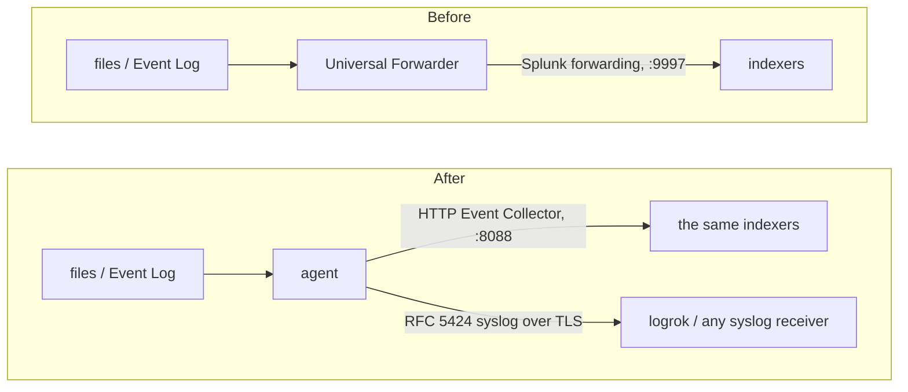

# Migrating from the Splunk Universal Forwarder

The agent can take over a host's log collection from a Splunk Universal Forwarder (UF) and keep
delivering to the same Splunk, with the same **index, sourcetype, source and host** on every event, so
existing searches, dashboards and alerts keep working. Or it can send the same data, with that metadata
attached, to logrok or any RFC 5424 syslog receiver.

You don't rewrite the configuration by hand: the agent reads the forwarder's own `inputs.conf` and
`outputs.conf` and writes an agent configuration plus a report of everything it could not carry over.

**Verified against:** Splunk Universal Forwarder 9.x, checked against the 9.4.0 configuration reference. Delivery into Splunk Enterprise 9.4 over HEC was run end to end; the converter was not run against a Universal Forwarder itself.

## How it fits together



The agent sends to Splunk over the **HTTP Event Collector (HEC)**, Splunk's documented ingest API. HEC
must be enabled on the indexers (or on a HEC tier) and you need a HEC token. Everything that runs on
the indexers (`props.conf`, `transforms.conf`, index-time routing) is untouched. Data arriving on HEC's
event endpoint skips line breaking and timestamp extraction: the agent sends whole events with their
own timestamps.

## Step 1 — convert

The converter is a separate small tool, `luna-migrate` (the agent binary itself carries no converter).
Get `luna-migrate` first: a separate download published with every agent release (`luna-migrate-<os>-<arch>`, saved as `luna-migrate` / `luna-migrate.exe`) — see [Getting luna-migrate](../USER-GUIDE.md#getting-luna-migrate).

Run it on the forwarder's host (it reads the configuration files and looks at the monitored
paths to tell files from directories):

```bash
luna-migrate splunk /opt/splunkforwarder \
  -out /etc/logrok-universal-agent/agent.yaml \
  -report uf-conversion.json
```

```powershell
& ".\luna-migrate.exe" splunk "C:\Program Files\SplunkUniversalForwarder" `
  -out "C:\ProgramData\logrok-universal-agent\agent.yaml" `
  -report uf-conversion.json
```

`luna-migrate splunk` accepts the forwarder's home directory, its `etc/` directory, a single app, or a
directory holding an already merged `inputs.conf` / `outputs.conf` (for example the output of
`splunk btool inputs list` and `splunk btool outputs list`, if you prefer to convert off the host).

It applies Splunk's precedence for these files: `etc/system/local` over every app's `local` over
every app's `default` over `etc/system/default`, apps ranked the way Splunk ranks them. Deployment-server
apps are included, because they live under `etc/apps`.

| Flag | Default | Meaning |
|---|---|---|
| `-out` | *(required)* | where to write the agent configuration; an existing file is never overwritten |
| `-report` | — | also write the full report as JSON |
| `-target` | `hec` | `hec`: keep sending to Splunk. `syslog`: RFC 5424 over TLS (to logrok or any syslog receiver) |
| `-hec-url` | the forwarding servers, port 8088 | comma-separated HEC URL(s), when HEC is not on the indexers' default port (a HEC tier, a load balancer) |
| `-syslog-endpoint` | — | `host:port` of the syslog receiver for `-target syslog` |
| `-syslog-plain` | off | send the syslog output over plain TCP instead of TLS (a receiver without TLS, or a lab) |
| `-start-at` | `end` | where file inputs start on first run: `end` (only new lines: nothing the forwarder already sent is sent again) or `beginning` |
| `-agent` | beside `luna-migrate`, or on the `PATH` | the agent binary used to validate the result; `none` skips that step |

luna-migrate checks the configuration's structure, then runs the installed agent's `-check-config` (found beside `luna-migrate` or on the `PATH`, or named with `-agent`), which builds every module exactly as that agent version would; a configuration the agent rejects is removed. Without an agent to hand it says so — then run `logrok-universal-agent -check-config -config agent.yaml` on the target host.

## Step 2 — read the report

The summary prints every finding; the JSON report holds the same with the file and line each setting
came from.

| Severity | Meaning |
|---|---|
| `manual` | **not carried over**: a person must decide (each line says what to do instead) |
| `warning` | carried over, with a difference to check (for example a sourcetype the forwarder picked automatically) |
| `info` | carried over differently, nothing to do (for example `crcSalt`, which the agent does not need) |
| `skipped` | deliberately not converted: disabled stanzas and the forwarder's own logs (`$SPLUNK_HOME`, `_internal`) |

Then fill in what the report lists under "fill in before deploying". The HEC token is never copied from
`outputs.conf`: the file says `REPLACE_WITH_HEC_TOKEN`. Also make sure the token may write to every index
the report names (the token's **allowed indexes**).

## What is converted

| Forwarder | Agent |
|---|---|
| `[monitor://<path>]` | `filetail`. A directory becomes `<path>/**` (every file below it; `recursive = false` → `<path>/*`, when the converter can inspect the path; converting off-host it keeps `<path>/**` and warns you to change it to `*` if the path is a directory); `...` becomes `**` |
| `whitelist` / `blacklist` on a monitor | path / `exclude` globs when the expression is a file-extension match (`\.log$`, `\.(gz\|bz2)$`); anything else is `manual` |
| `followTail = 1` | `start_at: end` |
| `[WinEventLog://<channel>]` | `windows_eventlog` for that channel |
| event-ID `whitelist` / `blacklist` (`4624,4625,4700-4702`) | a structured query (`<Select>` / `<Suppress>`). The `key=regex` filter form is `manual` |
| `renderXml = true` | `render: xml` |
| `[udp://<port>]` / `[tcp://<port>]` | `syslog_in` on that port (TCP: newline-delimited) |
| `[journald://…]` | `journald` (units, identifiers, priority) |
| `index`, `sourcetype`, `source`, `host` (per stanza or in `[default]`) | carried on every event of that input: see [Splunk metadata fields](../CONFIGURATION.md#splunk-metadata-fields) |
| `[tcpout:<group>]` `server = …` | one `hec` output per group: the same hosts on the HEC port, `round_robin` across them |
| several groups in `defaultGroup` | each group gets every event (as the forwarder clones to every default group) |
| `_TCP_ROUTING` on an input | routing conditions, so a group receives only the inputs routed to it |
| `useACK = true` | `use_ack: true` (enable acknowledgement on the HEC token too) |
| `compressed = true` | `gzip: true` |
| `[httpout]` (a forwarder already sending HEC) | its `uri` as the HEC endpoint |

File inputs send the file's path as `source`, exactly as the forwarder did (`source_style: splunk` on the
HEC output). For an Event Log channel the source is `WinEventLog:<channel>`, and when the stanza sets no
sourcetype the converter uses `XmlWinEventLog` (with `renderXml`) or `WinEventLog`, marked `warning`:
**confirm it matches what your existing data in Splunk carries**.

## What is not converted (and what to do)

| Forwarder | Why / instead |
|---|---|
| `[script://…]` | the agent does not run scripts: run the script on a schedule writing to a file, and tail the file |
| `[batch://…]` (`move_policy = sinkhole`) | the forwarder **deletes** those files after reading; the agent never deletes source files. Tail them and remove them yourself once delivered |
| `[splunktcp://…]` | this forwarder *receives* from other forwarders. Migrate those senders instead |
| `[perfmon://]`, `[WinHostMon://]` | no direct equivalent; the `wmi` input can poll WMI classes |
| `[WinRegMon://]` | collect Sysmon registry events (Event IDs 12–14) with `windows_eventlog` |
| `[admon://]` | collect directory-service auditing from the Security channel |
| `host_segment`, `host_regex` | events get the agent's host (or the stanza's fixed `host`) |
| `ignoreOlderThan` | no age filter: narrow the paths or excludes |
| `evt_resolve_ad_obj` | Active Directory object names inside the event data are not resolved; the event's user SID is still resolved to account name, domain and type by default |
| classic (non-XML) WinEventLog text | the stanza is converted, with a `warning` about the format; events carry the rendered message with the event data as fields; `render: xml` gives the XML the Splunk Add-on for Windows parses |
| `clientCert` on the forwarding connection | HEC authenticates with the token |
| `props.conf` settings that run **on the forwarder** (`CHARSET`, `INDEXED_EXTRACTIONS`, `force_local_processing`, `NO_BINARY_CHECK`, `EVENT_BREAKER_ENABLE`, `EVENT_BREAKER`) | each listed as `manual` in the report; where the agent has an equivalent it is named (`encoding`, the parse processors, `multiline`), and `EVENT_BREAKER` and `EVENT_BREAKER_ENABLE` are reported as not needed (the agent ships whole events) and `NO_BINARY_CHECK` as not applicable (the agent does not skip binary-looking files) |

## Step 3 — cut over without a gap

Prefer a few seconds of duplicates to a gap:

1. Install the agent with the converted configuration and start it. With `start_at: end` it reads only
   lines written from now on, and Event Log channels start from new events.
2. Confirm in Splunk that events arrive from the agent: same index, sourcetype, source, and host as before.
3. Stop and disable the forwarder.

Between steps 1 and 3 both send new lines, so those few seconds arrive twice. Stopping the forwarder
*first* would instead lose the lines written before the agent starts. The agent does not read the
forwarder's own file positions.

## Sending to logrok instead

```bash
luna-migrate splunk /opt/splunkforwarder -out agent.yaml \
  -target syslog -syslog-endpoint logrok.example.com:16575
```

Each event keeps the forwarder metadata the stanza (or `[default]`) sets, as structured data: `splunk.index` (when it is set and is not `default`), `splunk.sourcetype` (when set) and `splunk.host` (when set, and not `$decideOnStartup`), and `splunk.source` (when the stanza sets `source`, names one file that the converter can inspect on the host it runs on (converting off-host, for example from `btool` output, a single-file monitor gets none), is an Event Log stanza — `WinEventLog:<channel>` — or is a `tcp`/`udp` stanza — `tcp:<port>` or `udp:<port>`). A field the stanza does not set is not added. In logrok they are
searchable as `extra.splunk.sourcetype` and so on. For a stanza that monitors a directory or a pattern,
each file's path travels as the syslog APP-NAME (`file:<path>`; when the `file:<path>` text is longer than 48
characters (a path over 43) or contains a space or other non-printable character, the full path also
rides as a `source` structured-data parameter). Add the TLS trust (`ca_file`, and a
client certificate if your receiver requires one) to the generated `syslog` output.

## Licensing

The converter is free. What the converted configuration uses follows the normal rules
([LICENSING](../LICENSING.md)): file tailing and syslog forwarding are Core; the Windows Event Log
input, the `hec` output, more than one `hec` destination with per-destination routing conditions (several
forwarding groups or `_TCP_ROUTING`) and the disk spool are Apex.
